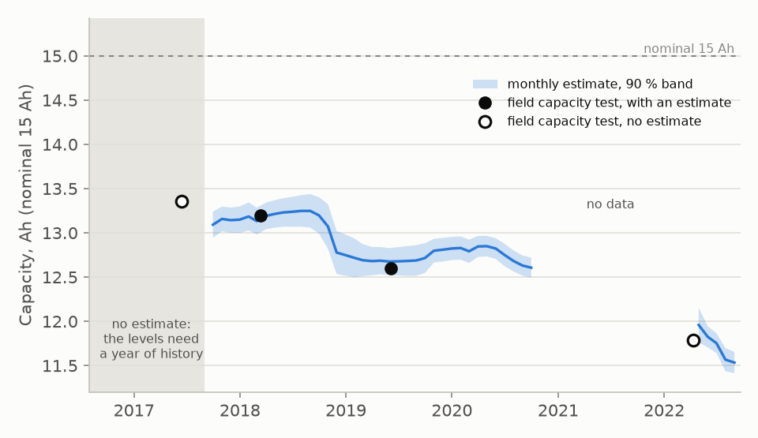

# besslib

State of health from battery storage operating data — with confidence bands, in the fields of the
EU Battery Regulation (2023/1542, Annex VII). Checked so far on home storage that reaches full and empty regularly;
not on grid-scale or mid-state-of-charge duty.

**Version 0.2.0, 23 November 2026.** It computes the Annex VII parameters; it does not certify them. It is not a
compliance certificate and not legal advice.

Author: Islam Ghonaiem, ghonaiem@vgtai.com — questions on the method and its failures are welcome.



*System 05 (LMO/NMC, 15 Ah nominal): the capacity from operating data, at the end of each month, with its 90 % band, against the 4 field capacity tests (dots). 2 of the 4 tests have an estimate at their date, and the band holds the test value in 2 of them. The first estimate is at the end of September 2017: the first year gives none (grey). Hollow dots: tests without an estimate. 17 month ends without data are left blank.*

Checked on open field data: 21 home storage systems, 1,269 months, 60 field capacity tests.
On the 14 held-out systems (not used to tune any threshold; their release 0.1.0 results showed two faults that this version's rules now catch, so these numbers are a second look, not a blind test):

- LMO/NMC and NMC, 28 tests: median error 2.99 points of nominal capacity, a test without an estimate counted as infinite (target ≤ 3): **passed**; over the 22 tests with an estimate, 1.54 points.
- LFP, 10 tests: 5 have no estimate (2 in the first year, 3 with too few full-to-empty pairs) and the other 5 read a median 4.48 points high (target: median error ≤ 5 points, a test without an estimate counted as infinite): **failed**.
- The 90 % band held the measured value in 29 % of 28 tests (target 80 %): **failed**. [Why →](https://github.com/GhonAI/besslib/blob/v0.2.0/docs/limits.md)

**Version 0.2** is closer to the held-out field tests where it gives an estimate (median error 2.13 → 1.54 points over the 22 tests with one), but the median over all 28, which V2 judges, rose (2.62 → 2.99); its band narrowed (median width 2.90 → 1.30 points) and held fewer tests (43 % → 29 %). The band is built for the capacity between two rest voltages and leaves out the drift of the BMS stops the tests run to; which band change narrowed it most is not separated. [Why →](https://github.com/GhonAI/besslib/blob/v0.2.0/docs/04_version_0_2.md#what-the-capacity-measures-and-what-the-checks-compare-it-with)

**What the data showed.** On the 6 LMO/NMC systems the relaxed voltage of the empty rests fell by 50 to 157 mV per cell between the first and the last month end that has one: the systems were discharged to a lower voltage as they aged (cause not verified). So the capacity between fixed rest voltages and the charge a field test measures between the stops drift apart, and a band must carry that drift. [Data →](https://github.com/GhonAI/besslib/blob/v0.2.0/docs/04_version_0_2.md#what-the-capacity-measures-and-what-the-checks-compare-it-with)

Every number on this page is written by `validation/make_readme.py` from a results file in `validation/results/`.

## Install and run

```
pip install besslib
```

```python
import besslib
reduced, spec = besslib.io.read_sample()     # system 05, Aug 2016 – Sep 2022, CC BY 4.0
record = besslib.soh.annex_vii(None, spec, reduced=reduced)
print(record.to_frame())
```

Output (the frame, as a table; resistance in ohm, efficiency and power capability as shares):

| code | field | value | low | high | unit | events | status |
|---|---|---|---|---|---|---|---|
| A1 | the remaining capacity | 11.38 | 11.32 | 11.43 | Ah | 210.4 | estimated |
| A2 | where possible, the remaining power capability | 0.7262 | 0.6553 | 0.797 | share of the first day | 283 | estimated |
| A3 | where possible, the remaining round trip efficiency | 0.9605 | 0.9602 | 0.9608 | share | 97.41 | estimated |
| A4 | the evolution of self-discharging rates | 5.788 | 5.042 | 6.534 | mA | 210.4 | estimated |
| A5 | where possible, the ohmic resistance | 0.1406 | 0.1341 | 0.1471 | ohm | 55.67 | estimated |
| B1 | the date of manufacture of the battery and, where appropriate, the date of putting into service |  |  |  | date | 0 | not possible from this data: not in the dataset |
| B2 | the energy throughput | 5646 | 5616 | 5676 | kWh | 1607 | estimated |
| B3 | the capacity throughput | 37250 | 37070 | 37420 | Ah | 1607 | estimated |
| B4 | the tracking of harmful events, such as the number of deep discharge events, time spent in extreme temperatures, time spent charging in extreme temperatures | 566 | 566 | 566 | events | 566 | estimated |
| B5 | the number of full equivalent charge-discharge cycles | 1242 | 1236 | 1247 | cycles | 1607 | estimated |

Each band is a 90 % band from its field's method (fit scatter, sensor accuracy or both; see the method column below). On the 28 held-out LMO/NMC and NMC field tests the capacity band held 29 %, so a band is not the whole uncertainty. For A1, A3, A4 and A5, "events" is a count weighted by the 180-day memory, hence the decimals; for A2 and B2–B5 it counts days, for B4 discharges. A2 is relative to the first day of the resistance fit (2017-03-16), not to the system's installation (2014-11-21, in B1's details; B1 is not possible because the date of manufacture is missing).

The sample is system 05, LMO/NMC, 15 Ah nominal, from August 2016 to September 2022: three reduced tables (one row per day, per current step and per rest candidate, not the raw samples), 6.8 MB in the package; the raw archive is 856 MB. The sample's data is CC BY 4.0, not BSD-3-Clause; its credit is in
[`NOTICE.md`](https://github.com/GhonAI/besslib/blob/v0.2.0/src/besslib/data/sample_05/NOTICE.md) and in each file's metadata.

The quickstart runs without the capacity-test mask, as a user would. The published record of the same system leaves
the test windows out ([Annex VII page](https://github.com/GhonAI/besslib/blob/v0.2.0/docs/03_annex_vii.md)); a test checks that the sample with that mask
gives the published record exactly.

**Your own data:** a pandas DataFrame in the frame format of
[`besslib/frames.py`](https://github.com/GhonAI/besslib/blob/v0.2.0/src/besslib/frames.py) (columns, units, sign convention) and a `besslib.PackSpec`;
then `besslib.soh.annex_vii(frame, spec)`. **The full field data** of one system, from the Zenodo archive:

```
git clone https://github.com/GhonAI/besslib && cd besslib
pip install -e .[dev]
# downloads Data_ID_05.zip (856 MB), reduces it, deletes it, and writes
# validation/results/phase3/system_05_record.json and system_05_yearly.csv
python validation/run_annex_vii.py --held-out 5
```

## What it computes

Each field carries a value, a band, the number of events it rests on, the method with its source, and a status.
Where the data cannot give a value, the status says `not possible from this data` with the reason. Nothing is
filled in silently.

| Code | Annex VII (quoted) | What besslib reports | Method and source |
|---|---|---|---|
| A1 | "the remaining capacity" | remaining capacity between a full and an empty rest at two stated relaxed voltages (the record gives both); not the charge between the BMS stops | capacity between full and empty rests by coulomb counting, fitted with the offset current and the relaxed voltage of each rest (Figgener et al., Nature Energy 9, 1438 (2024), doi:10.1038/s41560-024-01620-9); read at the mean full and empty rest voltages of the memory time, which the record gives |
| A2 | "where possible, the remaining power capability" | power capability share, derived from the 1-second resistance, not measured | ratio of the resistance on the first day to the resistance at the date, from dV/dI of current steps between consecutive samples (Barai et al., Sci. Rep. 8, 21 (2018), doi:10.1038/s41598-017-18424-5; Schweiger et al., Sensors 10, 5604 (2010), doi:10.3390/s100605604); no power test |
| A3 | "where possible, the remaining round trip efficiency" | round-trip efficiency (DC, at the battery terminals) over full-to-full loops | energy out / energy in, summed over closed loops from one full rest to the next (Regulation (EU) 2023/1542, Annex IV (6)); band: how far that ratio can be off because a loop does not end at exactly the state of charge it started from; the size of that error is learnt from the loops themselves (mean lag-2 product of the loop scores minus the mean lag-1 product) |
| A4 | "the evolution of self-discharging rates" | apparent charge loss (an upper bound for self-discharge) | minus the offset current of the capacity fit (Figgener et al., Nature Energy 9, 1438 (2024), doi:10.1038/s41560-024-01620-9); band with the current sensor's gain error |
| A5 | "where possible, the ohmic resistance" | 1-second resistance, pack temperature band at 25 degrees C | dV/dI of current steps between consecutive samples (Barai et al., Sci. Rep. 8, 21 (2018), doi:10.1038/s41598-017-18424-5; Schweiger et al., Sensors 10, 5604 (2010), doi:10.3390/s100605604) |
| B1 | "the date of manufacture of the battery and, where appropriate, the date of putting into service" | date of manufacture; date of putting into service | the pack's documents (PackSpec), passed through |
| B2 | "the energy throughput" | energy throughput (in + out) since the first day of data | trapezoid sums of charging and discharging power over the measured time; band: sensor accuracy (Figgener et al. 2024, Supplementary Table 2) as a rectangular half-width (JCGM 100:2008, 4.3.7) |
| B3 | "the capacity throughput" | capacity throughput (in + out) since the first day of data | trapezoid sums of charging and discharging current over the measured time; band: sensor accuracy (Figgener et al. 2024, Supplementary Table 2) as a rectangular half-width (JCGM 100:2008, 4.3.7) |
| B4 | "the tracking of harmful events, such as the number of deep discharge events, time spent in extreme temperatures, time spent charging in extreme temperatures" | discharges to the system's own end-of-discharge level (observed; not a limit count) | measured hours per pack-temperature band and mode; discharges that reached the system's own end-of-discharge level (empty rests); voltage extremes; counts against limits when limits are given |
| B5 | "the number of full equivalent charge-discharge cycles" | full equivalent cycles since the first day of data | capacity throughput / (2 x reference capacity); band: sensor accuracy (Figgener et al. 2024, Supplementary Table 2) as a rectangular half-width (JCGM 100:2008, 4.3.7) |

## How it was checked

Thresholds were tuned on 7 development systems and frozen. The results below come from the
14 held-out systems and from synthetic packs with a known truth. The held-out systems were run once at the
settings of release 0.1.0 and once more at the settings of this version. The capacity plausibility
rules and the power-capability rule of this version were found on them. What changed, with every check before and
after: [version 0.2 page](https://github.com/GhonAI/besslib/blob/v0.2.0/docs/04_version_0_2.md). A failed check is published as failed, with its reason.

Configuration hashes: capacity `b3959941c19b`, record `d49cbfdcd5b6`. Every result file carries them.

**Capacity** ([page](https://github.com/GhonAI/besslib/blob/v0.2.0/docs/02_capacity_validation.md); the reference tests: [page](https://github.com/GhonAI/besslib/blob/v0.2.0/docs/01_reference.md))

| Check | Scope | Value | Pass if | Result |
|---|---|---|---|---|
| V2 | held-out LMO/NMC and NMC | median \|error\| 2.99 points (22/28 estimated) | <= 3 points | passed |
| V2 info | same, without 03/3 and 08/1 | median \|error\| 3.25 points (26 tests) | information | – |
| V3 | held-out LFP | median \|error\| inf points; median error +4.48 (5/10 estimated) | <= 5 points, bias shown | failed |
| V4 | held-out LMO/NMC and NMC | band held the test in 29% of 28 | >= 80 % | failed |
| V4 info | held-out LFP | band held the test in 10% of 10 | information | – |
| V4 info | same as V4, without 03/3 and 08/1 | band held the test in 27% of 26 | information | – |
| V5 | held-out LMO/NMC (4 systems) | mean fade -3.49 points/year; paper -3.1 | within +-0.5 | passed |
| V5 info | all LMO/NMC (6 systems) | mean fade -3.47 points/year | information | – |
| V5 | held-out NMC (4 systems) | mean fade -1.21 points/year; paper -1.9 | within +-0.5 | failed |
| V5 info | all NMC (6 systems) | mean fade -1.17 points/year | information | – |
| V5 | held-out LFP (5 systems) | mean fade -1.84 points/year; paper -2.0 | within +-0.5 | passed |
| V5 info | all LFP (7 systems) | mean fade -1.07 points/year | information | – |
| V6 | 200 synthetic packs | band held the true usable fade (-1.88) in 76.0% | 85-95 % | failed |
| V7 | core against batch path, 90 daily estimates (months of tests 01/1, 07/1, 17/2) | max relative difference 2.0e-14 | <= 1e-6 | passed |
| V8 | 21 systems | one command per system: python validation/run_capacity.py &lt;id> | all 21 rebuilt with one hash | passed |

**The other Annex VII fields** ([page](https://github.com/GhonAI/besslib/blob/v0.2.0/docs/03_annex_vii.md))

| Check | Scope | Value | Pass if | Result |
|---|---|---|---|---|
| W1 info | development records | 7 of 7 records; 0 fields break the rule | information | – |
| W1 | held-out records | 14 of 14 records; 0 fields break the rule | 0 | passed |
| W2 | 200 synthetic packs: resistance at the weighted mean age of the days in memory | fails under each truth. same-days truth 200 of 200: too wide, because that truth shares every day with the estimate, so the day-to-day scatter the statistical half-width stands for (median 0.62% of the value) is not in the difference; the largest difference is 0.77%, and the systematic half-width alone (median 0.53%) holds 187 of 200. At the date 0 of 200: the estimate lags the growing resistance (the value at the date is a median 2.3% above it). At 25 degrees C 90 of 200: the days in the band read a median +0.9% against 25 degrees C, and the estimator has no temperature model | 85-95 % | failed |
| W2 | 200 synthetic packs: resistance growth per year, whole record, against the simulator's known growth (median 4.93 % per year at the fit's origin; this truth was chosen after the first results) | band held the truth in 184 of 200 (92.0%); same-days truth (information): 199 of 200 (99.5%) | 85-95 % | passed |
| W5 | 200 synthetic packs: round-trip efficiency, full-to-full loops | band held the truth in 176 of 200 (88.0%) | 85-95 % | passed |
| W7 | 200 synthetic packs: apparent charge loss (hidden drain) | band held the truth in 188 of 200 (94.0%) | 85-95 % | passed |
| W8 | 200 synthetic packs: Ah, kWh, cycles; planted events (pack B: current gain error only) | largest relative error 0.498%; events exact on 200 of 200; 200 of 200 packs within the rule | <= 0.6 % and exact, every pack | passed |
| W8 info | 200 synthetic packs: the same on pack B with current and voltage noise | largest relative error 0.498%; events exact on 189 of 200; 189 of 200 packs within the rule | information | – |
| W3 info | development capacity tests | median \|difference\| 21.9 % over 12 of 22 tests with a reference; median difference by chemistry {'LFP': 64.1, 'LMO/NMC': -8.2, 'NMC': -11.5} | information | – |
| W3 | held-out capacity tests | 18 of 38 tests have a reference: not possible | >= 30 references, then <= 20 % | not possible |
| W4 info | development: neighbouring 5-degree bands: the colder reads higher | 50 of 58 (86%) | information | – |
| W6 info | development: full-to-full against empty-to-empty loop ratios within 1 point (no band needed) | 21 of 31 (68%) | information | – |
| W4 | held-out: neighbouring 5-degree bands: the colder reads higher | 94 of 101 (93%) | >= 80% | passed |
| W6 | held-out: full-to-full against empty-to-empty loop ratios within 1 point (no band needed) | 39 of 55 (71%) | >= 80% | failed |
| W9 | core against batch, resistance: 240 daily estimates (months of tests 01/1 (2017-06), 07/1 (2017-06), 17/2 (2020-06)) | max relative difference 3.6e-14 (64-bit); 2.6e-06 (32-bit, information) | <= 1e-6 | passed |
| W9 | core against batch, efficiency: 10 daily estimates (months of tests 01/1 (2017-06), 07/1 (2017-06), 17/2 (2020-06)) | max relative difference 0.0e+00 (64-bit); 1.3e-06 (32-bit, information) | <= 1e-6 | passed |
| W9 | daily counters against rest counters: 138814 rests, systems [1, 2, 3, 4, 5, 6, 7, 8, 9, 10, 11, 12, 13, 14, 15, 16, 17, 18, 19, 20, 21] | max relative difference 8.7e-13 (throughput, system 13) | <= 1e-6 | passed |
| W10 | phase 2 rebuilt for 21 systems | 0 of 60 files differ | 0 differences | passed |
| W10 | record A1 against the phase 2 capacity run, every month end, 21 systems | 0 values differ over 1139 month ends (21 systems with a file) | 0 differences, every system | passed |
| W10 | records rebuilt twice for 21 systems | 0 differences over 42 files | 0 differences | passed |

## Limits

1. **The capacity band does not hold the charge between the BMS stops.** On 200 synthetic packs the monthly 90 % band held the charge between the stops at the date in 2278 of 4782 month ends (48 %). It held the capacity between the rest voltages it reports in 4248 of 4562 (93 %), against a truth chosen after the first results.
2. **Partial windows are not covered.** Storage that works at a middle state of charge gives no full-to-empty pairs and so no capacity. This comes after the pack simulator (besslib.sim).
3. Already published on the pages: the method needs regular full cycles; the first year of a record gives no capacity estimate; apparent charge loss is an upper bound for self-discharge; efficiency is DC at the battery terminals; resistance is a short-pulse value, not the impedance-spectroscopy one.

Fixed in version 0.2, by the same rules: A4 bias, capacity at or below zero, power capability without resistance ([limits](https://github.com/GhonAI/besslib/blob/v0.2.0/docs/limits.md)).

All limits, with their numbers and pages: [`docs/limits.md`](https://github.com/GhonAI/besslib/blob/v0.2.0/docs/limits.md).

## Rebuild every number

```
git clone https://github.com/GhonAI/besslib && cd besslib
pip install -e .[dev]
python validation/build_reference.py        # the field capacity tests, from the Zenodo archives
python validation/run_capacity.py <id>      # capacity, one system
python validation/run_annex_vii.py <id>     # the Annex VII record, one system
python validation/make_readme.py            # this page
```

The scripts download the archives one at a time and delete them after reducing.

## Cite

Use GitHub's "Cite this repository" ([`CITATION.cff`](https://github.com/GhonAI/besslib/blob/v0.2.0/CITATION.cff)), and cite the data.

## Data and credit

Data: Figgener, J. et al., Data for: Multi-year field measurements of home storage systems and their use in capacity estimation, Zenodo (2024), https://doi.org/10.5281/zenodo.12091223, licence CC BY 4.0.

Paper: Figgener, J. et al., Multi-year field measurements of home storage systems and their use in capacity estimation, Nature Energy 9, 1438-1447 (2024), https://doi.org/10.1038/s41560-024-01620-9, licence CC BY-NC-ND 4.0: cited, nothing copied.

## Contact

Islam Ghonaiem, ghonaiem@vgtai.com. Issues: [GitHub](https://github.com/GhonAI/besslib/issues).

## Licence

Code: BSD-3-Clause, see [`LICENSE`](https://github.com/GhonAI/besslib/blob/v0.2.0/LICENSE). The shipped sample: CC BY 4.0 (see above).
