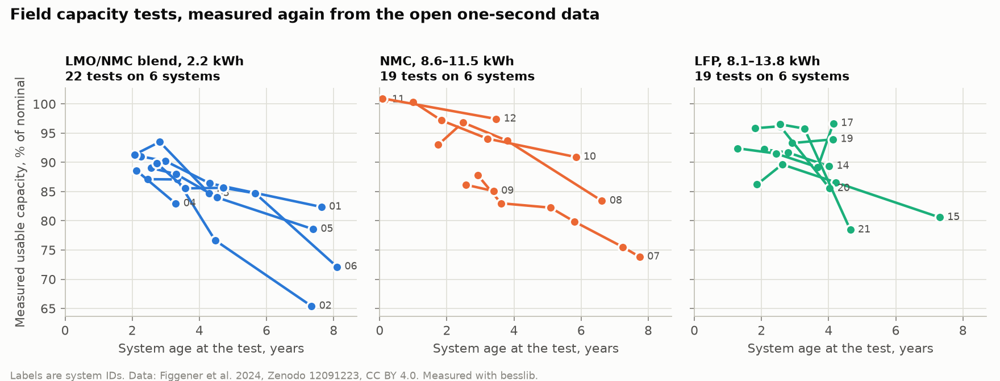
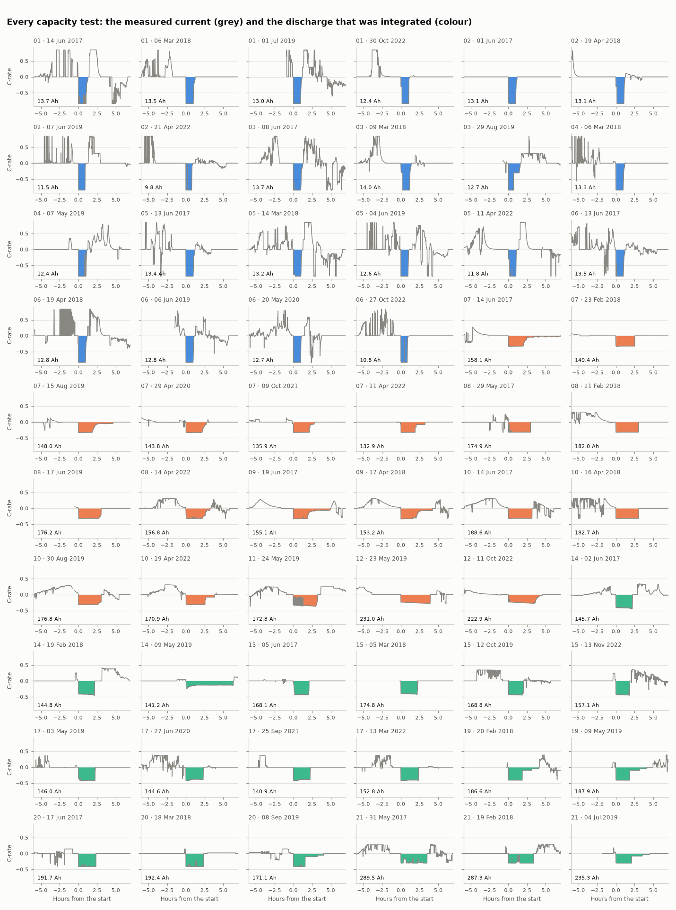
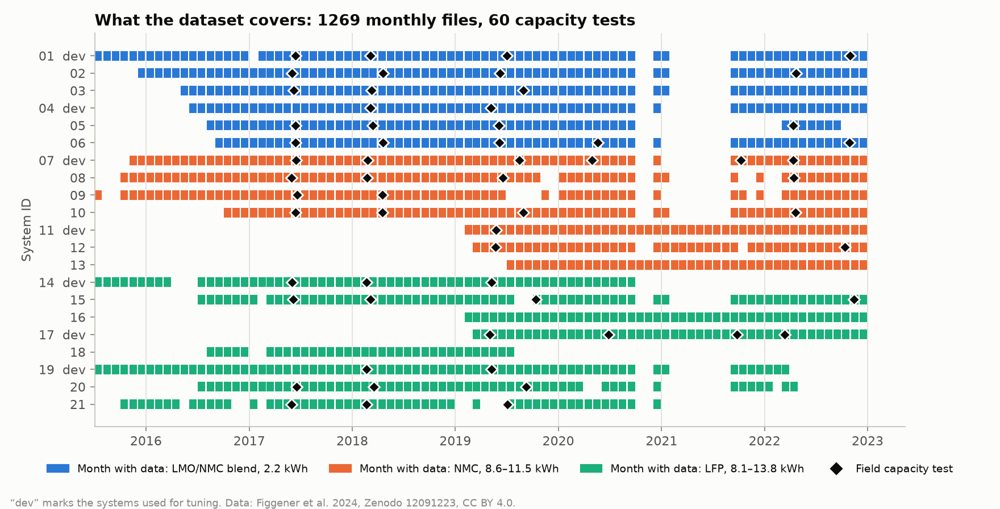

# Phase 1 — the reference: 60 field capacity tests, measured again

Written by `validation/make_reference_doc.py` from `validation/results/`. No number on this page is typed by hand.

## What this is

The open dataset documents when each field capacity test started, but not what it measured.
This page measures every test again from the one-second data. These values are the reference
that besslib's capacity estimates are checked against in phase 2.

- **Tests documented:** 60, on 18 of 21 systems.
- **Tests measured:** 60. **Not measured:** 0.
- **Check V1** (at least 55 of 60 measured, each missing one explained): **pass**.
- **The documented start fits the data:** the discharge begins a median of 4 s before the documented time (largest difference 29.3 min).
- **Data gaps inside the measured discharges:** 0 missing seconds in total; largest interpolated share in one test 24.84 %.

## How a test is measured

A test is a full charge, then a discharge at the system's maximum power until it stops by itself
(Figgener et al. 2024, Supplementary Note 6). `besslib.soh.measure_capacity_test` uses three rules:

1. The test current is the median current from 2 to 12 minutes after the documented start. It must be a
   discharge of at least C/10. If it is not, the probe moves one minute later, up to 60 minutes, until it
   is and the probe also begins inside the discharge.
2. The discharge begins where the current last was weaker than 20 % of the test current.
3. The discharge ends when the current stays weaker than 5 % of the test current for 5 minutes;
   the tail down to 1 % is kept.

Capacity is the integral of the current between the two, energy the integral of the power.
No estimator and no battery model is involved. The rules were written on the development systems.

**Rule 1 was changed on 14 Nov 2026**, after every test on the sheet below was checked by eye. Before, the
probe stayed at the documented start and needed only C/20, and the tests below were reported as not
measured although their discharge is in the data: it began late, or after a few minutes at low power, or
after a pause. The change leaves every other test exactly as it was measured before.

| System | Set | Documented start | Probe moved, min | Discharge began | Capacity, Ah |
|---|---|---|---|---|---|
| 03 | held-out | 2019-08-29 10:24 | 22 | 10:47:27 | 12.70 |
| 07 | development | 2021-10-09 19:02 | 7 | 19:11:06 | 135.93 |
| 07 | development | 2022-04-11 19:27 | 29 | 19:56:55 | 132.89 |

In some tests of systems 03, 07, 09, 14, 19, 20, 21 the current steps down before the end, so the
median C-rate over the whole discharge is below 80 % of the test C-rate. The lower-current part is kept:
each step comes when the voltage reaches a low point, so the system is lowering its power to keep
discharging, and the test runs until it stops by itself. "Test C-rate" on this page is the test current
of rule 1, measured 2 to 12 minutes into the test; "Median C-rate" is the median over the whole
discharge. Where the two differ much, the power changed during the test.

## Summary by chemistry

| Chemistry | Systems with tests | Tests measured | Capacity, % of nominal (min – max) | Test C-rate (min – max) | Change between tests, points per year (median of systems) |
|---|---|---|---|---|---|
| LMO/NMC | 6 | 22 | 65.4 – 93.5 | 0.30 – 0.85 | -3.2 (n = 6) |
| NMC | 6 | 19 | 73.8 – 101.0 | 0.16 – 0.34 | -2.1 (n = 4) |
| LFP | 6 | 19 | 78.5 – 96.7 | 0.18 – 0.43 | -1.4 (n = 6) |

The last column is a straight line through each system's own tests (systems with at least two tests, one year apart).
It describes these tests only; it is not besslib's fade estimate.

## How far the reference itself can be trusted

A battery does not gain capacity with age. Where a later test reads higher than an earlier one,
the difference shows the scatter of the tests themselves: how full the system really was, the
temperature, the voltage limits its software used on that day.

- Pairs of consecutive tests on one system: 42.
- Pairs where the later test reads more than 2 points higher: 4.

| System | Chemistry | Set | From test | To test | Months between | Change, points of nominal |
|---|---|---|---|---|---|---|
| 17 | LFP | development | 2021-09-25 | 2022-03-13 | 6 | +7.5 |
| 08 | NMC | held-out | 2017-05-29 | 2018-02-21 | 9 | +3.8 |
| 15 | LFP | held-out | 2017-06-05 | 2018-03-05 | 9 | +3.4 |
| 03 | LMO/NMC | held-out | 2017-06-08 | 2018-03-09 | 9 | +2.2 |

This matters for phase 2: an estimate cannot be expected to agree with a test more closely than two
tests agree with each other.

## Every test, to check by eye

## What the dataset covers

- 1269 monthly files, 157 GB unpacked, Jul 2015 to Dec 2022.
- Systems without a capacity test: 13, 16, 18.

## Data quality of the development systems

Only the seven development systems are read in full before the thresholds are frozen. The split was fixed on 13 Nov 2026, before any data was read; the other fourteen systems are held out.

| System | Chemistry | Months | Rows, million | Missing inside months, % | Interpolated, % | Charge in, Ah | Charge out, Ah | Out ÷ in, % |
|---|---|---|---|---|---|---|---|---|
| 01 | LMO/NMC | 80 | 165.2 | 15.80 | 0.008 | 17,300 | 16,786 | 97.0 |
| 04 | LMO/NMC | 69 | 160.3 | 7.36 | 0.008 | 21,057 | 19,868 | 94.4 |
| 07 | NMC | 76 | 192.6 | 0.96 | 2.271 | 197,108 | 193,438 | 98.1 |
| 11 | NMC | 47 | 121.8 | 0.14 | 0.000 | 174,168 | 159,468 | 91.6 |
| 14 | LFP | 60 | 136.4 | 6.81 | 0.008 | 137,122 | 127,192 | 92.8 |
| 17 | LFP | 46 | 117.3 | 0.61 | 0.001 | 111,085 | 102,403 | 92.2 |
| 19 | LFP | 72 | 110.5 | 37.33 | 5.691 | 175,412 | 158,939 | 90.6 |

"Out ÷ in" is the charge discharged divided by the charge charged over the whole record.
A lithium-ion cell returns nearly all of its charge, so a value well below 100 % means current leaves
the battery without passing the sensor (BMS supply, balancing) or the sensor has an offset.
The paper corrects this with an offset current; besslib estimates it in phase 2.

## All measured tests

"Ah out before the start" is the charge that left the battery between the end of the last charge and the
start of the test discharge. It is shown, not added.

| System | Chemistry | Set | Documented start | Age, years | Capacity, Ah | Energy, kWh | % of nominal | Test C-rate | Median C-rate | Minutes | Pack temp, °C | Ah out before the start |
|---|---|---|---|---|---|---|---|---|---|---|---|---|
| 01 | LMO/NMC | development | 2017-06-14 14:23 | 2.3 | 13.65 | 2.029 | 91.0 | 0.84 | 0.84 | 77 | 28.4 | 0.00 |
| 01 | LMO/NMC | development | 2018-03-06 16:24 | 3.0 | 13.54 | 2.007 | 90.2 | 0.84 | 0.84 | 75 | 24.1 | 0.00 |
| 01 | LMO/NMC | development | 2019-07-01 13:55 | 4.3 | 12.96 | 1.920 | 86.4 | 0.84 | 0.84 | 69 | 30.6 | 0.00 |
| 01 | LMO/NMC | development | 2022-10-30 15:02 | 7.6 | 12.36 | 1.832 | 82.4 | 0.30 | 0.84 | 73 | 26.0 | -0.11 |
| 02 | LMO/NMC | held-out | 2017-06-01 19:31 | 2.5 | 13.07 | 1.936 | 87.1 | 0.84 | 0.84 | 70 | 27.5 | 0.00 |
| 02 | LMO/NMC | held-out | 2018-04-19 15:54 | 3.3 | 13.06 | 1.942 | 87.1 | 0.30 | 0.84 | 75 | 27.4 | -0.02 |
| 02 | LMO/NMC | held-out | 2019-06-07 12:49 | 4.5 | 11.50 | 1.701 | 76.7 | 0.84 | 0.84 | 61 | 31.3 | 0.00 |
| 02 | LMO/NMC | held-out | 2022-04-21 14:30 | 7.3 | 9.81 | 1.433 | 65.4 | 0.84 | 0.84 | 56 | 26.8 | 0.00 |
| 03 | LMO/NMC | held-out | 2017-06-08 11:55 | 2.1 | 13.70 | 2.041 | 91.3 | 0.84 | 0.84 | 76 | 27.3 | 0.00 |
| 03 | LMO/NMC | held-out | 2018-03-09 13:28 | 2.8 | 14.03 | 2.083 | 93.5 | 0.30 | 0.84 | 83 | 20.2 | 0.00 |
| 03 | LMO/NMC | held-out | 2019-08-29 10:24 | 4.3 | 12.70 | 1.894 | 84.7 | 0.85 | 0.31 | 96 | 32.9 | 0.00 |
| 04 | LMO/NMC | development | 2018-03-06 15:54 | 2.1 | 13.29 | 1.960 | 88.6 | 0.84 | 0.84 | 72 | 21.2 | 0.00 |
| 04 | LMO/NMC | development | 2019-05-07 09:56 | 3.3 | 12.44 | 1.826 | 82.9 | 0.84 | 0.84 | 71 | 21.4 | 0.00 |
| 05 | LMO/NMC | held-out | 2017-06-13 16:40 | 2.6 | 13.36 | 1.983 | 89.0 | 0.84 | 0.84 | 73 | 26.6 | 0.00 |
| 05 | LMO/NMC | held-out | 2018-03-14 14:07 | 3.3 | 13.20 | 1.943 | 88.0 | 0.79 | 0.84 | 72 | 15.9 | 0.00 |
| 05 | LMO/NMC | held-out | 2019-06-04 14:37 | 4.5 | 12.60 | 1.867 | 84.0 | 0.84 | 0.84 | 66 | 28.9 | 0.00 |
| 05 | LMO/NMC | held-out | 2022-04-11 12:56 | 7.4 | 11.79 | 1.736 | 78.6 | 0.30 | 0.84 | 73 | 18.8 | -0.11 |
| 06 | LMO/NMC | held-out | 2017-06-13 13:53 | 2.7 | 13.48 | 2.008 | 89.9 | 0.84 | 0.84 | 74 | 20.8 | 0.00 |
| 06 | LMO/NMC | held-out | 2018-04-19 13:34 | 3.6 | 12.83 | 1.896 | 85.5 | 0.84 | 0.84 | 70 | 19.8 | 0.05 |
| 06 | LMO/NMC | held-out | 2019-06-06 14:05 | 4.7 | 12.85 | 1.901 | 85.7 | 0.84 | 0.84 | 68 | 20.6 | 0.00 |
| 06 | LMO/NMC | held-out | 2020-05-20 13:59 | 5.7 | 12.71 | 1.882 | 84.7 | 0.84 | 0.84 | 67 | 19.4 | 0.00 |
| 06 | LMO/NMC | held-out | 2022-10-27 13:39 | 8.1 | 10.82 | 1.591 | 72.1 | 0.84 | 0.84 | 59 | 20.1 | 0.00 |
| 07 | NMC | development | 2017-06-14 18:25 | 2.9 | 158.07 | 7.573 | 87.8 | 0.33 | 0.04 | 418 | 29.8 | 0.10 |
| 07 | NMC | development | 2018-02-23 18:08 | 3.6 | 149.41 | 7.108 | 83.0 | 0.34 | 0.33 | 152 | 22.5 | 1.47 |
| 07 | NMC | development | 2019-08-15 19:23 | 5.1 | 148.04 | 7.095 | 82.2 | 0.33 | 0.09 | 280 | 30.8 | 0.79 |
| 07 | NMC | development | 2020-04-29 14:55 | 5.8 | 143.79 | 6.862 | 79.9 | 0.33 | 0.33 | 165 | 27.4 | 0.02 |
| 07 | NMC | development | 2021-10-09 19:02 | 7.2 | 135.93 | 6.469 | 75.5 | 0.33 | 0.32 | 168 | 26.4 | 1.24 |
| 07 | NMC | development | 2022-04-11 19:27 | 7.7 | 132.89 | 6.319 | 73.8 | 0.33 | 0.32 | 195 | 24.7 | 1.17 |
| 08 | NMC | held-out | 2017-05-29 16:41 | 1.7 | 174.88 | 8.083 | 93.0 | 0.32 | 0.32 | 178 | 33.6 | 0.05 |
| 08 | NMC | held-out | 2018-02-21 15:37 | 2.5 | 182.04 | 8.451 | 96.8 | 0.32 | 0.32 | 183 | 34.4 | 1.29 |
| 08 | NMC | held-out | 2019-06-17 15:31 | 3.8 | 176.17 | 8.168 | 93.7 | 0.32 | 0.32 | 183 | 34.6 | 0.02 |
| 08 | NMC | held-out | 2022-04-14 12:12 | 6.6 | 156.79 | 7.266 | 83.4 | 0.32 | 0.32 | 194 | 35.2 | 0.03 |
| 09 | NMC | held-out | 2017-06-19 12:57 | 2.6 | 155.10 | 7.458 | 86.2 | 0.33 | 0.08 | 297 | 31.3 | 1.43 |
| 09 | NMC | held-out | 2018-04-17 12:46 | 3.4 | 153.16 | 7.360 | 85.1 | 0.33 | 0.22 | 255 | 29.3 | 0.03 |
| 10 | NMC | held-out | 2017-06-14 14:04 | 1.0 | 188.64 | 8.771 | 100.3 | 0.32 | 0.32 | 191 | 30.6 | 0.04 |
| 10 | NMC | held-out | 2018-04-16 16:29 | 1.8 | 182.71 | 8.489 | 97.2 | 0.32 | 0.32 | 184 | 28.7 | 0.00 |
| 10 | NMC | held-out | 2019-08-30 13:49 | 3.2 | 176.84 | 8.197 | 94.1 | 0.32 | 0.32 | 184 | 31.3 | 0.00 |
| 10 | NMC | held-out | 2022-04-19 13:25 | 5.8 | 170.91 | 7.911 | 90.9 | 0.32 | 0.31 | 231 | 28.9 | 0.03 |
| 11 | NMC | development | 2019-05-24 11:09 | 0.1 | 172.84 | 7.298 | 100.7 | 0.31 | 0.34 | 195 | 29.9 | 0.80 |
| 12 | NMC | held-out | 2019-05-23 13:28 | 0.1 | 230.97 | 9.632 | 101.0 | 0.23 | 0.26 | 240 | 30.3 | 0.00 |
| 12 | NMC | held-out | 2022-10-11 18:24 | 3.5 | 222.92 | 9.326 | 97.4 | 0.16 | 0.25 | 275 | 33.8 | -3.49 |
| 14 | LFP | development | 2017-06-02 09:42 | 2.1 | 145.70 | 7.311 | 92.2 | 0.41 | 0.42 | 133 | 25.6 | 0.14 |
| 14 | LFP | development | 2018-02-19 09:41 | 2.8 | 144.84 | 7.205 | 91.7 | 0.41 | 0.42 | 131 | 16.4 | 0.02 |
| 14 | LFP | development | 2019-05-09 07:53 | 4.0 | 141.17 | 7.251 | 89.3 | 0.24 | 0.13 | 382 | 19.2 | 0.01 |
| 15 | LFP | held-out | 2017-06-05 17:58 | 1.9 | 168.10 | 6.981 | 86.2 | 0.18 | 0.43 | 126 | 28.3 | 0.23 |
| 15 | LFP | held-out | 2018-03-05 14:19 | 2.6 | 174.82 | 7.258 | 89.6 | 0.39 | 0.40 | 137 | 25.6 | 0.00 |
| 15 | LFP | held-out | 2019-10-12 12:10 | 4.2 | 168.82 | 7.018 | 86.6 | 0.43 | 0.44 | 124 | 32.2 | 0.00 |
| 15 | LFP | held-out | 2022-11-13 09:22 | 7.3 | 157.12 | 6.549 | 80.6 | 0.43 | 0.44 | 112 | 25.3 | 0.10 |
| 17 | LFP | development | 2019-05-03 14:57 | 1.3 | 146.01 | 7.331 | 92.4 | 0.37 | 0.42 | 137 | 22.5 | 0.00 |
| 17 | LFP | development | 2020-06-27 14:18 | 2.4 | 144.61 | 7.295 | 91.5 | 0.42 | 0.39 | 142 | 29.3 | 0.56 |
| 17 | LFP | development | 2021-09-25 15:28 | 3.7 | 140.87 | 7.080 | 89.2 | 0.42 | 0.39 | 138 | 25.1 | 0.00 |
| 17 | LFP | development | 2022-03-13 12:51 | 4.1 | 152.75 | 7.667 | 96.7 | 0.42 | 0.40 | 147 | 22.5 | 0.00 |
| 19 | LFP | development | 2018-02-20 09:54 | 2.9 | 186.61 | 6.766 | 93.3 | 0.41 | 0.10 | 244 | 17.7 | 0.02 |
| 19 | LFP | development | 2019-05-09 09:03 | 4.1 | 187.89 | 6.812 | 93.9 | 0.41 | 0.10 | 245 | 21.6 | 0.01 |
| 20 | LFP | held-out | 2017-06-17 20:22 | 1.8 | 191.68 | 6.974 | 95.8 | 0.41 | 0.41 | 142 | 33.5 | 0.00 |
| 20 | LFP | held-out | 2018-03-18 18:46 | 2.6 | 192.36 | 7.001 | 96.2 | 0.41 | 0.41 | 144 | 30.9 | 0.00 |
| 20 | LFP | held-out | 2019-09-08 19:21 | 4.0 | 171.08 | 6.254 | 85.5 | 0.41 | 0.10 | 244 | 34.9 | 0.00 |
| 21 | LFP | held-out | 2017-05-31 11:39 | 2.6 | 289.52 | 10.633 | 96.5 | 0.30 | 0.30 | 211 | 26.4 | 0.01 |
| 21 | LFP | held-out | 2018-02-19 08:25 | 3.3 | 287.33 | 10.546 | 95.8 | 0.30 | 0.30 | 204 | 23.0 | 0.00 |
| 21 | LFP | held-out | 2019-07-04 11:26 | 4.6 | 235.34 | 8.713 | 78.5 | 0.30 | 0.08 | 272 | 27.1 | 0.00 |

### Tests with discharge just before they began

In these tests more than 1 % of the measured capacity was discharged in the hour before the test discharge
began. The battery may not have been full when the test began, and then the measured value is below
what a test from full would give. It is shown, not added.
"Ah out since the last charge" can read lower when a short charge happened in between.

| System | Set | Documented start | Discharged in the hour before, Ah | Share of the measured capacity, % | Ah out since the last charge |
|---|---|---|---|---|---|
| 03 | held-out | 2019-08-29 10:24 | 0.41 | 3.2 | 0.00 |
| 08 | held-out | 2017-05-29 16:41 | 10.00 | 5.7 | 0.05 |

## Source and credit

Data: Figgener, J. et al., *Data for: Multi-year field measurements of home storage systems and their use in
capacity estimation*, Zenodo (2024), https://doi.org/10.5281/zenodo.12091223, licence CC BY 4.0.
Paper: Figgener, J. et al., Nature Energy 9, 1438–1447 (2024), https://doi.org/10.1038/s41560-024-01620-9.
The values on this page are computed by besslib from that data; they are not taken from the paper.
