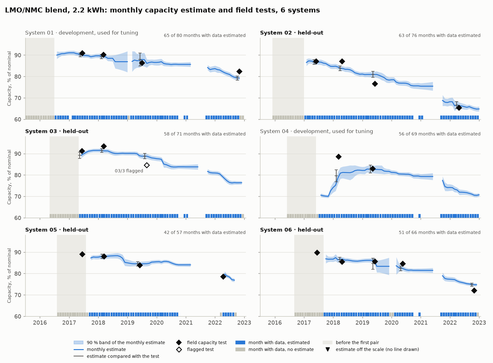
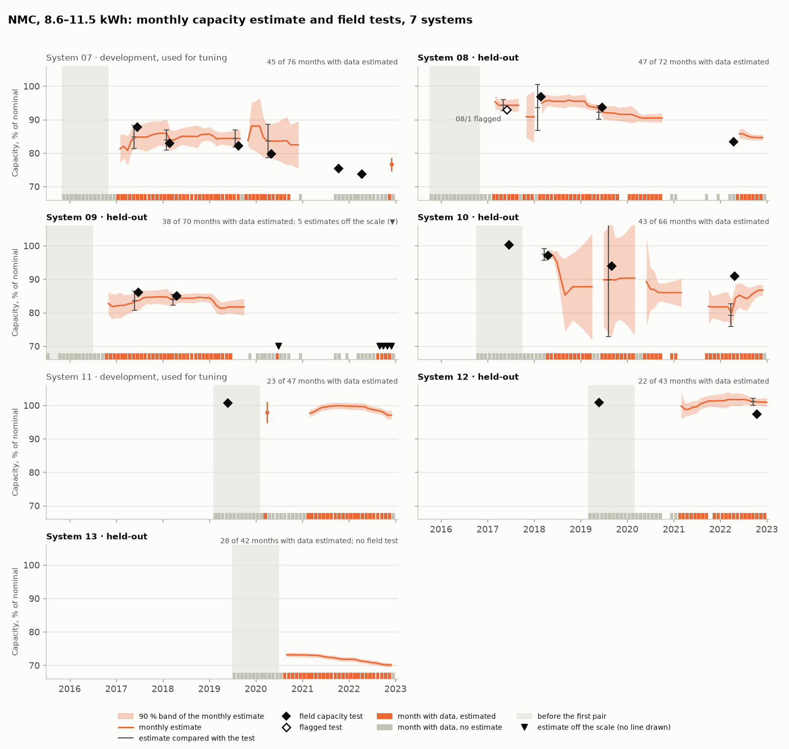
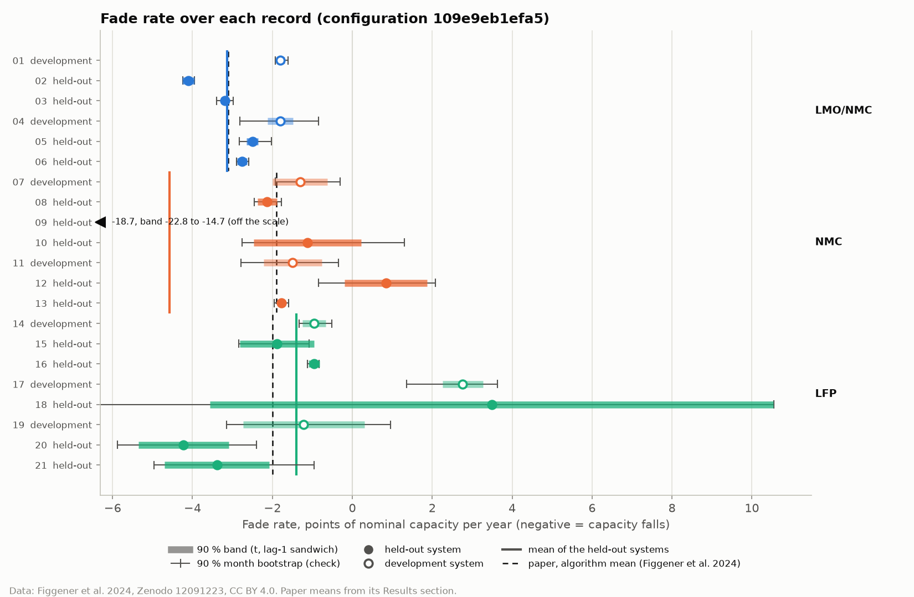
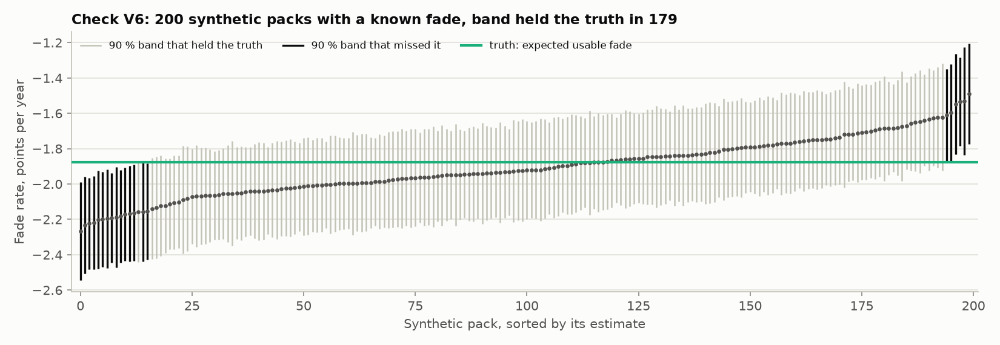
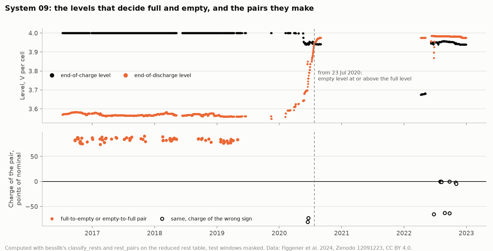

# Phase 2 — capacity from operating data, checked against the field tests

Written by `validation/make_capacity_doc.py` from `validation/results/`. No number on this page is typed by hand.

besslib estimates the usable capacity of a home storage system from its daily operation, with a 90 % band, and
compares it with the field capacity tests measured in phase 1 ([`01_reference.md`](01_reference.md)). The settings were
tuned on the 7 development systems, then frozen; the 14 held-out systems were run once with them.
The headline comes from held-out systems only.

## Result

- **Configuration:** `109e9eb1efa5`, frozen on the development systems 01, 04, 07, 11, 14, 17 and 19 before any held-out system was run.
- **Held-out systems with results:** 14 of 14.
- **Checks passed:** V2, V5 LMO/NMC, V6, V7, V8. **Failed:** V3, V4, V5 NMC, V5 LFP.
  - V3 failed: median absolute error infinite (5 of 10 tests without an estimate) (rule <= 5 points, bias shown); median error +4.80 points; 5 of the 5 estimates read above the test.
  - V4 failed: the band held 12 of 28 tests (rule >= 80 %).
  - V5 NMC failed: held-out mean -4.58 points per year against the paper's -1.9 (rule within +-0.5).
  - V5 LFP failed: held-out mean -1.39 points per year against the paper's -2.0 (rule within +-0.5).
- **Held-out field tests compared:** 38 of 38; with an estimate: 27.
- **Held-out LMO/NMC and NMC:** median absolute error 2.62 points of nominal capacity; 90 % band held the test in 12 of 28 (43%).
- **Held-out LFP:** median absolute error infinite (5 of 10 tests without an estimate); 90 % band held the test in 1 of 10 (10%).
- A test without an estimate counts as an infinite error and as not held.
- **Impossible output:** 5 monthly estimates on system 09 are at or below zero or have a band below zero and still carry the status `estimated` (see Limits).

| Tests | Compared | With an estimate | Median abs. error, points | Median error, points | Band held the test | Median band width, points |
|---|---|---|---|---|---|---|
| Held-out LMO/NMC and NMC | 28 of 28 | 22 | 2.62 | -0.70 | 12 of 28 (43%) | 2.90 |
| Held-out LFP | 10 of 10 | 5 | infinite (5 of 10 tests without an estimate) | +4.80 | 1 of 10 (10%) | 6.49 |
| Held-out, all | 38 of 38 | 27 | 3.79 | +0.25 | 13 of 38 (34%) | 3.05 |


## Checks V2–V8

| Check | Scope | Value | Pass rule | Result |
|---|---|---|---|---|
| V2 | held-out LMO/NMC and NMC | median |error| 2.62 points (22/28 estimated) | <= 3 points | pass |
| V2 info | same, without 03/3 and 08/1 | median |error| 2.62 points (26 tests) | information |  |
| V3 | held-out LFP | median |error| inf points; median error +4.80 (5/10 estimated) | <= 5 points, bias shown | **fail** |
| V4 | held-out LMO/NMC and NMC | band held the test in 43% of 28 | >= 80 % | **fail** |
| V4 info | held-out LFP | band held the test in 10% of 10 | information |  |
| V4 info | same as V4, without 03/3 and 08/1 | band held the test in 42% of 26 | information |  |
| V5 | held-out LMO/NMC (4 systems) | mean fade -3.14 points/year; paper -3.1 | within +-0.5 | pass |
| V5 info | all LMO/NMC (6 systems) | mean fade -2.69 points/year | information |  |
| V5 | held-out NMC (5 systems) | mean fade -4.58 points/year; paper -1.9 | within +-0.5 | **fail** |
| V5 info | all NMC (7 systems) | mean fade -3.67 points/year | information |  |
| V5 | held-out LFP (5 systems) | mean fade -1.39 points/year; paper -2.0 | within +-0.5 | **fail** |
| V5 info | all LFP (8 systems) | mean fade -0.80 points/year | information |  |
| V6 | 200 synthetic packs | band held the true usable fade (-1.88) in 89.5% | 85-95 % | pass |
| V7 | core against batch path, 90 daily estimates (months of tests 01/1, 07/1, 17/2) | max relative difference 2.0e-15 | <= 1e-6 | pass |
| V8 | 21 systems | one command per system: python validation/run_capacity.py <id> | all 21 rebuilt with one hash | pass |

"inf" in V3: 5 of 10 tests have no estimate (half of the tests). A missing estimate counts as an infinite error, so the median absolute error is infinite.

Rules fixed before the held-out run:

- A test without an estimate counts as an infinite error and as not held.
- All 28 held-out LMO/NMC and NMC tests count in V2 and V4.
- Tests 03/3 (3.2 % of its capacity) and 08/1 (5.7 % of its capacity) had charge discharged in the hour before the test began (phase 1). They count, are flagged
  in the tables, and get one information line without them.
- Fade (V5) is judged per chemistry on the held-out systems against the paper's algorithm means;
  the mean over all 21 systems is an information line.
- A check without results is written as `not run`, never as pass or fail.

## Why a check failed

### V3: held-out LFP

Value: median |error| inf points; median error +4.80 (5/10 estimated). Pass rule: <= 5 points, bias shown.

| Test | Began | Test, % of nominal | Test C-rate | Estimate [90 % band] | Error, points | Held | Status |
|---|---|---|---|---|---|---|---|
| 15/1 | 2017-06-05 | 86.2 | 0.18 | – | – | no | not possible: no levels yet |
| 15/2 | 2018-03-05 | 89.7 | 0.39 | – | – | no | not possible: too few full-empty pairs |
| 15/3 | 2019-10-12 | 86.6 | 0.43 | – | – | no | not possible: too few full-empty pairs |
| 15/4 | 2022-11-13 | 80.6 | 0.43 | 85.4 [84.1 – 86.6] | +4.80 | no | estimated |
| 20/1 | 2017-06-17 | 95.8 | 0.41 | – | – | no | not possible: no levels yet |
| 20/2 | 2018-03-18 | 96.2 | 0.41 | 98.8 [95.5 – 102.2] | +2.66 | yes | estimated |
| 20/3 | 2019-09-08 | 85.5 | 0.41 | 93.7 [89.4 – 98.0] | +8.16 | no | estimated |
| 21/1 | 2017-05-31 | 96.5 | 0.30 | 100.5 [97.2 – 103.7] | +3.94 | no | estimated |
| 21/2 | 2018-02-19 | 95.8 | 0.30 | 105.5 [102.8 – 108.2] | +9.71 | no | estimated |
| 21/3 | 2019-07-04 | 78.4 | 0.30 | – | – | no | not possible: too few full-empty pairs |

- Tests without an estimate: 5 of 10; by reason: not possible: too few full-empty pairs 3; not possible: no levels yet 2.
- Over the 5 tests with an estimate: median absolute error 4.80 points, median error +4.80 points; 5 of 5 read above the test.
- The field tests themselves, consecutive pairs of the same system with the largest drops: 21/2 to 21/3 -17.3 points (Jul 2019); 20/2 to 20/3 -10.6 points (Sep 2019).
- System 21: its end-of-discharge level (quarterly median) is 3.141 V per cell in 2018Q1 and 3.178 in 2019Q3, the quarters of 21/2 and 21/3: +38 mV per cell between the two tests.
- System 20: its end-of-discharge level (quarterly median) is 3.126 V per cell in 2018Q1 and 3.191 in 2019Q3, the quarters of 20/2 and 20/3: +65 mV per cell between the two tests.

The numbers show two parts: 5 of 10 tests have no estimate, and 5 of the 5 estimates read above their test. Among the possible reasons for the high readings — the estimate's lag behind a falling capacity, a change of the end-of-discharge level, the difference between a maximum-power test and daily operation — the share of each is not separated.

### V4: held-out LMO/NMC and NMC

Value: band held the test in 43% of 28. Pass rule: >= 80 %.

- Tests without an estimate: 6 of 28; they count as not held. Over the 22 tests with an estimate the band held 12 (55%).
- Misses: 10; the estimate was above the test in 5 and below it in 5.
- Median half-width of the band: 1.45 points. Median absolute error of the estimated tests: 2.13 points.
- Lag: at the median held-out fade of these systems (2.63 points per year) the estimate trails a steady fade by about 1.30 points (180 days of memory).
- Field tests of the same system, consecutive pairs (these 8 systems): 20; the later test reads higher in 3 (median rise +2.2, largest +3.8 points). Over all systems: 7 of 42 (median rise +2.2, largest +7.5 points).

A battery does not gain capacity, so where a later test reads higher by d, at least one of the two tests is off the
capacity by d/2 or more, and a band whose half-width is below d/2 cannot hold both.
The band is built from the scatter of the pairs only. It holds none of: the lag behind a falling capacity, the
difference between a maximum-power test and daily operation, the test's own repeatability.

The numbers show that 6 of 28 tests had no estimate and that the median band half-width is smaller than the median error. How much of the misses comes from the lag, from the test conditions and from the tests' own repeatability is not separated.

### V5 NMC: held-out NMC (5 systems)

Value: mean fade -4.58 points/year; paper -1.9. Pass rule: within +-0.5.

| System | Rate, points/year | 90 % band | Pairs full-empty / same-kind | Span, years | Reduced chi-square | Mean of the others |
|---|---|---|---|---|---|---|
| 08 | -2.13 | -2.37 to -1.89 | 173 / 541 | 5.7 | 0.39 | -5.19 |
| 09 | -18.73 | -22.80 to -14.65 | 85 / 356 | 6.1 | 12.81 | -1.04 |
| 10 | -1.12 | -2.47 to +0.22 | 108 / 320 | 5.0 | 3.43 | -5.45 |
| 12 | +0.84 | -0.19 to +1.88 | 79 / 507 | 1.7 | 0.55 | -5.94 |
| 13 | -1.77 | -1.86 to -1.68 | 499 / 387 | 2.3 | 0.07 | -5.28 |

- Mean of the 5 held-out NMC rates: -4.58 points per year; paper -1.9; difference -2.68 (rule: within ±0.5).
- Bands that include zero: 10 and 12.
- Without system 09, the one that moves the mean most: -1.04 points per year, difference +0.86; the check would still fail without it.
- System 09 also has impossible monthly estimates (see Limits); its fade fit's reduced chi-square is 12.8.

The held-out NMC rates range over 19.57 points per year across 5 systems; the mean of so few is moved by any one of them, as the last column shows. Whether the systems age differently from the paper's fleet mean or the estimator reads them differently is not separated.

### V5 LFP: held-out LFP (5 systems)

Value: mean fade -1.39 points/year; paper -2.0. Pass rule: within +-0.5.

| System | Rate, points/year | 90 % band | Pairs full-empty / same-kind | Span, years | Reduced chi-square | Mean of the others |
|---|---|---|---|---|---|---|
| 15 | -1.89 | -2.81 to -0.96 | 83 / 284 | 5.4 | 2.51 | -1.27 |
| 16 | -0.96 | -1.10 to -0.82 | 76 / 236 | 2.7 | 0.04 | -1.50 |
| 18 | +3.49 | -3.56 to +10.54 | 9 / 27 | 1.7 | 10.73 | -2.61 |
| 20 | -4.23 | -5.35 to -3.10 | 48 / 278 | 3.1 | 4.64 | -0.69 |
| 21 | -3.39 | -4.70 to -2.08 | 59 / 225 | 3.9 | 4.04 | -0.90 |

- Mean of the 5 held-out LFP rates: -1.39 points per year; paper -2.0; difference +0.61 (rule: within ±0.5).
- Bands that include zero: 18.
- Without system 18, the one that moves the mean most: -2.61 points per year, difference -0.61; the check would still fail without it.

The held-out LFP rates range over 7.71 points per year across 5 systems; the mean of so few is moved by any one of them, as the last column shows. Whether the systems age differently from the paper's fleet mean or the estimator reads them differently is not separated.


## Development systems (tuning, not a result)

These are the systems the settings were tuned on. They are not a result and are never mixed into one.

| Tests | Compared | With an estimate | Median abs. error, points | Median error, points | Band held the test | Median band width, points |
|---|---|---|---|---|---|---|
| Development LMO/NMC and NMC | 13 of 13 | 10 | 3.03 | -0.56 | 7 of 13 (54%) | 5.32 |
| Development LFP | 9 of 9 | 8 | 2.27 | +0.65 | 6 of 9 (67%) | 3.39 |
| Development, all | 22 of 22 | 18 | 2.35 | -0.00 | 13 of 22 (59%) | 4.49 |

The tuning run chose configuration `109e9eb1efa5` (the same as the frozen `109e9eb1efa5`): on its 22 development tests a median absolute error of 2.35 points, 18 with an estimate, band coverage 59%. The frozen run gives the same numbers.

## Every system over time

Each panel is one system: the monthly estimate with its band, the field tests, and the estimate each test was
compared with (drawn just before the test). Gaps in the band are months without an estimate; nothing is
interpolated. The strip at the bottom marks every month with data.






## Every test

The estimate is the one at the start of the test's masked window, from operating data before it only.
Error = estimate minus test, in points of nominal capacity.

| Test | Set | Chemistry | Began | Test, Ah | Test, % of nominal | Test C-rate | Estimate, % of nominal [90 % band] | Error, points | Held | Status | Flag |
|---|---|---|---|---|---|---|---|---|---|---|---|
| 01/1 | development | LMO/NMC | 2017-06-14 | 13.65 | 91.0 | 0.84 | 90.1 [89.2 – 91.0] | -0.93 | yes | estimated |  |
| 01/2 | development | LMO/NMC | 2018-03-06 | 13.54 | 90.2 | 0.84 | 89.2 [88.3 – 90.2] | -1.01 | no | estimated |  |
| 01/3 | development | LMO/NMC | 2019-07-01 | 12.96 | 86.4 | 0.84 | 87.9 [84.9 – 91.0] | +1.53 | yes | estimated |  |
| 01/4 | development | LMO/NMC | 2022-10-30 | 12.36 | 82.4 | 0.30 | 79.2 [78.2 – 80.2] | -3.13 | no | estimated |  |
| 02/1 | held-out | LMO/NMC | 2017-06-01 | 13.07 | 87.1 | 0.84 | 86.7 [85.6 – 87.9] | -0.38 | yes | estimated |  |
| 02/2 | held-out | LMO/NMC | 2018-04-19 | 13.06 | 87.1 | 0.30 | 83.8 [82.7 – 84.9] | -3.25 | no | estimated |  |
| 02/3 | held-out | LMO/NMC | 2019-06-07 | 11.50 | 76.7 | 0.84 | 80.9 [79.5 – 82.3] | +4.26 | no | estimated |  |
| 02/4 | held-out | LMO/NMC | 2022-04-21 | 9.81 | 65.4 | 0.84 | 66.6 [65.0 – 68.2] | +1.22 | yes | estimated |  |
| 03/1 | held-out | LMO/NMC | 2017-06-08 | 13.70 | 91.3 | 0.84 | 89.2 [87.7 – 90.7] | -2.15 | no | estimated |  |
| 03/2 | held-out | LMO/NMC | 2018-03-09 | 14.03 | 93.5 | 0.30 | 91.4 [90.5 – 92.3] | -2.10 | no | estimated |  |
| 03/3 | held-out | LMO/NMC | 2019-08-29 | 12.70 | 84.7 | 0.85 | 88.8 [87.5 – 90.0] | +4.09 | no | estimated | discharged before the start |
| 04/1 | development | LMO/NMC | 2018-03-06 | 13.29 | 88.6 | 0.84 | 79.6 [76.8 – 82.4] | -8.99 | no | estimated |  |
| 04/2 | development | LMO/NMC | 2019-05-07 | 12.44 | 82.9 | 0.84 | 82.7 [80.9 – 84.6] | -0.19 | yes | estimated |  |
| 05/1 | held-out | LMO/NMC | 2017-06-13 | 13.36 | 89.0 | 0.84 | – | – | no | not possible: no levels yet |  |
| 05/2 | held-out | LMO/NMC | 2018-03-14 | 13.20 | 88.0 | 0.79 | 88.0 [87.0 – 89.1] | +0.07 | yes | estimated |  |
| 05/3 | held-out | LMO/NMC | 2019-06-04 | 12.60 | 84.0 | 0.84 | 84.5 [83.5 – 85.5] | +0.53 | yes | estimated |  |
| 05/4 | held-out | LMO/NMC | 2022-04-11 | 11.79 | 78.6 | 0.30 | – | – | no | not possible: no full-empty pair within the memory time |  |
| 06/1 | held-out | LMO/NMC | 2017-06-13 | 13.48 | 89.9 | 0.84 | – | – | no | not possible: no levels yet |  |
| 06/2 | held-out | LMO/NMC | 2018-04-19 | 12.83 | 85.5 | 0.84 | 86.6 [85.6 – 87.7] | +1.08 | no | estimated |  |
| 06/3 | held-out | LMO/NMC | 2019-06-06 | 12.85 | 85.7 | 0.84 | 84.6 [82.1 – 87.2] | -1.02 | yes | estimated |  |
| 06/4 | held-out | LMO/NMC | 2020-05-20 | 12.71 | 84.7 | 0.84 | 82.4 [81.3 – 83.5] | -2.34 | no | estimated |  |
| 06/5 | held-out | LMO/NMC | 2022-10-27 | 10.82 | 72.1 | 0.84 | 74.8 [74.1 – 75.5] | +2.67 | no | estimated |  |
| 07/1 | development | NMC | 2017-06-14 | 158.07 | 87.8 | 0.33 | 84.8 [81.3 – 88.3] | -3.03 | yes | estimated |  |
| 07/2 | development | NMC | 2018-02-23 | 149.41 | 83.0 | 0.34 | 83.9 [80.8 – 86.9] | +0.85 | yes | estimated |  |
| 07/3 | development | NMC | 2019-08-15 | 148.04 | 82.2 | 0.33 | 84.3 [81.8 – 86.9] | +2.10 | yes | estimated |  |
| 07/4 | development | NMC | 2020-04-29 | 143.79 | 79.9 | 0.33 | 83.6 [78.6 – 88.6] | +3.71 | yes | estimated |  |
| 07/5 | development | NMC | 2021-10-09 | 135.93 | 75.5 | 0.33 | – | – | no | not possible: too few full-empty pairs |  |
| 07/6 | development | NMC | 2022-04-11 | 132.89 | 73.8 | 0.33 | – | – | no | not possible: too few full-empty pairs |  |
| 08/1 | held-out | NMC | 2017-05-29 | 174.88 | 93.0 | 0.32 | 94.3 [92.6 – 95.9] | +1.26 | yes | estimated | discharged before the start |
| 08/2 | held-out | NMC | 2018-02-21 | 182.04 | 96.8 | 0.32 | 93.6 [86.7 – 100.6] | -3.20 | yes | estimated |  |
| 08/3 | held-out | NMC | 2019-06-17 | 176.17 | 93.7 | 0.32 | 92.2 [90.1 – 94.2] | -1.56 | yes | estimated |  |
| 08/4 | held-out | NMC | 2022-04-14 | 156.79 | 83.4 | 0.32 | – | – | no | not possible: too few full-empty pairs |  |
| 09/1 | held-out | NMC | 2017-06-19 | 155.10 | 86.2 | 0.33 | 83.6 [80.7 – 86.4] | -2.58 | yes | estimated |  |
| 09/2 | held-out | NMC | 2018-04-17 | 153.16 | 85.1 | 0.33 | 83.8 [82.3 – 85.3] | -1.29 | yes | estimated |  |
| 10/1 | held-out | NMC | 2017-06-14 | 188.64 | 100.3 | 0.32 | – | – | no | not possible: no levels yet |  |
| 10/2 | held-out | NMC | 2018-04-16 | 182.71 | 97.2 | 0.32 | 97.4 [95.7 – 99.2] | +0.25 | yes | estimated |  |
| 10/3 | held-out | NMC | 2019-08-30 | 176.84 | 94.1 | 0.32 | 89.8 [72.8 – 106.8] | -4.23 | yes | estimated |  |
| 10/4 | held-out | NMC | 2022-04-19 | 170.91 | 90.9 | 0.32 | 79.2 [75.8 – 82.7] | -11.68 | no | estimated |  |
| 11/1 | development | NMC | 2019-05-24 | 172.84 | 100.7 | 0.31 | – | – | no | not possible: no levels yet |  |
| 12/1 | held-out | NMC | 2019-05-23 | 230.97 | 100.9 | 0.23 | – | – | no | not possible: no levels yet |  |
| 12/2 | held-out | NMC | 2022-10-11 | 222.92 | 97.4 | 0.16 | 101.1 [100.0 – 102.2] | +3.63 | no | estimated |  |
| 14/1 | development | LFP | 2017-06-02 | 145.70 | 92.2 | 0.41 | 94.5 [93.6 – 95.4] | +2.27 | no | estimated |  |
| 14/2 | development | LFP | 2018-02-19 | 144.84 | 91.7 | 0.41 | 92.8 [91.4 – 94.2] | +1.12 | yes | estimated |  |
| 14/3 | development | LFP | 2019-05-09 | 141.17 | 89.4 | 0.24 | 90.5 [88.4 – 92.5] | +1.11 | yes | estimated |  |
| 15/1 | held-out | LFP | 2017-06-05 | 168.10 | 86.2 | 0.18 | – | – | no | not possible: no levels yet |  |
| 15/2 | held-out | LFP | 2018-03-05 | 174.82 | 89.7 | 0.39 | – | – | no | not possible: too few full-empty pairs |  |
| 15/3 | held-out | LFP | 2019-10-12 | 168.82 | 86.6 | 0.43 | – | – | no | not possible: too few full-empty pairs |  |
| 15/4 | held-out | LFP | 2022-11-13 | 157.12 | 80.6 | 0.43 | 85.4 [84.1 – 86.6] | +4.80 | no | estimated |  |
| 17/1 | development | LFP | 2019-05-03 | 146.01 | 92.4 | 0.37 | – | – | no | not possible: no levels yet |  |
| 17/2 | development | LFP | 2020-06-27 | 144.61 | 91.5 | 0.42 | 91.7 [90.9 – 92.5] | +0.18 | yes | estimated |  |
| 17/3 | development | LFP | 2021-09-25 | 140.87 | 89.2 | 0.42 | 90.5 [89.6 – 91.3] | +1.33 | no | estimated |  |
| 17/4 | development | LFP | 2022-03-13 | 152.75 | 96.7 | 0.42 | 94.2 [91.8 – 96.7] | -2.43 | yes | estimated |  |
| 19/1 | development | LFP | 2018-02-20 | 186.61 | 93.3 | 0.41 | 90.5 [78.8 – 102.2] | -2.81 | yes | estimated |  |
| 19/2 | development | LFP | 2019-05-09 | 187.89 | 93.9 | 0.41 | 83.3 [68.8 – 97.7] | -10.69 | yes | estimated |  |
| 20/1 | held-out | LFP | 2017-06-17 | 191.68 | 95.8 | 0.41 | – | – | no | not possible: no levels yet |  |
| 20/2 | held-out | LFP | 2018-03-18 | 192.36 | 96.2 | 0.41 | 98.8 [95.5 – 102.2] | +2.66 | yes | estimated |  |
| 20/3 | held-out | LFP | 2019-09-08 | 171.08 | 85.5 | 0.41 | 93.7 [89.4 – 98.0] | +8.16 | no | estimated |  |
| 21/1 | held-out | LFP | 2017-05-31 | 289.52 | 96.5 | 0.30 | 100.5 [97.2 – 103.7] | +3.94 | no | estimated |  |
| 21/2 | held-out | LFP | 2018-02-19 | 287.33 | 95.8 | 0.30 | 105.5 [102.8 – 108.2] | +9.71 | no | estimated |  |
| 21/3 | held-out | LFP | 2019-07-04 | 235.34 | 78.4 | 0.30 | – | – | no | not possible: too few full-empty pairs |  |

### Bias per chemistry

| Chemistry | Set | Tests with an estimate | Median error, points | Estimate below the test | Test C-rate (min – max) | Median error, tests below / at or above the chemistry's median test C-rate |
|---|---|---|---|---|---|---|
| LMO/NMC | held-out | 13 of 16 | +0.07 | 6 of 13 | 0.30 – 0.85 | -1.02 (n = 7) / +0.87 (n = 6); split at 0.84 C |
| LMO/NMC | development | 6 of 6 | -0.97 | 5 of 6 | 0.30 – 0.84 | -2.03 (n = 2) / -0.60 (n = 4); split at 0.84 C |
| NMC | held-out | 9 of 12 | -1.56 | 6 of 9 | 0.16 – 0.33 | +0.25 (n = 5) / -2.07 (n = 4); split at 0.32 C |
| NMC | development | 4 of 7 | +1.48 | 1 of 4 | 0.31 – 0.34 | – (n = 0) / +1.48 (n = 4); split at 0.32 C |
| LFP | held-out | 5 of 10 | +4.80 | 0 of 5 | 0.18 – 0.43 | +6.83 (n = 2) / +4.80 (n = 3); split at 0.41 C |
| LFP | development | 8 of 9 | +0.65 | 3 of 8 | 0.24 – 0.42 | +1.11 (n = 3) / +0.18 (n = 5); split at 0.41 C |

No rate correction is applied: a field test discharges at the system's maximum power and often deeper than daily
operation, and the estimate measures the capacity between the system's own end of charge and end of discharge
under its normal load.

## Fade rates



| System | Set | Chemistry | Rate, points/year [90 % band] | Bootstrap 90 % | Bootstrap ÷ band width | Per 100 EFC [90 % band] | EFC per year | Span, years | Pairs full-empty / same-kind | Status |
|---|---|---|---|---|---|---|---|---|---|---|
| 01 | development | LMO/NMC | -1.80 [-1.90, -1.70] | [-1.92, -1.61] | 1.52 | -1.46 [-1.54, -1.37] | 124 | 6.4 | 782 / 382 | estimated |
| 02 | held-out | LMO/NMC | -4.10 [-4.25, -3.95] | [-4.25, -3.95] | 0.99 | -2.43 [-2.52, -2.34] | 169 | 5.9 | 750 / 791 | estimated |
| 03 | held-out | LMO/NMC | -3.19 [-3.28, -3.10] | [-3.39, -2.98] | 2.25 | -1.82 [-1.88, -1.77] | 175 | 5.5 | 1142 / 446 | estimated |
| 04 | development | LMO/NMC | -1.80 [-2.12, -1.48] | [-2.82, -0.84] | 3.08 | -0.94 [-1.11, -0.77] | 191 | 5.5 | 850 / 678 | estimated |
| 05 | held-out | LMO/NMC | -2.50 [-2.64, -2.36] | [-2.83, -2.02] | 2.84 | -1.41 [-1.49, -1.33] | 177 | 5.0 | 743 / 519 | estimated |
| 06 | held-out | LMO/NMC | -2.76 [-2.88, -2.64] | [-2.90, -2.59] | 1.26 | -1.87 [-1.95, -1.79] | 148 | 5.3 | 992 / 378 | estimated |
| 07 | development | NMC | -1.30 [-1.99, -0.62] | [-1.93, -0.31] | 1.18 | -1.09 [-1.67, -0.52] | 119 | 6.0 | 71 / 770 | estimated |
| 08 | held-out | NMC | -2.13 [-2.37, -1.89] | [-2.45, -1.78] | 1.41 | -1.49 [-1.66, -1.32] | 143 | 5.7 | 173 / 541 | estimated |
| 09 | held-out | NMC | -18.73 [-22.80, -14.65] | [-23.37, -13.15] | 1.25 | -19.89 [-24.22, -15.56] | 94 | 6.1 | 85 / 356 | estimated |
| 10 | held-out | NMC | -1.12 [-2.47, +0.22] | [-2.76, +1.30] | 1.51 | -1.16 [-2.56, +0.23] | 96 | 5.0 | 108 / 320 | estimated |
| 11 | development | NMC | -1.49 [-2.22, -0.76] | [-2.78, -0.35] | 1.67 | -0.63 [-0.94, -0.32] | 237 | 2.7 | 183 / 540 | estimated |
| 12 | held-out | NMC | +0.84 [-0.19, +1.88] | [-0.84, +2.07] | 1.41 | +0.64 [-0.14, +1.41] | 133 | 1.7 | 79 / 507 | estimated |
| 13 | held-out | NMC | -1.77 [-1.86, -1.68] | [-1.96, -1.59] | 2.13 | -0.90 [-0.94, -0.85] | 198 | 2.3 | 499 / 387 | estimated |
| 14 | development | LFP | -0.96 [-1.25, -0.67] | [-1.33, -0.52] | 1.42 | -0.85 [-1.11, -0.60] | 113 | 3.6 | 47 / 376 | estimated |
| 15 | held-out | LFP | -1.89 [-2.81, -0.96] | [-2.85, -1.08] | 0.96 | -1.85 [-2.76, -0.94] | 102 | 5.4 | 83 / 284 | estimated |
| 16 | held-out | LFP | -0.96 [-1.10, -0.82] | [-1.12, -0.84] | 1.04 | -0.51 [-0.58, -0.44] | 188 | 2.7 | 76 / 236 | estimated |
| 17 | development | LFP | +2.76 [+2.26, +3.27] | [+1.35, +3.63] | 2.26 | +1.86 [+1.52, +2.19] | 149 | 2.6 | 88 / 151 | estimated |
| 18 | held-out | LFP | +3.49 [-3.56, +10.54] | [-40.49, +10.55] | 3.62 | +21.12 [-21.58, +63.81] | 17 | 1.7 | 9 / 27 | estimated |
| 19 | development | LFP | -1.21 [-2.74, +0.31] | [-3.15, +0.96] | 1.35 | -1.86 [-4.20, +0.48] | 65 | 4.0 | 153 / 235 | estimated |
| 20 | held-out | LFP | -4.23 [-5.35, -3.10] | [-5.88, -2.39] | 1.55 | -2.55 [-3.23, -1.87] | 166 | 3.1 | 48 / 278 | estimated |
| 21 | held-out | LFP | -3.39 [-4.70, -2.08] | [-4.96, -0.96] | 1.53 | -3.51 [-4.87, -2.15] | 96 | 3.9 | 59 / 225 | estimated |

EFC: equivalent full cycles, the charge moved divided by twice the nominal capacity.
The band is the core's: a Student-t interval on the lag-1 sandwich standard error of the fit over all pairs.
The month bootstrap resamples whole calendar months of pairs; it also keeps any correlation within a month
(temperature, season, operation) that the band does not model. The two are shown side by side, not merged.
Held-out systems: the bootstrap interval is wider than the band in 12 of 14 (median ratio 1.46, largest 3.62 on system 18).
Development systems: the bootstrap interval is wider than the band in 7 of 7 (median ratio 1.52, largest 3.08 on system 04).
Where the bootstrap is much wider, the band understates the uncertainty of the rate.

Means per chemistry, against the paper's algorithm means (Figgener et al. 2024, Results):

| Chemistry | Held-out mean, points/year | Paper, algorithm mean | Held-out minus paper | All systems (information) | Development only (information) |
|---|---|---|---|---|---|
| LMO/NMC | -3.14 (n = 4) | -3.1 | -0.04 | -2.69 (n = 6) | -1.80 (n = 2) |
| NMC | -4.58 (n = 5) | -1.9 | -2.68 | -3.67 (n = 7) | -1.40 (n = 2) |
| LFP | -1.39 (n = 5) | -2.0 | +0.61 | -0.80 (n = 8) | +0.20 (n = 3) |

## Offset current

besslib fits the offset current together with the capacity. The paper finds it from full-to-full and
empty-to-empty pairs: the intercept of their mean current against their voltage difference (Figgener et al. 2024,
Supplementary Fig. 13). Both are computed here from the same pairs; besslib's is the whole-record fit.

| System | Set | Chemistry | besslib, A | The paper's way, A | Difference, A | Same-kind pairs used |
|---|---|---|---|---|---|---|
| 01 | development | LMO/NMC | -0.009 | -0.015 | +0.006 | 379 |
| 02 | held-out | LMO/NMC | -0.020 | -0.023 | +0.003 | 788 |
| 03 | held-out | LMO/NMC | -0.008 | -0.012 | +0.004 | 434 |
| 04 | development | LMO/NMC | -0.021 | -0.026 | +0.005 | 672 |
| 05 | held-out | LMO/NMC | -0.009 | -0.005 | -0.004 | 508 |
| 06 | held-out | LMO/NMC | -0.004 | -0.007 | +0.004 | 372 |
| 07 | development | NMC | -0.070 | -0.051 | -0.019 | 770 |
| 08 | held-out | NMC | -0.038 | -0.027 | -0.012 | 539 |
| 09 | held-out | NMC | -0.031 | +0.000 | -0.031 | 356 |
| 10 | held-out | NMC | -0.046 | -0.041 | -0.004 | 320 |
| 11 | development | NMC | -0.429 | -0.480 | +0.051 | 539 |
| 12 | held-out | NMC | -0.533 | -0.566 | +0.033 | 507 |
| 13 | held-out | NMC | -0.339 | -0.323 | -0.016 | 387 |
| 14 | development | LFP | -0.262 | -0.266 | +0.004 | 376 |
| 15 | held-out | LFP | -0.715 | -0.719 | +0.004 | 284 |
| 16 | held-out | LFP | -0.213 | -0.218 | +0.005 | 236 |
| 17 | development | LFP | -0.268 | -0.276 | +0.008 | 151 |
| 18 | held-out | LFP | -0.114 | -0.086 | -0.028 | 27 |
| 19 | development | LFP | -0.462 | -0.399 | -0.063 | 235 |
| 20 | held-out | LFP | -0.760 | -0.732 | -0.028 | 278 |
| 21 | held-out | LFP | -0.789 | -0.661 | -0.128 | 225 |

Systems with both: 21. Largest difference: 0.128 A. Negative means the battery loses
charge the meter does not see (BMS supply, balancing, self-discharge, sensor offset).

## Synthetic check V6 and code-path check V7



- Packs: 200; with a fade rate: 200. Each pack has its own operation, current-sensor gain error and
  stop errors of its BMS; the full chain runs on each (rest detection, classification, pairs, fade rate) with the frozen settings.
- Truth: the expected fade of the usable capacity, -1.88 points per year (the simulated capacity fades by -2.0; the BMS stops at voltage limits, so the usable part fades a little slower).
- Mean estimate: -1.91 points per year.
- The band held the truth in 179 of 200 packs (89.5%); each pack's own usable fade in 95.5%; the capacity fade in 86.0%.
- Offset current: median absolute error 0.0036 A (true value -0.050 A).
- Bootstrap ÷ band width: median 0.95.
- **V6** (85-95 %): **pass**.

**V7, the code path.** Core against batch path, 90 daily estimates (months of tests 01/1, 07/1, 17/2): max relative difference 2.0e-15 (rule <= 1e-6): **pass**.
The step-by-step core, one update per pair as a BMS or the C port runs it, gives the same estimate and band as
the batch path that builds the same sums in one step.

## How it works

Rest-anchored coulomb counting, after Figgener et al. (2024, Supplementary Methods), with besslib's own estimator.

1. **Rests.** A rest is a stretch where the current stays below C/200 for at least 20 minutes (excursions up to 10 s tolerated), after at least 0.2 × C of charge has moved.
2. **Full and empty.** The *edge voltage* of a rest is the median voltage in the 60 s before it, while
   current still flows: under load the voltage rises or falls steeply at both ends of the charge window, also for LFP.
   The system's end-of-charge and end-of-discharge levels are the 0.9 and 0.1 quantiles
   of its edge voltages over the trailing 365 days, so every season is in the window. A rest is full
   (empty) when its edge voltage lies within 3% of the level span of the end-of-charge (end-of-discharge) level.
   No level exists, and no rest is full or empty, before 365 days of history.
3. **Pairs.** Two consecutive full or empty rests form a pair when they are at most 10 days apart with at
   most 600 s of missing data between them. Kinds: full-to-empty, empty-to-full (x = ∓1), full-to-full and
   empty-to-empty (x = 0).
4. **Model.** The charge measured over a pair is `q = C · x − I_offset · Δt`: C the usable capacity, I_offset the current
   the meter does not see (BMS supply, balancing, self-discharge, sensor offset), Δt the time between the rests.
   Same-kind pairs fix the offset, full-to-empty pairs the capacity. Both are fitted together, by weighted least squares.
5. **Forgetting.** A pair of age s counts with weight exp(−s / 180 days).
6. **Band.** 90 %, from the scatter of the pairs themselves: a lag-1 sandwich covariance of the residuals (consecutive
   pairs share a rest, so their errors are correlated at lag 1) and a Student-t quantile. The current sensor's gain
   error (0.5%, Figgener et al. 2024, Supplementary Table 2) is added as a systematic term.
7. **Causal.** The estimate at a date uses only pairs that end before it, as a BMS would.
8. **Tests masked.** From 1 day before each field test begins to 1 day after it ends, the
   rests are removed and no pair spans the window. The estimate compared with a test is the one at the start of
   its masked window.
9. **Fade rate.** The same fit with `C = c0 + r · years`, no forgetting, over the whole record; it needs full-to-empty
   pairs spanning at least 1 year.

When a step is not possible, the output says `not possible from this data` with the reason, and gives no value.

Settings (`CapacityConfig()`, hash `109e9eb1efa5`):

| Setting | Value | Meaning |
|---|---|---|
| `current_c_rate` | 0.005 | rest: current below this share of the nominal capacity (x C) |
| `min_duration_min` | 20 | rest: shortest duration, min |
| `peak_s` | 10 | rest: longest current excursion tolerated inside it, s |
| `min_throughput` | 0.2 | rest: charge moved since the last accepted rest, x C |
| `pre_window_s` | 60 | edge voltage: median over this time before the rest, s |
| `break_gap_s` | 60 | a data step longer than this adds no charge and ends a rest, s |
| `edge_quantile` | 0.9 | end-of-charge level: this quantile of the charge-side edge voltages (end-of-discharge: 1 minus it) |
| `edge_tolerance` | 0.03 | full (empty): edge voltage within this share of the level span of its level |
| `level_window_days` | 365 | levels: trailing window, days |
| `level_warmup_days` | 365 | levels: none before this much history, days |
| `min_level_rests` | 10 | levels: fewest rests of each direction in the window |
| `ocv_fit_max_min` | 120 | open-circuit fit length, min (reported, not used for capacity) |
| `max_link_days` | 10 | pairs: longest time between the two rests, days |
| `max_missing_s` | 600 | pairs: most missing data between the two rests, s |
| `tau_days` | 180 | memory time of the forgetting, days |
| `level` | 0.9 | band level |
| `sigma_q_rel` | 0.005 | relative weight: charge error of a pair, x charge moved |
| `sigma_soc_edge` | 0.02 | relative weight: state-of-charge error of one rest |
| `gain_error` | 0.005 | current sensor gain error, added to the capacity band |
| `min_cross` | 3 | fewest full-to-empty or empty-to-full pairs in memory (decayed count) |
| `min_same` | 2 | fewest full-to-full or empty-to-empty pairs in memory (decayed count) |
| `fade_min_span_years` | 1 | fade rate: shortest span of full-to-empty pairs, years |

## How the settings were fixed

All settings were fixed on the development systems, by rules written before any estimate was compared with a test.

- **Grid search** (27 settings: current threshold C/50, C/100, C/200; minimum rest duration, min 10, 20, 40; memory time, days 30, 90, 180). Rule: the lowest median
  absolute error among the settings whose 90 % band holds at least 80 % of the development tests;
  if none does, the highest coverage. **No setting reached it**: the highest development coverage was 59%. The rule's fallback, the highest coverage, chose C/200, 20 min, 180 days (coverage 59%, median absolute error 2.35 points). So before the held-out run the 90 % band was already known to hold only 59% of the development tests.
- **Edge tolerance** 3% of the level span (`edge_tolerance.py`): the widest tolerance at which the
  median full-to-empty charge falls by at most 2% in every bin, each bin with at least 10 pairs;
  from pair charges only, no test value. It is the value in `CapacityConfig()`.
- **Level window** (`level_window.py`, no test value read): a home storage system is rarely emptied in summer and
  rarely filled in winter, so a short window lets the levels follow the season. One year was kept:

| Level window (warm-up) | Seasonal amplitude of the estimate, points (median of systems) | Full-empty pairs below 70% of the median charge (median of systems) | Month ends estimated |
|---|---|---|---|
| 90 d, no warm-up | 0.88 | 0.75 % | 418 of 482 |
| 90 d | 1.09 | 0.82 % | 399 of 482 |
| 365 d | 0.56 | 0.00 % | 308 of 482 |

## Limits

**No estimate in the first year.** The full and empty levels need 365 days of history, so the first year of every record gives none (`not possible from this data: not enough history yet to set the full and empty levels`). Over the 21 systems with results, 802 of 1269 months with data have an estimate; 248 lie before the first pair.
Field tests in that first year: 8 (05/1, 06/1, 10/1, 11/1, 12/1, 15/1, 17/1, 20/1).

| System | Set | Months with data | Estimated | Before the first pair | too few full-empty pairs | too few same-kind pairs | no full-empty pair within the memory time | no positive variance for the band | After the last pair | Estimated month ends without data that month | Median band width, points |
|---|---|---|---|---|---|---|---|---|---|---|---|
| 01 | development | 80 | 65 (81%) | 12 | 0 | 0 | 1 | 0 | 2 | 4 | 2.1 |
| 02 | held-out | 76 | 63 (83%) | 13 | 0 | 0 | 0 | 0 | 0 | 6 | 2.4 |
| 03 | held-out | 71 | 58 (82%) | 12 | 0 | 0 | 0 | 0 | 1 | 6 | 1.9 |
| 04 | development | 69 | 56 (81%) | 12 | 0 | 1 | 0 | 0 | 0 | 7 | 2.7 |
| 05 | held-out | 57 | 42 (74%) | 12 | 1 | 0 | 1 | 0 | 1 | 5 | 2.0 |
| 06 | held-out | 66 | 51 (77%) | 12 | 0 | 0 | 2 | 0 | 1 | 7 | 2.0 |
| 07 | development | 76 | 45 (59%) | 12 | 17 | 0 | 1 | 0 | 1 | 2 | 7.1 |
| 08 | held-out | 72 | 47 (65%) | 13 | 8 | 0 | 3 | 0 | 1 | 2 | 3.5 |
| 09 | held-out | 70 | 38 (54%) | 10 | 19 | 0 | 2 | 0 | 1 | 3 | 4.3 |
| 10 | held-out | 66 | 43 (65%) | 12 | 8 | 0 | 2 | 0 | 1 | 3 | 8.8 |
| 11 | development | 47 | 23 (49%) | 12 | 11 | 0 | 0 | 0 | 1 | 0 | 2.0 |
| 12 | held-out | 43 | 22 (51%) | 12 | 9 | 0 | 0 | 0 | 0 | 1 | 3.5 |
| 13 | held-out | 42 | 28 (67%) | 12 | 1 | 0 | 0 | 0 | 1 | 0 | 1.2 |
| 14 | development | 60 | 30 (50%) | 9 | 20 | 0 | 0 | 0 | 1 | 0 | 2.6 |
| 15 | held-out | 66 | 32 (48%) | 11 | 22 | 0 | 0 | 0 | 1 | 3 | 4.4 |
| 16 | held-out | 47 | 32 (68%) | 13 | 1 | 0 | 0 | 0 | 1 | 0 | 1.7 |
| 17 | development | 46 | 30 (65%) | 13 | 1 | 0 | 0 | 0 | 2 | 0 | 1.7 |
| 18 | held-out | 34 | 5 (15%) | 11 | 17 | 0 | 0 | 0 | 1 | 0 | 25.4 |
| 19 | development | 72 | 43 (60%) | 12 | 3 | 0 | 7 | 0 | 7 | 3 | 11.4 |
| 20 | held-out | 57 | 26 (46%) | 12 | 8 | 0 | 2 | 0 | 9 | 0 | 8.3 |
| 21 | held-out | 52 | 23 (44%) | 11 | 15 | 0 | 1 | 1 | 1 | 4 | 6.3 |

Column names are short forms of the statuses: *too few full-empty pairs*: `not possible from this data: too few full-to-empty or empty-to-full pairs`; *too few same-kind pairs*: `not possible from this data: too few full-to-full or empty-to-empty pairs to fix the offset`; *no full-empty pair within the memory time*: `not possible from this data: no full-to-empty or empty-to-full pair within the memory time`; *no positive variance for the band*: `not possible from this data: the residuals give no positive variance for the band`.
"Before the first pair" months lie before the levels exist or before the first pair after them.
"Estimated month ends without data that month": the estimate carries the earlier pairs forward, decaying; its
band widens as they age, but no new measurement enters. The figures show these months as band without a rug mark.

**Tests without an estimate, by reason** (systems with results): not possible: no levels yet: 8; not possible: too few full-empty pairs: 6; not possible: no full-empty pair within the memory time: 1.
This is the designed answer: where the operation gives too few full and empty rests, the output says so and gives no value.
This version covers home storage that reaches full and empty regularly. Storage that works at a middle state of
charge, or only in partial windows, gives no full-to-empty pairs and therefore no estimate.

**The band is on the weighted capacity of the pairs behind it, not on the capacity at the date.** Old pairs fade
with the memory time of 180 days; when pairs come evenly, their weighted mean age is that memory time, so
the estimate lags a steady fade by about 180 days. At the median fade of the 14 held-out systems with a rate, 2.63 points per year, that is 1.30 points. The band does not include this lag, nor a
systematic difference between the usable capacity in daily operation and a field test at the system's maximum power.

**The paper's interval is not this band.** In Figgener et al. (2024, Fig. 4) the shaded interval contains a fixed share of all
estimates: it is the spread of the estimates. besslib's 90 % band is a band on the capacity, and V4 tests how often it
holds the field test.

**Field tests are not daily operation.** A field test discharges at the system's maximum power, often deeper than
daily operation. No rate correction is applied; the estimate is compared as it is. The bias table above shows the
median signed error per chemistry next to the test C-rates.

**Impossible values marked `estimated`.** This version has no plausibility check on its own output.
System 09: 5 of its 41 estimated month ends have an estimate at or below zero or a lower band edge below zero; the first is Jun 2020. Its widest monthly band is 237 points. Its fade fit reads -18.73 points per year [-22.80, -14.65], reduced chi-square 12.8.
Over the other 20 systems: 0 such month ends. A value like this should have come out as `not possible from this data`; this version lets it through, and its fade fit enters V5.

Cause, from the levels that decide full and empty (figure below; the run's own functions on the reduced rest table, the 441 pairs equal to the run's): before 16 Jun 2020 the median end-of-charge level of system 09 is 4.000 V per cell and the end-of-discharge level 3.567; from then on 3.949 and 3.982. From 23 Jul 2020 the end-of-discharge level lies at or above the end-of-charge level (832 rests). Full and empty then no longer mark the two ends of the charge window: 12 of the 12 full-to-empty and empty-to-full pairs from 16 Jun 2020 on carry charge of the wrong sign, with a median of -3.3 points of nominal against +84.1 before. 20 of the other 20 systems have neither an inverted level nor a pair of the wrong sign.
These pairs explain the impossible estimates and the fade fit. Why the system's operation changed so that its levels moved is not established from the data on this page.



**The levels that decide full and empty**, per system, as the run builds them (the library's own functions on the
reduced rest tables, test windows masked; the rebuilt pairs equal the run's in 21 of 21 systems):

| System | Chemistry | Cells in series | End-of-charge level, V per cell (min – max) | End-of-discharge level, V per cell (min – max) | Largest quarter-to-quarter step of the end-of-discharge level, mV per cell | Rests with empty level ≥ full level | Full-empty pairs with charge of the wrong sign |
|---|---|---|---|---|---|---|---|
| 01 | LMO/NMC | 40 | 4.122 – 4.130 | 3.248 – 3.406 | -26 (2020Q3) | 0 | 0 |
| 02 | LMO/NMC | 40 | 4.134 – 4.139 | 3.249 – 3.400 | -29 (2019Q1) | 0 | 0 |
| 03 | LMO/NMC | 40 | 4.131 – 4.136 | 3.243 – 3.373 | -28 (2018Q4) | 0 | 0 |
| 04 | LMO/NMC | 40 | 4.117 – 4.126 | 3.240 – 3.394 | -33 (2018Q1) | 0 | 0 |
| 05 | LMO/NMC | 40 | 4.128 – 4.138 | 3.249 – 3.304 | -39 (2018Q2) | 0 | 0 |
| 06 | LMO/NMC | 40 | 4.126 – 4.130 | 3.248 – 3.350 | -27 (2018Q4) | 0 | 0 |
| 07 | NMC | 13 | 3.987 – 4.005 | 3.531 – 3.624 | +92 (2021Q3) | 0 | 0 |
| 08 | NMC | 13 | 3.968 – 3.994 | 3.346 – 3.405 | +40 (2022Q2) | 0 | 0 |
| 09 | NMC | 13 | 3.674 – 4.001 | 3.548 – 3.985 | +260 (2020Q3) | 832 | 12 |
| 10 | NMC | 13 | 3.975 – 3.991 | 3.347 – 3.445 | +28 (2020Q4) | 0 | 0 |
| 11 | NMC | 14 | 4.091 – 4.098 | 3.241 – 3.295 | +44 (2021Q1) | 0 | 0 |
| 12 | NMC | 14 | 4.094 – 4.099 | 3.262 – 3.315 | +31 (2021Q1) | 0 | 0 |
| 13 | NMC | 14 | 4.128 – 4.129 | 3.564 – 3.579 | -5 (2021Q1) | 0 | 0 |
| 14 | LFP | 16 | 3.524 – 3.538 | 2.969 – 3.001 | -12 (2019Q1) | 0 | 0 |
| 15 | LFP | 16 | 3.502 – 3.520 | 2.958 – 3.031 | -39 (2021Q4) | 0 | 0 |
| 16 | LFP | 16 | 3.531 – 3.544 | 3.001 – 3.023 | +10 (2020Q2) | 0 | 0 |
| 17 | LFP | 16 | 3.519 – 3.542 | 2.894 – 2.939 | +25 (2022Q4) | 0 | 0 |
| 18 | LFP | 16 | 3.498 – 3.529 | 3.071 – 3.103 | +23 (2017Q4) | 0 | 0 |
| 19 | LFP | 14 | 3.503 – 3.516 | 3.156 – 3.198 | +28 (2020Q2) | 0 | 0 |
| 20 | LFP | 14 | 3.458 – 3.501 | 3.124 – 3.202 | +41 (2019Q1) | 0 | 0 |
| 21 | LFP | 14 | 3.423 – 3.517 | 3.140 – 3.211 | -23 (2017Q4) | 0 | 0 |

**Largest held-out misses:** 10/4 -11.7 points (band 6.8 wide, not held); 21/2 +9.7 points (band 5.4 wide, not held); 20/3 +8.2 points (band 8.5 wide, not held).

**Held because the band is wide:** the median band of the held-out estimates is 3.1 points; the widest bands among the held tests are 10/3 34.0 points (error -4.2); 08/2 13.9 points (error -3.2); 20/2 6.8 points (error +2.7). A test held by a wide band says little about accuracy.

**Estimates above the nominal capacity** (month ends, highest value): 12 (18 of 23, up to 101.8 %; its highest field test 101.0 %); 20 (4 of 26, up to 100.3 %; its highest field test 96.2 %); 21 (22 of 27, up to 106.3 %; its highest field test 96.5 %). On 20 and 21 no field test reaches the nominal capacity.

**Fade bands that include zero:** 10 (held-out, -1.12 [-2.47, +0.22]), 12 (held-out, +0.84 [-0.19, +1.88]), 18 (held-out, +3.49 [-3.56, +10.54]), 19 (development, -1.21 [-2.74, +0.31]). On these records the fade is not resolved.

**Fewest pairs:** system 18 with 36 pairs (9 full-to-empty or empty-to-full) over 1.7 years; its fade +3.49 points per year, band [-3.56, +10.54], month bootstrap [-40.5, +10.6], reduced chi-square 10.7.

**System 17: a capacity step after a data gap.** The data stop on 25 Jan 2022 and resume on 11 Feb 2022 (17 days). The monthly estimate around the gap, % of nominal: 90.4 (Jan 2022), 92.1 (Feb 2022), 95.5 (Mar 2022). The field tests move the same way: 17/3 read 89.2 %, 17/4 96.7 %. A straight line through a record with a step reads positive here: +2.76 points per year [+2.26, +3.27]. Cells do not gain capacity, so the step is in the usable capacity the system gives; the fade model has no term for a step.

**System 19: high scatter.** Its median monthly band is 11.4 points wide, against 2.7 for the median of the other systems with results. The fade fit's reduced chi-square is 8.9. Its median end-of-discharge level is 3.168 V per cell; the other LFP systems: 14 2.973, 15 2.990, 16 3.010, 17 2.907, 18 3.100, 20 3.144, 21 3.165. That this stop lies on the flat part of the LFP voltage curve, where the edge voltage says little about the state of charge, is an observation from the development work that this page does not back with a number.

**System 11: its end-of-discharge level moves.** Over the record it ranges from 3.241 to 3.295 V per cell; the largest step between two quarters is +44 mV per cell, into 2021Q1 (quarterly medians 2020Q4 3.244, 2021Q1 3.288, 2021Q2 3.281). That the system's own software made this change, and how the usable capacity responds to it, is an observation from the development work that this page does not back with a number.

## Rebuild

```
pip install -e .[dev]
python validation/run_capacity.py <id>        # one system, 1 to 21; downloads its archive if needed
python validation/check_capacity.py           # the checks V2-V8
python validation/make_capacity_doc.py        # this page and its figures
```

The 21 system archives together are 21 GB (sizes from the Zenodo record, `validation/results/zenodo_files.json`). `run_capacity.py` reduces each held-out archive to its rest candidates and
then deletes it. The tuning and the settings studies are rebuilt with `tune_capacity.py`, `edge_tolerance.py`,
`level_window.py` and `synthetic_coverage.py` (V6) in `validation/`.
Every result row carries the configuration hash; this page refuses to build from results of any hash other than `109e9eb1efa5`.

## Source and credit

Data: Figgener, J. et al., *Data for: Multi-year field measurements of home storage systems and their use in
capacity estimation*, Zenodo (2024), https://doi.org/10.5281/zenodo.12091223, licence CC BY 4.0.
Paper: Figgener, J. et al., Nature Energy 9, 1438–1447 (2024), https://doi.org/10.1038/s41560-024-01620-9.
The values on this page are computed by besslib from that data; only the fade means marked as the paper's are taken from it.
besslib computes capacity figures; it does not certify them.
