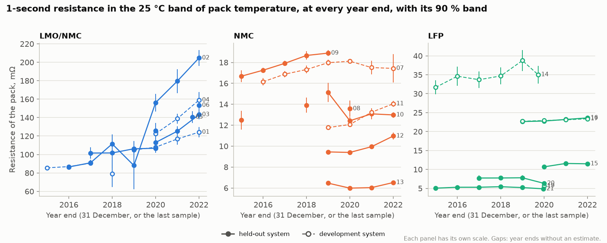
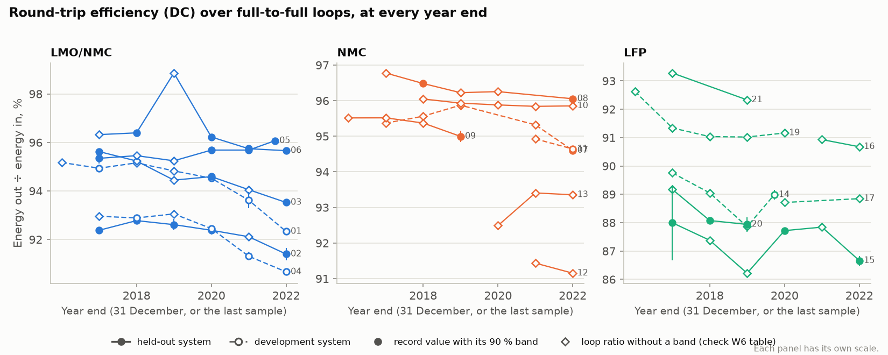
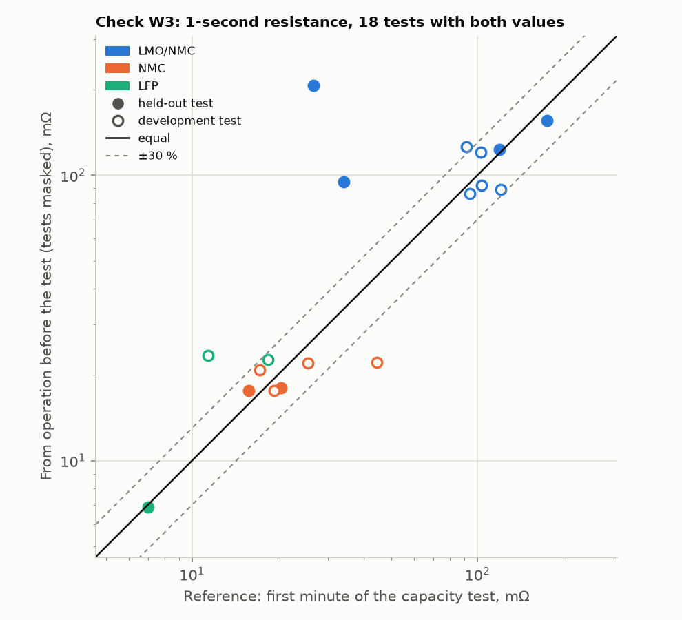
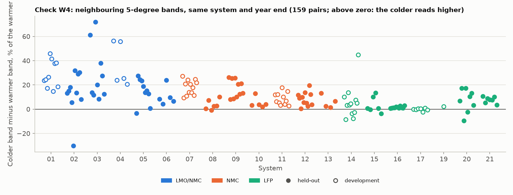
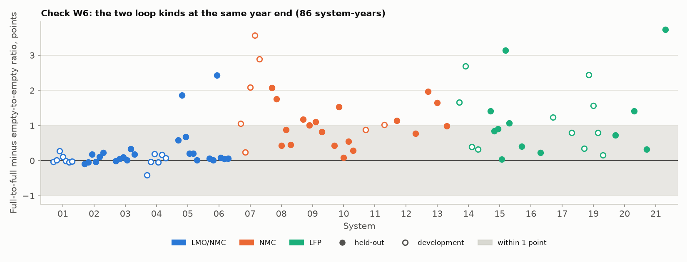

# The Annex VII record from operating data

Written by `validation/make_annex_vii_doc.py` from `validation/results/`. No number on this page is typed by hand.

besslib computes the ten parameters that Annex VII of Regulation (EU) 2023/1542 lists for the state of health and the expected lifetime of a stationary battery energy storage system, from operating data only: each with a value, a 90 % band and the number of events it rests on, or `not possible from this data` with the reason. The settings were tuned on the 7 development systems, then frozen. The 14 held-out systems were run once at the settings of release 0.1.0 and once at these ([what changed](04_version_0_2.md)).

**Not a compliance certificate, not legal advice: it computes the Annex VII parameters; it does not certify them.**

## Result

- **Configuration:** capacity `b3959941c19b` (unchanged from the capacity page), record `d49cbfdcd5b6`, frozen on the development systems 01, 04, 07, 11, 14, 17 and 19 and on synthetic packs before the held-out systems were run at them. They had been run once before, at the release 0.1.0 settings (capacity `109e9eb1efa5`, record `c2f7f545cebb`).
- **Held-out records:** 14 of 14.
- **Passed:** W1, W2 growth, W5, W7, W8, X5, W4, W9, W10. **Failed:** W2 value, W6. **Not possible:** W3. **Not run:** none.
  - W2 value failed (200 synthetic packs: resistance at the weighted mean age of the days in memory): fails under each truth. same-days truth 200 of 200: too wide, because that truth shares every day with the estimate, so the day-to-day scatter the statistical half-width stands for (median 0.62% of the value) is not in the difference; the largest difference is 0.77%, and the systematic half-width alone (median 0.53%) holds 187 of 200. At the date 0 of 200: the estimate lags the growing resistance (the value at the date is a median 2.3% above it). At 25 degrees C 90 of 200: the days in the band read a median +0.9% against 25 degrees C, and the estimator has no temperature model (rule 85-95 %).
  - W6 failed (held-out: full-to-full against empty-to-empty loop ratios within 1 point (no band needed)): 39 of 55 (71%) (rule >= 80%).
  - W3 not possible (held-out capacity tests): 18 of 38 tests have a reference: not possible (rule >= 30 references, then <= 20 %). The rule, fixed before the held-out run, publishes this case as `not possible`. In version 0.1 the check script first wrote it as `fail`, and that label was corrected after that run, with no result changed.

## Checks W1–W10

| Check | Scope | Value | Pass rule | Result |
|---|---|---|---|---|
| W1 info | development records | 7 of 7 records; 0 fields break the rule | 0 | information |
| W1 | held-out records | 14 of 14 records; 0 fields break the rule | 0 | pass |
| W2 | 200 synthetic packs: resistance at the weighted mean age of the days in memory | fails under each truth. same-days truth 200 of 200: too wide, because that truth shares every day with the estimate, so the day-to-day scatter the statistical half-width stands for (median 0.62% of the value) is not in the difference; the largest difference is 0.77%, and the systematic half-width alone (median 0.53%) holds 187 of 200. At the date 0 of 200: the estimate lags the growing resistance (the value at the date is a median 2.3% above it). At 25 degrees C 90 of 200: the days in the band read a median +0.9% against 25 degrees C, and the estimator has no temperature model | 85-95 % | **fail** |
| W2 | 200 synthetic packs: resistance growth per year, whole record, against the simulator's known growth (median 4.93 % per year at the fit's origin; this truth was chosen after the first results) | band held the truth in 184 of 200 (92.0%); same-days truth (information): 199 of 200 (99.5%) | 85-95 % | pass |
| W5 | 200 synthetic packs: round-trip efficiency, full-to-full loops | band held the truth in 176 of 200 (88.0%) | 85-95 % | pass |
| W7 | 200 synthetic packs: apparent charge loss (hidden drain) | band held the truth in 188 of 200 (94.0%) | 85-95 % | pass |
| W8 | 200 synthetic packs: Ah, kWh, cycles; planted events (pack B: current gain error only) | largest relative error 0.498%; events exact on 200 of 200; 200 of 200 packs within the rule | <= 0.6 % and exact, every pack | pass |
| W8 info | 200 synthetic packs: the same on pack B with current and voltage noise | largest relative error 0.498%; events exact on 189 of 200; 189 of 200 packs within the rule | information | information |
| W3 info | development capacity tests | median \|difference\| 21.9 % over 12 of 22 tests with a reference; median difference by chemistry {'LFP': 64.1, 'LMO/NMC': -8.2, 'NMC': -11.5} | information | information |
| W3 | held-out capacity tests | 18 of 38 tests have a reference: not possible | >= 30 references, then <= 20 % | not possible |
| X5 | development: W4 table, system-days with more than one row | 0 | 0 | pass |
| W4 info | development: neighbouring 5-degree bands: the colder reads higher | 50 of 58 (86%) | >= 80% | information |
| X5 | development: W6 table, system-days with more than one row | 0 | 0 | pass |
| W6 info | development: full-to-full against empty-to-empty loop ratios within 1 point (no band needed) | 21 of 31 (68%) | >= 80% | information |
| X5 | held-out: W4 table, system-days with more than one row | 0 | 0 | pass |
| W4 | held-out: neighbouring 5-degree bands: the colder reads higher | 94 of 101 (93%) | >= 80% | pass |
| X5 | held-out: W6 table, system-days with more than one row | 0 | 0 | pass |
| W6 | held-out: full-to-full against empty-to-empty loop ratios within 1 point (no band needed) | 39 of 55 (71%) | >= 80% | **fail** |
| W9 | core against batch, resistance: 240 daily estimates (months of tests 01/1 (2017-06), 07/1 (2017-06), 17/2 (2020-06)) | max relative difference 3.6e-14 (64-bit); 2.6e-06 (32-bit, information) | <= 1e-6 | pass |
| W9 | core against batch, efficiency: 10 daily estimates (months of tests 01/1 (2017-06), 07/1 (2017-06), 17/2 (2020-06)) | max relative difference 0.0e+00 (64-bit); 1.3e-06 (32-bit, information) | <= 1e-6 | pass |
| W9 | daily counters against rest counters: 138814 rests, systems [1, 2, 3, 4, 5, 6, 7, 8, 9, 10, 11, 12, 13, 14, 15, 16, 17, 18, 19, 20, 21] | max relative difference 8.7e-13 (throughput, system 13) | <= 1e-6 | pass |
| W10 | phase 2 rebuilt for 21 systems | 0 of 60 files differ | 0 differences | pass |
| W10 | record A1 against the phase 2 capacity run, every month end, 21 systems | 0 values differ over 1139 month ends (21 systems with a file) | 0 differences, every system | pass |
| W10 | records rebuilt twice for 21 systems | 0 differences over 42 files | 0 differences | pass |

W1, W3, W4 and W6 pass or fail on the held-out systems; their development and all-systems lines are information. A check without results says `not run`, never pass or fail. Every word in the Result column is the one in `validation/results/checks_phase3.csv`.

### Readings chosen after the development results

Three readings of the checks were chosen after the development results were seen, and before the first held-out run (release 0.1.0). They are stated here because they were not fixed with the pass numbers.

1. **W2, the growth.** The resistance growth on the synthetic packs is judged against the simulator's known growth, 5 % of the start value per year; median 4.93 % per year at the fit's origin. The same-days truth is shown next to it as information.
2. **W6, the two loop kinds.** W6 compares the full-to-full and the empty-to-empty loop ratios themselves; no band is needed. The ratio is Σ λ·E_out ÷ Σ λ·E_in over the loops in memory, with the estimator's weights; it exists once the full and empty levels are set and at least 5 loops are in memory, and it equals the record's value wherever the record has one (the check stops otherwise).
3. **The efficiency band.** Each loop's score is g_k = E_out,k − η·E_in,k. A loop runs from one rest to the next, so its score holds the state-of-charge error of its two end rests with opposite signs. Two neighbouring loops share a rest: the mean lag-1 product of the scores is the loops' own covariance minus the rest error's variance s². Loops two apart share no rest: the mean lag-2 product is the loops' own covariance alone. So s² is estimated as the mean lag-2 product minus the mean lag-1 product, each weighted by the forgetting weights of the loops it joins. The band is η ± t·√(s²·C₂) ÷ A, with A = Σ λ·E_in, C₂ the sum of the squared weights of the rests, and t the Student-t quantile at the degrees of freedom of a chi-square variable with the mean and variance of s² (normal scores, autocovariances up to lag 2). Below one degree of freedom there is no band: `not possible from this data: the rest error is not known well enough`. Without three loops in a row: `not possible from this data: no three loops in a row share their rests, so the rest error cannot be told from a slow drift`. With s² negative beyond rounding: `not possible from this data: the loop scores show no state-of-charge error at the shared rests (their lag-1 products are not below their lag-2 products)`.

## The record of system 05

System 05 is a held-out system; it was named for this page before any result existed. Its record is `validation/results/phase3/system_05_record.json`.

- **Date of the record:** 2022-09-12 23:59:59 (the last sample).
- **Pack:** Figgener 2024, system 05; LMO/NMC; 40 cells in series, 1 in parallel; nominal 15 Ah, 2.2 kWh. Reference capacity: 15 Ah.
- **Sampling interval:** 1 s. **Band level:** 90 %.
- **Configuration:** capacity `b3959941c19b`, record `d49cbfdcd5b6`.
- **Field list:** Regulation (EU) 2023/1542, Annex VII, consolidated version of 31 July 2025.

| Code | Annex VII field | What is computed | Value [band] | Unit | Events | Status |
|---|---|---|---|---|---|---|
| A1 | "the remaining capacity" | remaining capacity between a full and an empty rest at two stated relaxed voltages (the record gives both); not the charge between the BMS stops | 11.37 [11.32, 11.43] | Ah (75.8 % of 15 Ah) | 207.4 | `estimated` |
| A2 | "where possible, the remaining power capability" | power capability share, derived from the 1-second resistance, not measured | 72.7 [65.6, 79.8] | % of the first day | 282 | `estimated` |
| A3 | "where possible, the remaining round trip efficiency" | round-trip efficiency (DC, at the battery terminals) over full-to-full loops | 96.07 [96.04, 96.10] | % | 96.1 | `estimated` |
| A4 | "the evolution of self-discharging rates" | apparent charge loss (an upper bound for self-discharge) | 5.7 [4.9, 6.4] | mA | 207.4 | `estimated` |
| A5 | "where possible, the ohmic resistance" | 1-second resistance, pack temperature band at 25 degrees C | 140.53 [134.03, 147.02] | mΩ | 55.2 | `estimated` |
| B1 | "the date of manufacture of the battery and, where appropriate, the date of putting into service" | date of manufacture; date of putting into service | – | date | – | `not possible from this data: not in the dataset` |
| B2 | "the energy throughput" | energy throughput (in + out) since the first day of data | 5646 [5616, 5676] | kWh | 1607 | `estimated` |
| B3 | "the capacity throughput" | capacity throughput (in + out) since the first day of data | 37246 [37069, 37423] | Ah | 1607 | `estimated` |
| B4 | "the tracking of harmful events, such as the number of deep discharge events, time spent in extreme temperatures, time spent charging in extreme temperatures" | discharges to the system's own end-of-discharge level (observed; not a limit count) | 566 | events | 566 | `estimated` |
| B5 | "the number of full equivalent charge-discharge cycles" | full equivalent cycles since the first day of data | 1242 [1236, 1247] | cycles | 1607 | `estimated` |

Events: A1 pairs of full and empty rests in memory (decayed count); A2 days with current steps in the growth fit; A3 closed full-to-full loops in memory (decayed count); A4 pairs of full and empty rests in memory (decayed count); A5 days with current steps in the band, in memory (decayed count); B1 none; B2 days with data; B3 days with data; B4 discharges that reached the system's own end-of-discharge level; B5 days with data.

**Method and source of each field, as the record states it:**

- **A1:** capacity between full and empty rests by coulomb counting, fitted with the offset current and the relaxed voltage of each rest (Figgener et al., Nature Energy 9, 1438 (2024), doi:10.1038/s41560-024-01620-9); read at the mean full and empty rest voltages of the memory time, which the record gives.
- **A2:** ratio of the resistance on the first day to the resistance at the date, from dV/dI of current steps between consecutive samples (Barai et al., Sci. Rep. 8, 21 (2018), doi:10.1038/s41598-017-18424-5; Schweiger et al., Sensors 10, 5604 (2010), doi:10.3390/s100605604); no power test.
- **A3:** energy out / energy in, summed over closed loops from one full rest to the next (Regulation (EU) 2023/1542, Annex IV (6)); band: how far that ratio can be off because a loop does not end at exactly the state of charge it started from; the size of that error is learnt from the loops themselves (mean lag-2 product of the loop scores minus the mean lag-1 product).
- **A4:** minus the offset current of the capacity fit (Figgener et al., Nature Energy 9, 1438 (2024), doi:10.1038/s41560-024-01620-9); band with the current sensor's gain error.
- **A5:** dV/dI of current steps between consecutive samples (Barai et al., Sci. Rep. 8, 21 (2018), doi:10.1038/s41598-017-18424-5; Schweiger et al., Sensors 10, 5604 (2010), doi:10.3390/s100605604).
- **B1:** the pack's documents (PackSpec), passed through.
- **B2:** trapezoid sums of charging and discharging power over the measured time; band: sensor accuracy (Figgener et al. 2024, Supplementary Table 2) as a rectangular half-width (JCGM 100:2008, 4.3.7).
- **B3:** trapezoid sums of charging and discharging current over the measured time; band: sensor accuracy (Figgener et al. 2024, Supplementary Table 2) as a rectangular half-width (JCGM 100:2008, 4.3.7).
- **B4:** measured hours per pack-temperature band and mode; discharges that reached the system's own end-of-discharge level (empty rests); voltage extremes; counts against limits when limits are given.
- **B5:** capacity throughput / (2 x reference capacity); band: sensor accuracy (Figgener et al. 2024, Supplementary Table 2) as a rectangular half-width (JCGM 100:2008, 4.3.7).

**A2.** Resistance of the growth fit on the first day (2017-03-16): 95.86 mΩ; at the date: 131.90 mΩ. Power in watts: `not possible from this data: voltage limits not given`. What it is: the resistance on the first day divided by the resistance at the date: the share of the first day's power that the same voltage limits allow now, if the resistance alone limits the power.

**A3.** Coulombic part 99.05 %, voltage part 96.99 %; degrees of freedom 8.0; rest error 34 Wh; lag-1 correlation of the loop scores -0.33. Empty-to-empty loops (cross-check W6, 110.8 loops in memory): `not possible from this data: the loop scores show no state-of-charge error at the shared rests (their lag-1 products are not below their lag-2 products)`. Limits as the record states them: DC at the battery terminals, not the AC efficiency of the plant; depends on the use (Schimpe et al., Applied Energy 210, 211 (2018), doi:10.1016/j.apenergy.2017.10.129); the band holds the ratio over these loops, not the efficiency under other use; a change of the loops' own efficiency within two loops makes the band too narrow; below one degree of freedom there is no band; the energy in also restores the charge the meter does not see; the band holds no zero offset of the current sensor.

**A4.** 5.7 mA is 27.7 % [24.0, 31.3] of 15 Ah per month (730.5 h). It holds the charge the battery loses that its meter does not see: cell self-discharge, BMS supply, balancing and the current sensor's zero offset; mostly not cell self-discharge.

| Last value of the calendar year | Apparent charge loss, mA [band] | Pairs in memory |
|---|---|---|
| 2017-12-31 | 9.4 [8.1, 10.6] | 46.1 |
| 2018-12-31 | 8.1 [7.2, 9.0] | 104.0 |
| 2019-12-31 | 9.0 [8.1, 9.9] | 150.4 |
| 2020-12-31 | 8.3 [7.6, 9.0] | 134.0 |
| 2021-02-28 | 8.3 [7.5, 9.0] | 96.5 |
| 2022-09-12 | 5.7 [4.9, 6.4] | 207.4 |

Evolution (a weighted line through the last value of each calendar year): -0.67 mA per year [-1.23, -0.12] over 6 year-end values.

**A5.** Every 5-degree band of pack temperature; the headline is the band at 25 °C. The voltage step over the current step between two samples 1 s apart; it depends on that timescale, the state of charge and the temperature, and is not the cell's ohmic resistance alone.

| Band, °C | Resistance, mΩ [band] | Days in memory | Steps in memory | Status |
|---|---|---|---|---|
| -2.5 to 2.5 | – | 0.0 | 0.0 | `not possible from this data: too few current steps near 0 °C` |
| 2.5 to 7.5 | – | 0.0 | 0.3 | `not possible from this data: too few current steps near 5 °C` |
| 7.5 to 12.5 | – | 2.6 | 107.2 | `not possible from this data: too few current steps near 10 °C` |
| 12.5 to 17.5 | – | 6.4 | 277.1 | `not possible from this data: too few current steps near 15 °C` |
| 17.5 to 22.5 | 161.93 [147.43, 176.44] | 21.4 | 871.1 | `estimated` |
| 22.5 to 27.5 | 140.53 [134.03, 147.02] | 55.2 | 3037.7 | `estimated` |
| 27.5 to 32.5 | 124.63 [119.10, 130.17] | 44.2 | 2694.0 | `estimated` |
| 32.5 to 37.5 | 123.87 [113.98, 133.75] | 14.0 | 432.1 | `estimated` |
| 37.5 to 42.5 | – | 0.0 | 0.1 | `not possible from this data: too few current steps near 40 °C` |

Resistance increase (Annex VII Part A asks for it in %): +6.84 % of the start value per year [+4.40, +9.29], over 282 days spanning 5.5 years.

**B1.** Date of manufacture: `not possible from this data: not in the dataset`. Date of putting into service: 2014-11-21 (stated in the pack's documents).

**B2, B3, B5.** Counted from 2016-08-17 to 2022-09-12: since the first day of data, not a lifetime total. Energy in 2901 kWh, out 2745 kWh; charge in 18873 Ah, out 18373 Ah. Days with data 1607; hours measured 37699, hours missing 15533; share of samples interpolated 5.23e-05.

**B4.** Pack temperature, not cell temperature. Discharges that reached the system's own end-of-discharge level: 566. Lowest and highest logged sample: 0.0 and 185.6 V for the pack, 0.000 and 4.640 V per cell in series (pack voltage / cells in series). These are raw single samples, not filtered; 0 V is not a cell state but a logging fault (cause not verified). Hours without a temperature: 0. Counts against limits (deep discharges, hours beyond the temperature limits, hours charging beyond them): `not possible from this data: no limits given`.

| Pack temperature, °C | Hours charging | Hours discharging | Hours idle |
|---|---|---|---|
| 0 to 5 | 42.3 | 5.7 | 353.5 |
| 5 to 10 | 533.8 | 206.0 | 3996.0 |
| 10 to 15 | 892.6 | 675.8 | 5562.4 |
| 15 to 20 | 1031.2 | 1082.3 | 4199.1 |
| 20 to 25 | 1529.1 | 1666.6 | 5192.5 |
| 25 to 30 | 1151.7 | 2309.9 | 4690.0 |
| 30 to 35 | 255.7 | 834.1 | 1323.1 |
| 35 to 40 | 7.2 | 72.7 | 85.5 |

Bands with no measured hour are left out of the table.

## The fleet

| System | Set | Chemistry | Record date | A1, % of nominal | A2, % of first day | A3, % | A4, mA | A5 at 25 °C, mΩ | A5 growth, % per year | B1 put into service | B2, kWh | B3, Ah | B4, empty rests | B5, cycles |
|---|---|---|---|---|---|---|---|---|---|---|---|---|---|---|
| 01 | development | LMO/NMC | 2022-12-31 | 77.4 [77.0, 77.9] | 64.7 [62.1, 67.4] | 92.33 [92.24, 92.42] | 13.0 [11.1, 14.9] | 124.21 [118.59, 129.82] | +7.3 [+6.5, +8.1] | 2015-03-12 | 5135 [5108, 5162] | 34087 [33925, 34249] | 796 | 1136 [1131, 1142] |
| 02 | held-out | LMO/NMC | 2022-12-31 | 63.4 [62.8, 64.0] | 30.0 [27.3, 32.7] | 91.40 [91.15, 91.65] | 14.7 [12.0, 17.5] | 204.72 [196.19, 213.24] | +33.2 [+28.9, +37.5] | 2014-12-18 | 6153 [6121, 6186] | 40305 [40113, 40496] | 775 | 1343 [1337, 1350] |
| 03 | held-out | LMO/NMC | 2022-12-31 | 74.4 [74.0, 74.8] | 61.2 [48.8, 73.7] | 93.53 [93.50, 93.56] | 8.3 [6.8, 9.8] | 143.21 [138.10, 148.31] | +10.2 [+4.8, +15.5] | 2015-05-14 | 5796 [5765, 5826] | 38227 [38045, 38408] | 912 | 1274 [1268, 1280] |
| 04 | development | LMO/NMC | 2022-12-31 | 69.4 [69.0, 69.8] | 33.0 [24.7, 41.4] | 90.67 [90.61, 90.72] | 18.8 [11.4, 26.3] | 159.00 [155.79, 162.20] | +31.5 [+19.6, +43.4] | 2016-01-19 | 6202 [6169, 6235] | 40925 [40731, 41120] | 865 | 1364 [1358, 1371] |
| 05 | held-out | LMO/NMC | 2022-09-12 | 75.8 [75.5, 76.2] | 72.7 [65.6, 79.8] | 96.07 [96.04, 96.10] | 5.7 [4.9, 6.4] | 140.53 [134.03, 147.02] | +6.8 [+4.4, +9.3] | 2014-11-21 | 5646 [5616, 5676] | 37246 [37069, 37423] | 566 | 1242 [1236, 1247] |
| 06 | held-out | LMO/NMC | 2022-12-31 | 73.0 [72.7, 73.4] | 58.1 [37.0, 79.2] | 95.66 [95.60, 95.72] | 3.7 [3.0, 4.4] | 153.34 [139.06, 167.63] | +13.0 [+1.7, +24.3] | 2014-09-21 | 4969 [4943, 4996] | 32861 [32705, 33017] | 894 | 1095 [1090, 1101] |
| 07 | development | NMC | 2022-12-31 | 61.3 [49.9, 72.7] | 82.2 [79.1, 85.3] | 94.60 [94.54, 94.66] | 97.3 [80.8, 113.7] | 17.43 [16.08, 18.78] | +3.0 [+2.4, +3.7] | 2014-07-14 | 19386 [19283, 19489] | 390546 [388692, 392400] | 118 | 1085 [1080, 1090] |
| 08 | held-out | NMC | 2022-12-31 | 82.5 [82.0, 83.0] | not possible (a) | 96.05 [96.03, 96.08] | 41.0 [31.2, 50.9] | not possible (b) | +1.5 [-0.6, +3.6] | 2015-08-31 | 21096 [20984, 21208] | 439856 [437768, 441945] | 278 | 1170 [1164, 1175] |
| 09 | held-out | NMC | 2022-12-31 | not possible (c) | not possible (d) | not possible (e) | not possible (c) | not possible (f) | not possible (f) | 2014-11-25 | 18713 [18614, 18812] | 376715 [374926, 378504] | 138 | 1046 [1041, 1051] |
| 10 | held-out | NMC | 2022-12-31 | 86.7 [86.2, 87.2] | 105.4 [98.9, 111.8] | not possible (g) | 35.3 [27.9, 42.8] | 12.98 [12.72, 13.25] | -0.8 [-1.8, +0.1] | 2016-06-15 | 15016 [14936, 15096] | 316852 [315348, 318356] | 271 | 843 [839, 847] |
| 11 | development | NMC | 2022-12-31 | 96.5 [95.8, 97.2] | 75.5 [72.8, 78.2] | 94.64 [94.59, 94.69] | 425.8 [394.3, 457.4] | 14.05 [13.75, 14.34] | +8.4 [+7.2, +9.6] | 2019-04-03 | 14403 [14326, 14479] | 333636 [332052, 335220] | 330 | 972 [968, 977] |
| 12 | held-out | NMC | 2022-12-31 | 100.2 [99.1, 101.4] | 78.5 [74.4, 82.6] | not possible (g) | 491.7 [416.4, 567.0] | 10.97 [10.63, 11.31] | +7.2 [+5.5, +9.0] | 2019-04-23 | 11679 [11617, 11741] | 270528 [269243, 271812] | 160 | 591 [588, 594] |
| 13 | held-out | NMC | 2022-12-31 | 69.0 [68.7, 69.3] | 94.5 [90.6, 98.4] | not possible (g) | 336.7 [333.3, 340.0] | 6.52 [6.39, 6.65] | +1.7 [+0.4, +3.0] | 2018-03-22 | 11206 [11146, 11265] | 260371 [259134, 261607] | 434 | 689 [686, 692] |
| 14 | development | LFP | 2020-09-20 | 90.0 [89.5, 90.6] | 87.8 [80.2, 95.5] | 88.98 [88.81, 89.15] | 273.9 [262.8, 284.9] | 35.02 [32.69, 37.36] | +2.7 [+0.8, +4.6] | 2015-05-05 | 13920 [13846, 13994] | 264314 [263059, 265569] | 205 | 836 [832, 840] |
| 15 | held-out | LFP | 2022-12-31 | 84.8 [83.8, 85.8] | 102.3 [88.7, 115.9] | 86.66 [86.49, 86.83] | 600.1 [576.8, 623.4] | 11.48 [11.14, 11.82] | -0.3 [-2.4, +1.7] | 2015-07-24 | 16957 [16867, 17047] | 397755 [395866, 399644] | 232 | 1020 [1015, 1025] |
| 16 | held-out | LFP | 2022-12-31 | 90.6 [90.2, 91.1] | 94.4 [93.9, 94.9] | not possible (h) | 215.1 [213.2, 217.1] | 23.60 [23.46, 23.75] | +1.6 [+1.4, +1.8] | 2017-10-17 | 14049 [13975, 14124] | 265789 [264527, 267051] | 280 | 841 [837, 845] |
| 17 | development | LFP | 2022-12-31 | 98.4 [97.0, 99.8] | 96.2 [95.4, 97.1] | not possible (h) | 263.6 [258.6, 268.6] | 23.37 [23.22, 23.53] | +1.0 [+0.8, +1.3] | 2018-01-21 | 11222 [11162, 11281] | 213487 [212474, 214501] | 191 | 676 [672, 679] |
| 18 | held-out | LFP | 2019-07-08 | not possible (i) | not possible (j) | not possible (g) | not possible (i) | not possible (k) | -0.8 [-3.3, +1.7] | 2015-10-23 | 3990 [3969, 4011] | 75274 [74917, 75631] | 35 | 238 [237, 239] |
| 19 | development | LFP | 2022-03-20 | not possible (i) | not possible (l) | not possible (h) | not possible (i) | not possible (m) | -0.3 [-2.3, +1.7] | 2015-03-23 | 12379 [12313, 12445] | 334349 [332762, 335937] | 232 | 836 [832, 840] |
| 20 | held-out | LFP | 2022-04-20 | not possible (i) | not possible (j) | not possible (e) | not possible (i) | not possible (k) | -5.6 [-7.4, -3.9] | 2015-08-27 | 14407 [14330, 14483] | 390311 [388458, 392164] | 162 | 976 [971, 980] |
| 21 | held-out | LFP | 2020-12-19 | 95.3 [78.6, 112.0] | 104.8 [101.1, 108.6] | not possible (e) | 881.5 [689.7, 1073.3] | 4.88 [4.74, 5.02] | -0.9 [-1.5, -0.2] | 2014-11-10 | 19273 [19170, 19375] | 520645 [518173, 523117] | 140 | 868 [864, 872] |

Value [90 % band] where the status is `estimated`; otherwise the reason, below. Records: 21 of 21. A5 is the headline temperature band. B1, date of manufacture, on all 21 records: `not possible from this data: not in the dataset`. B2, B3 and B5 count since the first day of data.

- (a) `not possible from this data: no resistance at the date (A5: the voltage is not refreshed with the current (31.4 % of steps show no voltage change))`
- (b) `not possible from this data: the voltage is not refreshed with the current (31.4 % of steps show no voltage change)`
- (c) `not possible from this data: the empty level has reached the full level, so full and empty no longer mark the two ends of the charge window`
- (d) `not possible from this data: no resistance at the date (A5: the current steps near 25 °C give a resistance at or below zero)`
- (e) `not possible from this data: too few closed loops`
- (f) `not possible from this data: the current steps near 25 °C give a resistance at or below zero`
- (g) `not possible from this data: the loop scores show no state-of-charge error at the shared rests (their lag-1 products are not below their lag-2 products)`
- (h) `not possible from this data: the rest error is not known well enough`
- (i) `not possible from this data: too few full-to-empty or empty-to-full pairs`
- (j) `not possible from this data: no resistance at the date (A5: too few current steps near 25 °C)`
- (k) `not possible from this data: too few current steps near 25 °C`
- (l) `not possible from this data: no resistance at the date (A5: the voltage is not refreshed with the current (49.6 % of steps show no voltage change))`
- (m) `not possible from this data: the voltage is not refreshed with the current (49.6 % of steps show no voltage change)`

## Resistance and efficiency over time



Resistance growth over the whole record, 25 °C band, no forgetting (R = a + b·years; growth = b ÷ a):

| Chemistry | Set | Systems with a growth | Median growth, % per year | Range |
|---|---|---|---|---|
| LMO/NMC | held-out | 4 | +11.6 | +6.8 to +33.2 |
| LMO/NMC | development | 2 | +19.4 | +7.3 to +31.5 |
| NMC | held-out | 4 | +1.6 | -0.8 to +7.2 |
| NMC | development | 2 | +5.7 | +3.0 to +8.4 |
| LFP | held-out | 5 | -0.8 | -5.6 to +1.6 |
| LFP | development | 3 | +1.0 | -0.3 to +2.7 |



Year ends with a full-loop efficiency and its band: 35 of 133. The others, by reason: `not possible from this data: not enough history yet to set the full and empty levels` 21; `not possible from this data: the loop scores show no state-of-charge error at the shared rests (their lag-1 products are not below their lag-2 products)` 29; `not possible from this data: the rest error is not known well enough` 31; `not possible from this data: too few closed loops` 17.
Where the record has no band, the figure shows the loop ratio of check W6 (the same value, no band).

## W3: resistance from operation against the capacity-test onsets

The reference is the same estimator on the samples from 10 s before to 60 s after the onset of each field capacity test. The operating value is the record's estimate in the band of the pack temperature at the onset, at the start of the test's masked window: it uses operation before the test only. Difference = (operating − reference) ÷ reference.

A test starts from full at the system's maximum power, which is not the daily operating point: a bias is expected and is shown per chemistry, not corrected.



| Set | Chemistry | Tests | With a reference | Without an operating value | Median difference, % | Median absolute difference, % |
|---|---|---|---|---|---|---|
| held-out | LMO/NMC | 16 | 12 | 8 | +91.0 | infinite |
| held-out | NMC | 12 | 3 | 1 | -0.5 | 12.6 |
| held-out | LFP | 10 | 3 | 2 | -1.6 | infinite |
| development | LMO/NMC | 6 | 6 | 1 | -8.2 | 21.5 |
| development | NMC | 7 | 4 | 0 | -11.5 | 17.3 |
| development | LFP | 9 | 2 | 0 | +64.1 | 64.1 |

A test with a reference but no operating value counts as an infinite difference. With fewer than 30 references among the held-out tests, W3 is not possible.

| Test | Set | Chemistry | Onset | Pack, °C | Band, °C | Reference, mΩ [band] | Reference steps | Operating, mΩ [band] | Difference, % |
|---|---|---|---|---|---|---|---|---|---|
| 01/1 | development | LMO/NMC | 2017-06-14 | 27.4 | 25 | 94.1 [93.6, 94.6] | 1 | 86.3 [84.4, 88.2] | -8.2 |
| 01/2 | development | LMO/NMC | 2018-03-06 | 22.9 | 25 | 103.1 [102.6, 103.7] | 1 | 92.2 [89.2, 95.2] | -10.6 |
| 01/3 | development | LMO/NMC | 2019-07-01 | 29.5 | 30 | 70.5 [61.0, 80.0] | 2 | `not possible from this data: the voltage is not refreshed with the current (96.6 % of steps show no voltage change)` | – |
| 01/4 | development | LMO/NMC | 2022-10-30 | 25.3 | 25 | 91.7 [91.2, 92.2] | 1 | 125.7 [119.8, 131.6] | +37.0 |
| 02/1 | held-out | LMO/NMC | 2017-06-01 | 26.0 | 25 | 34.0 [33.8, 34.2] | 1 | 94.9 [91.4, 98.4] | +179.3 |
| 02/2 | held-out | LMO/NMC | 2018-04-19 | 26.4 | 25 | `not possible from this data: the voltage is not refreshed with the current (100.0 % of steps show no voltage change)` | 1 | 88.4 [78.8, 98.1] | – |
| 02/3 | held-out | LMO/NMC | 2019-06-07 | 30.5 | 30 | 126.9 [123.1, 130.7] | 2 | `not possible from this data: the voltage is not refreshed with the current (87.0 % of steps show no voltage change)` | – |
| 02/4 | held-out | LMO/NMC | 2022-04-21 | 25.9 | 25 | 26.6 [26.5, 26.7] | 1 | 206.0 [193.7, 218.3] | +674.3 |
| 03/1 | held-out | LMO/NMC | 2017-06-08 | 26.3 | 25 | 99.6 [99.1, 100.1] | 1 | `not possible from this data: the voltage is not refreshed with the current (18.2 % of steps show no voltage change)` | – |
| 03/2 | held-out | LMO/NMC | 2018-03-09 | 19.3 | 20 | `not possible from this data: no qualifying current step` | 0 | `not possible from this data: the voltage is not refreshed with the current (16.9 % of steps show no voltage change)` | – |
| 03/3 | held-out | LMO/NMC | 2019-08-29 | 31.9 | 30 | 107.1 [106.6, 107.7] | 1 | `not possible from this data: the voltage is not refreshed with the current (55.8 % of steps show no voltage change)` | – |
| 04/1 | development | LMO/NMC | 2018-03-06 | 19.8 | 20 | 120.9 [120.2, 121.5] | 1 | 89.4 [79.2, 99.6] | -26.1 |
| 04/2 | development | LMO/NMC | 2019-05-07 | 19.8 | 20 | 103.0 [-0.9, 207.0] | 2 | 120.6 [104.5, 136.6] | +17.0 |
| 05/1 | held-out | LMO/NMC | 2017-06-13 | 25.4 | 25 | `not possible from this data: the current steps give a resistance at or below zero` | 1 | 101.9 [95.8, 107.9] | – |
| 05/2 | held-out | LMO/NMC | 2018-03-14 | 14.3 | 15 | 151.8 [-102.4, 406.0] | 2 | `not possible from this data: the voltage is not refreshed with the current (43.3 % of steps show no voltage change)` | – |
| 05/3 | held-out | LMO/NMC | 2019-06-04 | 28.1 | 30 | 121.0 [120.3, 121.6] | 1 | `not possible from this data: the voltage is not refreshed with the current (18.1 % of steps show no voltage change)` | – |
| 05/4 | held-out | LMO/NMC | 2022-04-11 | 17.5 | 20 | 115.4 [114.8, 116.0] | 1 | `not possible from this data: too few current steps near 20 °C` | – |
| 06/1 | held-out | LMO/NMC | 2017-06-13 | 21.0 | 20 | `not possible from this data: the current steps give a resistance at or below zero` | 1 | `not possible from this data: the voltage is not refreshed with the current (17.2 % of steps show no voltage change)` | – |
| 06/2 | held-out | LMO/NMC | 2018-04-19 | 20.8 | 20 | 115.1 [114.5, 115.7] | 1 | `not possible from this data: the voltage is not refreshed with the current (21.1 % of steps show no voltage change)` | – |
| 06/3 | held-out | LMO/NMC | 2019-06-06 | 20.5 | 20 | 5.8 [5.7, 5.8] | 1 | `not possible from this data: the voltage is not refreshed with the current (48.3 % of steps show no voltage change)` | – |
| 06/4 | held-out | LMO/NMC | 2020-05-20 | 19.3 | 20 | 119.7 [119.1, 120.3] | 1 | 123.0 [117.9, 128.1] | +2.8 |
| 06/5 | held-out | LMO/NMC | 2022-10-27 | 19.7 | 20 | 175.1 [174.2, 176.0] | 1 | 155.3 [151.5, 159.2] | -11.3 |
| 07/1 | development | NMC | 2017-06-14 | 25.7 | 25 | `not possible from this data: the current steps give a resistance at or below zero` | 1 | 16.5 [16.1, 16.9] | – |
| 07/2 | development | NMC | 2018-02-23 | 18.2 | 20 | 25.5 [23.7, 27.2] | 2 | 21.9 [21.3, 22.6] | -13.8 |
| 07/3 | development | NMC | 2019-08-15 | 26.2 | 25 | 19.4 [19.3, 19.5] | 1 | 17.6 [17.3, 17.9] | -9.3 |
| 07/4 | development | NMC | 2020-04-29 | 23.4 | 25 | `not possible from this data: no qualifying current step` | 0 | 18.2 [17.9, 18.4] | – |
| 07/5 | development | NMC | 2021-10-09 | 21.5 | 20 | 17.3 [17.2, 17.4] | 1 | 20.8 [20.0, 21.7] | +20.8 |
| 07/6 | development | NMC | 2022-04-11 | 20.2 | 20 | 44.3 [44.1, 44.5] | 1 | 22.1 [21.1, 23.1] | -50.2 |
| 08/1 | held-out | NMC | 2017-05-29 | 30.9 | 30 | `not possible from this data: the voltage is not refreshed with the current (100.0 % of steps show no voltage change)` | 1 | 13.2 [12.3, 14.2] | – |
| 08/2 | held-out | NMC | 2018-02-21 | 32.0 | 30 | `not possible from this data: the voltage is not refreshed with the current (100.0 % of steps show no voltage change)` | 1 | `not possible from this data: the voltage is not refreshed with the current (80.1 % of steps show no voltage change)` | – |
| 08/3 | held-out | NMC | 2019-06-17 | 32.3 | 30 | `not possible from this data: no qualifying current step` | 0 | 12.8 [12.3, 13.3] | – |
| 08/4 | held-out | NMC | 2022-04-14 | 33.6 | 35 | `not possible from this data: the voltage is not refreshed with the current (100.0 % of steps show no voltage change)` | 1 | `not possible from this data: the voltage is not refreshed with the current (22.7 % of steps show no voltage change)` | – |
| 09/1 | held-out | NMC | 2017-06-19 | 26.9 | 25 | 20.5 [20.4, 20.6] | 1 | 18.0 [17.7, 18.2] | -12.6 |
| 09/2 | held-out | NMC | 2018-04-17 | 25.2 | 25 | 15.8 [11.3, 20.2] | 2 | 17.6 [17.2, 17.9] | +11.5 |
| 10/1 | held-out | NMC | 2017-06-14 | 27.8 | 30 | `not possible from this data: the voltage is not refreshed with the current (100.0 % of steps show no voltage change)` | 1 | 12.6 [11.7, 13.4] | – |
| 10/2 | held-out | NMC | 2018-04-16 | 26.4 | 25 | `not possible from this data: the voltage is not refreshed with the current (100.0 % of steps show no voltage change)` | 1 | `not possible from this data: the voltage is not refreshed with the current (83.8 % of steps show no voltage change)` | – |
| 10/3 | held-out | NMC | 2019-08-30 | 28.8 | 30 | 14.6 [13.6, 15.6] | 3 | `not possible from this data: the voltage is not refreshed with the current (80.8 % of steps show no voltage change)` | – |
| 10/4 | held-out | NMC | 2022-04-19 | 26.5 | 25 | `not possible from this data: no qualifying current step` | 0 | 13.2 [12.8, 13.6] | – |
| 11/1 | development | NMC | 2019-05-24 | 25.3 | 25 | `not possible from this data: no qualifying current step` | 0 | 11.5 [11.3, 11.6] | – |
| 12/1 | held-out | NMC | 2019-05-23 | 23.1 | 25 | `not possible from this data: no qualifying current step` | 0 | 9.0 [8.8, 9.1] | – |
| 12/2 | held-out | NMC | 2022-10-11 | 26.7 | 25 | `not possible from this data: no qualifying current step` | 0 | 10.7 [10.3, 11.1] | – |
| 14/1 | development | LFP | 2017-06-02 | 23.3 | 25 | `not possible from this data: no qualifying current step` | 0 | 33.2 [31.3, 35.1] | – |
| 14/2 | development | LFP | 2018-02-19 | 12.9 | 15 | `not possible from this data: no qualifying current step` | 0 | `not possible from this data: too few current steps near 15 °C` | – |
| 14/3 | development | LFP | 2019-05-09 | 18.4 | 20 | `not possible from this data: no qualifying current step` | 0 | 36.2 [32.9, 39.4] | – |
| 15/1 | held-out | LFP | 2017-06-05 | 25.6 | 25 | `not possible from this data: no qualifying current step` | 0 | `not possible from this data: the voltage is not refreshed with the current (18.0 % of steps show no voltage change)` | – |
| 15/2 | held-out | LFP | 2018-03-05 | 22.5 | 20 | 19.9 [19.8, 20.0] | 1 | `not possible from this data: the voltage is not refreshed with the current (93.8 % of steps show no voltage change)` | – |
| 15/3 | held-out | LFP | 2019-10-12 | 29.9 | 30 | `not possible from this data: no qualifying current step` | 0 | `not possible from this data: the voltage is not refreshed with the current (84.6 % of steps show no voltage change)` | – |
| 15/4 | held-out | LFP | 2022-11-13 | 22.2 | 20 | `not possible from this data: the voltage is not refreshed with the current (100.0 % of steps show no voltage change)` | 1 | 12.7 [11.6, 13.7] | – |
| 17/1 | development | LFP | 2019-05-03 | 20.5 | 20 | 18.4 [18.3, 18.5] | 1 | 22.7 [22.5, 22.8] | +23.1 |
| 17/2 | development | LFP | 2020-06-27 | 28.0 | 30 | `not possible from this data: no qualifying current step` | 0 | `not possible from this data: too few current steps near 30 °C` | – |
| 17/3 | development | LFP | 2021-09-25 | 22.9 | 25 | `not possible from this data: no qualifying current step` | 0 | 23.0 [22.9, 23.2] | – |
| 17/4 | development | LFP | 2022-03-13 | 19.1 | 20 | 11.4 [11.3, 11.5] | 1 | 23.4 [23.1, 23.6] | +105.1 |
| 19/1 | development | LFP | 2018-02-20 | 15.9 | 15 | `not possible from this data: no qualifying current step` | 0 | `not possible from this data: the voltage is not refreshed with the current (91.8 % of steps show no voltage change)` | – |
| 19/2 | development | LFP | 2019-05-09 | 20.0 | 20 | `not possible from this data: no qualifying current step` | 0 | `not possible from this data: the voltage is not refreshed with the current (95.0 % of steps show no voltage change)` | – |
| 20/1 | held-out | LFP | 2017-06-17 | 33.1 | 35 | `not possible from this data: the voltage is not refreshed with the current (33.3 % of steps show no voltage change)` | 3 | `not possible from this data: the voltage is not refreshed with the current (19.9 % of steps show no voltage change)` | – |
| 20/2 | held-out | LFP | 2018-03-18 | 30.3 | 30 | 9.6 [9.5, 9.6] | 1 | `not possible from this data: the voltage is not refreshed with the current (18.8 % of steps show no voltage change)` | – |
| 20/3 | held-out | LFP | 2019-09-08 | 37.1 | 35 | 7.0 [7.0, 7.0] | 1 | 6.9 [6.5, 7.2] | -1.6 |
| 21/1 | held-out | LFP | 2017-05-31 | 26.3 | 25 | `not possible from this data: no qualifying current step` | 0 | 5.4 [5.3, 5.5] | – |
| 21/2 | held-out | LFP | 2018-02-19 | 21.8 | 20 | `not possible from this data: no qualifying current step` | 0 | 5.9 [5.6, 6.2] | – |
| 21/3 | held-out | LFP | 2019-07-04 | 27.2 | 25 | `not possible from this data: no qualifying current step` | 0 | 5.4 [5.3, 5.5] | – |

Between a system's first and last test with both values (information):

| System | Set | Tests | Reference change, % | Operating change, % |
|---|---|---|---|---|
| 01 | development | 01/1 to 01/4 | -2 | +46 |
| 02 | held-out | 02/1 to 02/4 | -22 | +117 |
| 04 | development | 04/1 to 04/2 | -15 | +35 |
| 06 | held-out | 06/4 to 06/5 | +46 | +26 |
| 07 | development | 07/2 to 07/6 | +74 | +1 |
| 09 | held-out | 09/1 to 09/2 | -23 | -2 |
| 17 | development | 17/1 to 17/4 | -38 | +3 |

## W4: the colder band reads higher

At every year end, every two neighbouring temperature bands of one system that both have an estimate form a pair (the pairs of the check); resistance falls with temperature, so the colder should read higher.



| System | Set | Chemistry | Pairs | Colder reads higher | Share |
|---|---|---|---|---|---|
| 01 | development | LMO/NMC | 10 | 10 | 100% |
| 02 | held-out | LMO/NMC | 10 | 9 | 90% |
| 03 | held-out | LMO/NMC | 9 | 9 | 100% |
| 04 | development | LMO/NMC | 5 | 5 | 100% |
| 05 | held-out | LMO/NMC | 9 | 8 | 89% |
| 06 | held-out | LMO/NMC | 5 | 5 | 100% |
| 07 | development | NMC | 12 | 12 | 100% |
| 08 | held-out | NMC | 6 | 5 | 83% |
| 09 | held-out | NMC | 10 | 10 | 100% |
| 10 | held-out | NMC | 5 | 5 | 100% |
| 11 | development | NMC | 11 | 11 | 100% |
| 12 | held-out | NMC | 11 | 11 | 100% |
| 13 | held-out | NMC | 4 | 4 | 100% |
| 14 | development | LFP | 12 | 8 | 67% |
| 15 | held-out | LFP | 6 | 4 | 67% |
| 16 | held-out | LFP | 11 | 11 | 100% |
| 17 | development | LFP | 7 | 3 | 43% |
| 19 | development | LFP | 1 | 1 | 100% |
| 20 | held-out | LFP | 8 | 6 | 75% |
| 21 | held-out | LFP | 7 | 7 | 100% |

## W6: full-to-full against empty-to-empty loops



| System | Set | Chemistry | System-years | Within 1 point | Median full minus empty, points | Largest, points |
|---|---|---|---|---|---|---|
| 01 | development | LMO/NMC | 7 | 7 | -0.01 | 0.28 |
| 02 | held-out | LMO/NMC | 6 | 6 | +0.04 | 0.23 |
| 03 | held-out | LMO/NMC | 6 | 6 | +0.08 | 0.33 |
| 04 | development | LMO/NMC | 6 | 6 | +0.02 | 0.41 |
| 05 | held-out | LMO/NMC | 6 | 5 | +0.40 | 1.86 |
| 06 | held-out | LMO/NMC | 6 | 5 | +0.06 | 2.43 |
| 07 | development | NMC | 5 | 1 | +2.08 | 3.56 |
| 08 | held-out | NMC | 5 | 3 | +0.88 | 2.07 |
| 09 | held-out | NMC | 4 | 1 | +1.05 | 1.18 |
| 10 | held-out | NMC | 5 | 4 | +0.43 | 1.53 |
| 11 | development | NMC | 2 | 1 | +0.95 | 1.02 |
| 12 | held-out | NMC | 2 | 1 | +0.96 | 1.14 |
| 13 | held-out | NMC | 3 | 1 | +1.65 | 1.97 |
| 14 | development | LFP | 4 | 2 | +1.03 | 2.69 |
| 15 | held-out | LFP | 6 | 3 | +0.98 | 3.14 |
| 16 | held-out | LFP | 2 | 2 | +0.32 | 0.41 |
| 17 | development | LFP | 2 | 1 | +1.02 | 1.24 |
| 19 | development | LFP | 5 | 3 | +0.80 | 2.44 |
| 20 | held-out | LFP | 2 | 1 | +1.07 | 1.41 |
| 21 | held-out | LFP | 2 | 1 | +2.03 | 3.73 |

Full-to-full reads higher than empty-to-empty in 75 of 86 system-years. A system-year is a year end (31 December at 00:00, or the last sample) where both loop kinds have a ratio. Where the two kinds differ, at least one of them does not close at the same state of charge each time; which one is not separated here.

## Synthetic packs: W2, W5, W7, W8

200 simulated packs, each with its own operation, sensor gain errors, BMS stop errors and planted harmful events; their resistance grows by 5 % of its start value per year and falls with the pack temperature, which follows the season. The full chain runs on each with the frozen settings.

| Check | Packs | Held | Share | Note |
|---|---|---|---|---|
| W2 value, same days | 200 | 200 | 100.0% | truth on the same days as the estimate (the defined truth) |
| W2 value, at the date | 200 | 0 | 0.0% | the estimate lags a growing resistance |
| W2 value, at 25 °C | 200 | 90 | 45.0% | no temperature model; the days in the band are not all at 25 °C |
| W2 growth | 200 | 184 | 92.0% | against the known 5 % per year; median estimate 5.08 % per year |
| W5 | 200 | 176 | 88.0% | 195 with a band, 176 held among them; median degrees of freedom 10.3 |
| W7 | 200 | 188 | 94.0% | truth 50 mA; mean error -0.03 mA |
| W8 | 200 | 200 | 100.0% | pack with the current gain error only; within the rule |

## Method and limits per field

Annex IV of the Regulation ([consolidated text](https://eur-lex.europa.eu/legal-content/EN/TXT/?uri=CELEX:02023R1542-20250731)) defines three of the terms; they are quoted. Part A asks for "internal resistance increase (in %)" and "power fade (in %)".

| Code | Annex VII field | besslib computes | Annex IV definition | Limits |
|---|---|---|---|---|
| A1 | "the remaining capacity" | remaining capacity between a full and an empty rest at two stated relaxed voltages (the record gives both); not the charge between the BMS stops | – | The capacity estimator of the capacity page: no value in the first year (the full and empty levels need a year of history). It is the capacity between the mean full and empty rest voltages of the memory time, which the record gives. The band does not hold the drift of the BMS stops against those voltages ([version 0.2 page](04_version_0_2.md#what-the-capacity-measures-and-what-the-checks-compare-it-with)). |
| A2 | "where possible, the remaining power capability" | power capability share, derived from the 1-second resistance, not measured | (4) "'Power fade' means the decrease over time and upon usage in the amount of power that a battery can deliver at the rated voltage." | Derived from the 1-second resistance, not measured: no power test. With an ohmic model the power at a fixed voltage limit goes as 1 ÷ R. The resistance grows with the length of the pulse (Barai 2018; Schweiger 2010), so the power of a pulse longer than one sample is lower than this share suggests. Watts need the pack's voltage limits, which the dataset does not give. Since version 0.2 it is `estimated` only when A5 is `estimated` at the same date. |
| A3 | "where possible, the remaining round trip efficiency" | round-trip efficiency (DC, at the battery terminals) over full-to-full loops | (6) "'Energy round trip efficiency' means the ratio of the net energy delivered by a battery during a discharge test to the total energy required to restore the initial state of charge by a standard charge." | DC at the battery terminals, not the AC efficiency of the plant: Schimpe et al. (2018) give AC system figures well below the battery's, and are cited for that scale only. It depends on the use. The energy in also restores the charge the meter does not see. A sensor gain error cancels in the ratio; a zero offset does not, and is not in the band. No value in the first year. |
| A4 | "the evolution of self-discharging rates" | apparent charge loss (an upper bound for self-discharge) | – | "Apparent charge loss": an upper bound for self-discharge. It holds cell self-discharge, BMS supply, balancing and the current sensor's zero offset, so it is mostly not cell self-discharge. |
| A5 | "where possible, the ohmic resistance" | 1-second resistance, pack temperature band at 25 degrees C | (5) "'Internal resistance' means the opposition to the flow of current within a cell or a battery under reference conditions, that is, the sum of electronic resistance and ionic resistance to the contribution to total effective resistance including inductive/capacitive properties." | "1-second resistance": at one-second sampling it holds the ohmic part and a part of the charge-transfer resistance; it is not the ohmic resistance of an impedance spectrum. It is an average over the states of charge the system visits, per 5-degree band of pack temperature, with no temperature model. Records with another sampling interval are not comparable; the record prints the interval. |
| B1 | "the date of manufacture of the battery and, where appropriate, the date of putting into service" | date of manufacture; date of putting into service | – | The date of manufacture is not in the dataset. The date of putting into service is the dataset's installation date, passed through. |
| B2 | "the energy throughput" | energy throughput (in + out) since the first day of data | – | Since the first day of data, not a lifetime total: the data start after installation. Gaps are not filled; the hours missing are printed. The band is the sensors' gain error only. |
| B3 | "the capacity throughput" | capacity throughput (in + out) since the first day of data | – | As B2. |
| B4 | "the tracking of harmful events, such as the number of deep discharge events, time spent in extreme temperatures, time spent charging in extreme temperatures" | discharges to the system's own end-of-discharge level (observed; not a limit count) | – | The temperature is the pack housing, not a cell. The cell voltage is the pack voltage ÷ cells in series, an average: one cell can be lower. Without limits (none are given here) the counts against limits are `not possible from this data: no limits given`; the observed facts are shown. |
| B5 | "the number of full equivalent charge-discharge cycles" | full equivalent cycles since the first day of data | – | As B2; cycles = capacity throughput ÷ (2 × reference capacity). |

Shared rules:

1. Every estimate has a status: `estimated`, or `not possible from this data` with the reason and no value. An impossible value (an efficiency above 100 % or at or below zero, a resistance at or below zero) is never `estimated`. Since version 0.2 a capacity whose levels have crossed, whose value or band reaches zero, or whose memory holds a full-to-empty or empty-to-full pair of the wrong sign is not `estimated` either.
2. Forgetting: an event of age s counts with weight λ = exp(−s ÷ 180 days), the capacity estimator's memory time, not tuned again.
3. Resistance and efficiency share one small core: a fit through the origin, R = Σ λ·b ÷ Σ λ·a, one update per event, fixed-size state, plain floats. The resistance band is the sandwich on the day scores (days share no sample, so no lag term; Newey and West 1987) plus the sensors' gain errors as a systematic term. The efficiency band is described above.
4. Sensor accuracies (Figgener et al. 2024, Supplementary Table 2): current 0.5%, voltage 0.25%, each read as a rectangular half-width (JCGM 100:2008, 4.3.7).
5. Capacity-test windows (1 day before to 1 day after) are masked from every estimate; the counts (B2–B5) include them.

Sources:

- Regulation (EU) 2023/1542, Annexes IV and VII, consolidated version of 31 July 2025: https://eur-lex.europa.eu/legal-content/EN/TXT/?uri=CELEX:02023R1542-20250731.
- Barai, A. et al., *Scientific Reports* 8, 21 (2018), https://doi.org/10.1038/s41598-017-18424-5 (CC BY 4.0): a DC resistance from any current step; its value depends on the measurement timescale.
- Schweiger, H.-G. et al., *Sensors* 10, 5604–5625 (2010), https://doi.org/10.3390/s100605604 (CC BY 3.0): current-step methods; the internal resistance depends on the method, the state of charge and the temperature.
- Schimpe, M. et al., *Applied Energy* 210, 211–229 (2018), https://doi.org/10.1016/j.apenergy.2017.10.129: cited for scale only (AC system efficiency against the battery's; efficiency depends on use). Not a target for besslib's DC figure.
- Newey, W. K. and West, K. D., *Econometrica* 55, 703–708 (1987), https://doi.org/10.2307/1913610: the sandwich covariance.
- JCGM 100:2008, *Evaluation of measurement data — Guide to the expression of uncertainty in measurement*, 4.3.7.
- Figgener, J. et al., *Nature Energy* 9, 1438–1447 (2024), https://doi.org/10.1038/s41560-024-01620-9 (the capacity method and the sensor accuracies; cited, nothing copied).

Not verified: any published resistance or efficiency figure for these 21 systems. The dataset has none, and none is compared here.

## Settings

Record settings (`RecordConfig()`, hash `d49cbfdcd5b6`). The capacity settings (`CapacityConfig()`, hash `b3959941c19b`) are those of the capacity page, unchanged.

| Setting | Value | Meaning |
|---|---|---|
| `min_step_c_rate` | 0.05 | current step: smallest change between two samples (x C); tuned, then frozen |
| `steady_s` | 2 | current step: steady time before it, s; tuned, then frozen |
| `steady_tolerance` | 0.2 | current step: the current stays within this share of the step while steady |
| `unrefreshed_max_share` | 0.01 | a band-day is left out when more of its steps than this show no voltage change |
| `temp_band_c` | 5 | width of a pack-temperature band, degrees C |
| `resistance_min_days` | 10 | resistance: fewest days in memory in the band (decayed count) |
| `growth_min_span_years` | 1 | resistance growth: shortest span of days, years |
| `efficiency_min_loops` | 5 | efficiency: fewest closed loops in memory (decayed count) |
| `tau_days` | 180 | memory time of the forgetting, days (the capacity estimator's, not tuned again) |
| `level` | 0.9 | band level |
| `current_accuracy` | 0.005 | current sensor accuracy, read as a rectangular half-width |
| `voltage_accuracy` | 0.0025 | voltage sensor accuracy, read as a rectangular half-width |
| `charge_loss_min_years` | 3 | apparent charge loss trend: fewest year-end values |
| `a2_needs_a5` | True | power capability (A2) only where the resistance (A5) is estimated at the same date |

**How the current-step filter was fixed** (development systems only; no test value read): a 9-setting grid. The rule, written before any result: the lowest median, over the 7 development systems, of the robust scatter (1.4826 × MAD ÷ median) of the daily values in the headline band around their 91-day running median, among the settings whose median share of days with a value is at least 0.5; if none reaches it, the highest share.

| Smallest step, x C | Steady, s | Median robust scatter | Median share of days with a value | Chosen | Record hash |
|---|---|---|---|---|---|
| 0.05 | 2 | 0.132 | 0.69 | **yes** | `c2f7f545cebb` |
| 0.05 | 5 | 0.143 | 0.67 |  | `94a542c1a0c2` |
| 0.05 | 10 | 0.138 | 0.65 |  | `4dff9151501c` |
| 0.1 | 2 | 0.134 | 0.40 |  | `3e128c973183` |
| 0.1 | 5 | 0.144 | 0.39 |  | `10f67da635c9` |
| 0.1 | 10 | 0.179 | 0.39 |  | `aeb58f1e01e9` |
| 0.2 | 2 | 0.148 | 0.39 |  | `74c6c7e49823` |
| 0.2 | 5 | 0.158 | 0.39 |  | `51333c2c3b38` |
| 0.2 | 10 | 0.157 | 0.39 |  | `322985dff88b` |

The current-step filter was tuned in version 0.1 (the record hashes above) and kept frozen in version 0.2; its two settings are unchanged.

## Version 0.2

Version 0.2 changes the capacity fit (rest-voltage terms, a trend, the band's forgetting, plausibility rules) and makes A2 follow A5. The held-out systems were seen once before, at the release 0.1.0 settings. What changed, and every check before and after, is on the [version 0.2 page](04_version_0_2.md).

## Rebuild

```
pip install -e .[dev]
python validation/run_annex_vii.py development      # the development records
python validation/run_annex_vii.py --held-out <id>  # one held-out record; downloads, reduces, deletes its archive
python validation/onset_resistance.py [--held-out]  # the W3 references
python validation/synthetic_phase3.py               # W2, W5, W7, W8 on 200 synthetic packs
python validation/check_annex_vii.py                # the checks W1-W10
python validation/make_annex_vii_doc.py             # this page and its figures
```

The current-step filter is tuned again with `validation/tune_resistance.py`. Every result row carries both configuration hashes; this page refuses to build from results of any hash other than capacity `b3959941c19b` and record `d49cbfdcd5b6`.

## Source and credit

Data: Figgener, J. et al., *Data for: Multi-year field measurements of home storage systems and their use in capacity estimation*, Zenodo (2024), https://doi.org/10.5281/zenodo.12091223, licence CC BY 4.0.
Paper: Figgener, J. et al., Nature Energy 9, 1438–1447 (2024), https://doi.org/10.1038/s41560-024-01620-9 (CC BY-NC-ND 4.0): cited only; no figure or text of it is copied.
The values on this page are computed by besslib from that data.
Not a compliance certificate, not legal advice: besslib computes the Annex VII parameters; it does not certify them.
