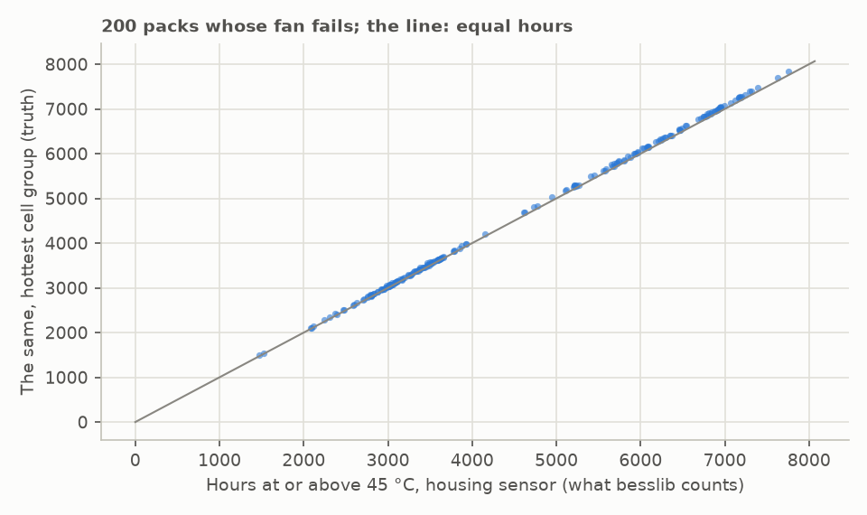
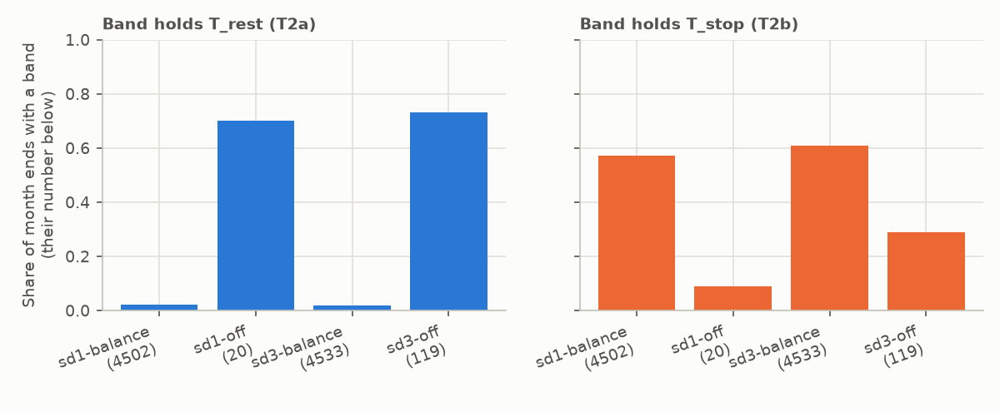
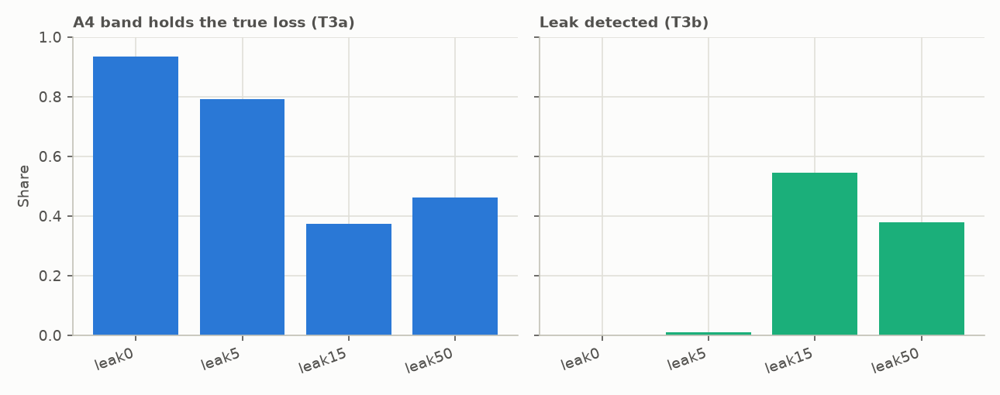
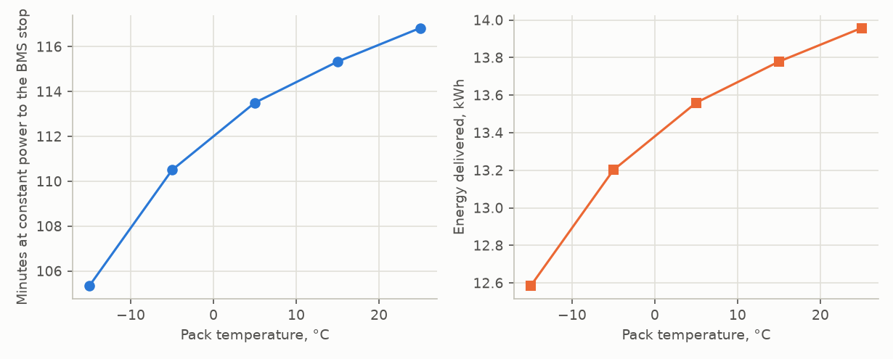
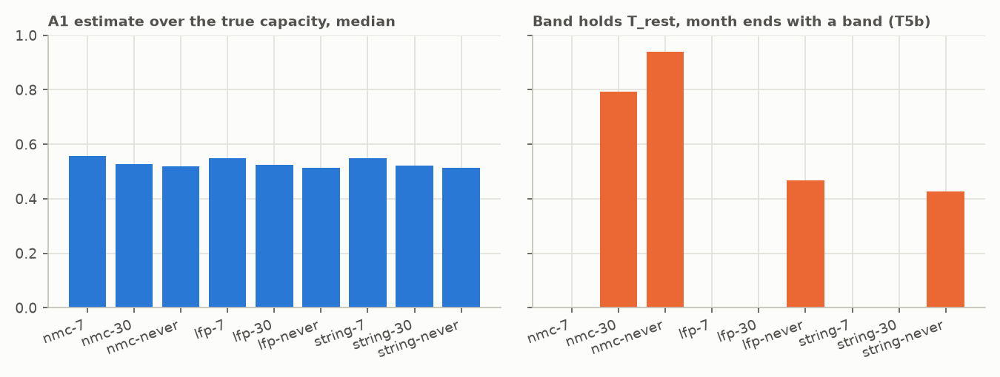
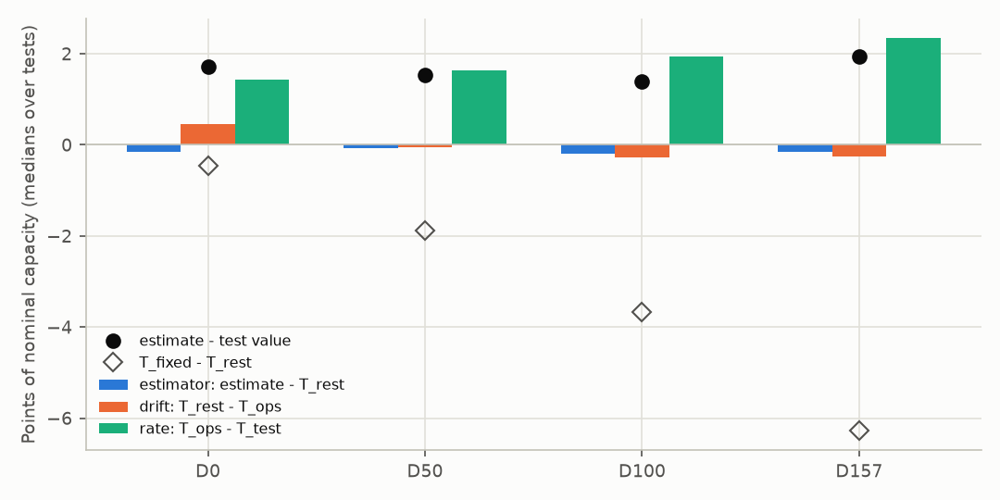

# The simulator: besslib.sim

Written by `validation/make_sim_doc.py` from `validation/results/` (the case rows, `sim_checks.csv`, `checks_sim.csv`). No number on this page is typed by hand.

## What it is

1. `besslib.sim` runs a battery pack, cell group by cell group, and writes the frames a meter at the pack terminals would report.
2. It also writes the truth behind them: every state of charge, every stop, every temperature.
3. That makes it a test bench for besslib.soh: a field is judged against a known truth.
4. It is not a model of any product: its curves are example values or one measured cell (see the sources below).
5. A case is a TOML file; one command runs it.

```
python -m besslib.sim run --case cold --seed 1 --out run_cold
python validation/sim_cases.py run heat --seeds held-out        # many packs, one case
```

## What it found

Version 0.2 of besslib, run on the six cases (200 packs per setting, held-out seeds). Most important first.

1. **On grid duty without a full charge, version 0.2 gives a wrong capacity instead of refusing.** The pack never leaves the middle of its range, yet A1 is `estimated` at month ends of every pack (NMC: 4791 of 7200 (66.5%); LFP: 4800 of 7200 (66.7%); the string: 4800 of 7200 (66.7%)), at a median 52% (NMC), 51% (LFP), 51% (string) of the true capacity. It takes the edges of the daily window for full and empty. [T5a]
2. **A weekly full charge does not repair it on LFP**: the estimate lies 51 Ah below T_rest (16 cells of 280 Ah) and 51 Ah below T_rest (the 396-cell string). The empty end is never reached. [T5b]
3. **More cells in series cost more capacity**: the 396-cell string loses 2.90% of its usable capacity to the cell spread; a 14-cell pack with the same spread and seed loses 1.62%. [T5f]
4. **A falling discharge stop hides fade.** A1 follows the stop down. At the largest drift the capacity between the first year's rest voltages is 6.3 points of nominal below the capacity between the voltages 0.2 reads at (0.5 without drift). [T6d]
5. The drift alone does not move the gap to a capacity test: estimate less test is +1.72 points without drift and +1.95 at 157 mV per cell. The largest term is the rate term (+2.34 points: the test at 0.84 C gives less than daily operation). The band is 0.70 points wide and holds the test value in 86 of 4000 (2.1%) tests. The test stops at the field tests' own lowest voltage; with one stop for tests and daily operation the rate term would be +15.5 points. [T6b, T6c, T6d]
6. Even without drift the band holds its own quantity (T_rest) in 8068 of 10964 (73.6%) month ends; the target is 85-95 %. [T6a]
7. On the NMC pack (sd 1 %, balancing on) the A1 band holds T_rest at 93 of 4502 (2.1%) month ends (mean error -1.44 Ah) and T_stop at 2751 of 4800 (57.3%) (mean error +0.38 Ah). The estimate is nearer the charge between the stops; T_rest, the charge between the mean rest voltages on a curved curve, is higher. [T2a, T2b]
8. **Balancing is worth a lot over three years.** The usable capacity lost to imbalance is 0.2% with balancing and 25.2% without it; with balancing off A1 finds a band in 2 of 200 packs only. [T2c]
9. A4 follows a leak late: its band holds the true loss at 918 of 971 (94.5%) month ends before the onset and at 406 of 2574 (15.8%) from 180 days after it (15 mA). Packs in which the leak is detected, by leak (0 = control): 0 mA 0 of 200 (0.0%), 5 mA 2 of 200 (1.0%), 15 mA 109 of 200 (54.5%), 50 mA 76 of 200 (38.0%). [T3a, T3b, T3c]
10. A5 orders the bands right in 1600 of 1600 (100.0%) neighbouring pairs; its one-step value is a median of -14.9% from the model's r0, and the band holds the median-step truth in 4 of 1800 (0.2%) band values, the estimator's own same-days form in 1800 of 1800 (100.0%). Hours charging below 0 °C (no block) agree with the truth in 199 of 200 (99.5%) packs; the others are off by at most 2.20 h (tolerance 1.98 h). A full pack at constant 0.5 C of its nominal energy runs 105 min and gives 12.6 kWh at -15 °C, 117 min and 14.0 kWh at 25 °C. [T4a, T4b, T4c, T4d]
11. B4's temperature hours are counted exactly: 200 of 200 (100.0%) packs agree with the true sensor trace within one sample step per edge crossing. The housing sensor is at or above 45 °C for a median 3779 h, the hottest cell group for 3824 h. [T1a, T1c]

## The six cases

The pass rules were fixed before any result and never moved. These set-ups were changed after development runs (seeds 0-9) and before the held-out run: case 6, the test's stop, the size of the limit's fall and the C/10 tests' stop; the BMS's balancing rule, which at first bled every high group alike and so could not balance; case 3, the month in which the true loss is read; case 5, a fade of 2 points a year was added. Nothing was changed after the held-out run.

| Case | What happens to the pack | besslib field | Rows with a pass rule | One key number |
|---|---|---|---|---|
| 1 Overheating | A fan fails and the summer is hot | B4 hours per temperature band; A5 by band | 2 pass, 0 fail | T1a fan-fails: 200 of 200 packs within tolerance |
| 2 Cell imbalance | Groups differ in capacity and self-discharge | A1 against two capacity truths | 0 pass, 4 fail | T2a sd1-balance: 93 of 4502 (2.1%) |
| 3 A failing cell | One cell gets a leak | A4, the apparent charge loss | 2 pass, 5 fail | T3b leak15: 109 of 200 packs (54.5%) |
| 4 The cold | A year of cold, charging blocked below 0 °C | A5 by band; B4 charging below a limit | 3 pass, 3 fail | T4a block: 0 of 1200 (0.0%) |
| 5 Grid duty | Mid state of charge; a calibration charge every so often or never | A1 without a full charge | 0 pass, 3 fail | T5a nmc-never: 0 of 200 packs with 0 estimated month ends and every reason 'not possible from this data' |
| 6 A drifting stop | The BMS's discharge stop moves | A1 against a capacity test | 2 pass, 7 fail | T6b D157: 48 of 1000 tests (4.8%) |

## The simulator's own checks

S1 to S4 check the plant (charge, energy, closed forms, the BMS's limits); S5 and S6 the files and the data contract; S8 the speed. S0 compares the `synth` case with the pack of the 0.1 and 0.2 checks.

| Check | What | Result | Pass if | Outcome |
|---|---|---|---|---|
| S0a | synth case against tests/synth.py at v0.2.0 | largest difference 0 | <= 1e-09 V, A and W | passes |
| S0b V6 | V6 rebuilt on besslib.sim by sim_s0.py published, 200 packs (data/sim_s0/synthetic_coverage.csv against validation/results/synthetic_coverage.csv) | byte-identical: sha256 467b268a5874 | the published numbers exactly: byte-identical, or every result column equal (run time left out) | passes |
| S0b X3 | X3 rebuilt on besslib.sim by sim_s0.py published, 200 packs (data/sim_s0/synthetic_lag.csv against validation/results/synthetic_lag.csv) | byte-identical: sha256 248d81f84e8f | the published numbers exactly: byte-identical, or every result column equal (run time left out) | passes |
| S0b W7 | W7 rebuilt on besslib.sim by sim_s0.py published, 200 packs (data/sim_s0/synthetic_phase3.csv against validation/results/synthetic_phase3.csv) | bytes differ: sha256 e34b144c94f0 (published dd60a65cfd8f) | the published numbers exactly: byte-identical, or every result column equal (run time left out) | passes |
| S0c | information | full: year 1 -1.9 mV (-0.15 points), year 2 -5.7 mV (-0.44 points), year 3 -9.6 mV (-0.74 points) | information | information |
| S1 | charge per group and month | worst 6.8e-14 over 5148 group-months | <= 1e-09 relative | passes |
| S2 | energy per group and month | worst 1.2e-13 over 10224 group-months (stored energy from the engine's block sums | <= 1e-06 relative | passes |
| S3 | closed forms | electrical worst 1.4e-15 V | <= 1e-12 V | passes |
| S4 | BMS limits and stops | synth (rule synth): 0 stops outside their step of 12667, 63596 samples with current beyond the limit of 28408320 | 0 | passes |
| S5 | each case written twice with seed 1 and once with seed 2, 2 months | same seed: 0 files differ | 0 files differ with the same seed | passes |
| S6 | 3 packs of each case (cell-imbalance, cold, demo, drifting-stop, failing-cell, grid-duty, grid-string, overheating, synth), 14 months | 0 failures | 0 failures | passes |
| S8 | information | synth (3 months): 0.29 s per pack-month, 200 packs x 36 months about 0.6 h on one core (extrapolated) | information | information |
| S9 | the field statistic (docs/04) on simulated packs against the planted fall of the empty stop (case 6) | D0: 200 of 200 packs; D50: 197 of 200 packs; D100: 146 of 200 packs; D157: 65 of 200 packs | >= 95% of packs within 10 mV | D0 passes; D50 passes; D100 fails; D157 fails |
| S10 | the LFP cell against measured HPPC current at 20 and 30 °C, not in its tables | 20 °C: RMS 15.1 mV; 30 °C: RMS 16.4 mV | RMS <= 20 mV between 10 % and 90 % state of charge | passes |

Full rows, with the packs and months of each: `validation/results/sim_checks.csv`.

## The cases

### 1. Overheating

14 cell groups of the NMC cell scaled to 100 Ah, 36 months, a thermal network with the sensor at the housing. The fan fails on a random day in months 13 to 30 (its air conductances fall to 25%). The summer afternoon reaches 35 °C; the BMS derates from 45 °C to zero current at 55 °C and stops at 60 °C. Sensor temperature noise is 0, so the sensor trace is the truth besslib is held to.

- **T1a**: B4 hours per 1-degree band and hours at or above the derating start against the true sensor trace, tolerance one step per edge crossing.
- **T1b**: A5 at each year end, neighbouring 5-degree bands with estimates: the colder reads the higher resistance.
- **T1c**: hours at or above the limit, hottest group (truth, 600 s) over the sensor.

| Check | Setting | Result | Pass if | Outcome |
|---|---|---|---|---|
| T1a | fan-fails | 200 of 200 packs within tolerance; 0 bands outside; worst band error 6.82e-13 h | 200 of 200 packs | passes |
| T1b | fan-fails | 2412 of 2412 pairs (100.0%) | at least 80% of pairs | passes |
| T1c | fan-fails | sensor median 3779.1 h, hottest group median 3823.8 h, ratio median 1.01 over the 200 packs with sensor hours above the limit; 200 of 200 packs have sensor hours above the limit | information | information |
| T1a | fan-works | 200 of 200 packs within tolerance; 0 bands outside; worst band error 9.09e-13 h | information | information |
| T1b | fan-works | 2045 of 2045 pairs (100.0%) | information | information |
| T1c | fan-works | sensor median 0.0 h, hottest group median 0.0 h, ratio median – over the 0 packs with sensor hours above the limit; 0 of 200 packs have sensor hours above the limit | information | information |



**What this shows.** Finding 11 above.

### 2. Cell imbalance

14 cell groups of the NMC cell scaled to 100 Ah, 36 months. The capacity spread has sd 1% or 3%; each group drains 2.0 mA on average (sd 0.5 mA). Passive balancing, on or off: every group above 4.0 V whose voltage is more than 10 mV above the lowest group's bleeds through 20 ohm; the lowest group never bleeds.

- **T2a**: the A1 band holds T_rest at the month end.
- **T2b**: the same against T_stop (information).
- **T2c**: usable capacity lost to imbalance, and the groups that limit the stops.

| Check | Setting | Result | Pass if | Outcome |
|---|---|---|---|---|
| T2a | sd1-balance | 93 of 4502 (2.1%); mean error -1.439 Ah, limit +-0.041 (200 packs); 298 month ends with a band left out (no reference voltages) | 85-95 % and mean error within 2 sd / sqrt(n) of zero | fails |
| T2b | sd1-balance | 2751 of 4800 (57.3%); mean error +0.381 Ah, limit +-0.041 (200 packs) | information | information |
| T2c | sd1-balance | loss median 0.20% (packs 200); full stops 544743, of them limited by the smallest group 26953; empty stops 340069, of them 289421; groups limiting a full stop per pack, median 13, an empty stop 1 (200 packs) | information | information |
| T2a | sd1-off | 14 of 20 (70.0%); mean error +0.341 Ah, limit +-1.177 (2 packs); 13 month ends with a band left out (no reference voltages) | 85-95 % and mean error within 2 sd / sqrt(n) of zero | fails |
| T2b | sd1-off | 3 of 33 (9.1%); mean error +2.218 Ah, limit +-1.338 (2 packs) | information | information |
| T2c | sd1-off | loss median 25.18% (packs 200); full stops 690702, of them limited by the smallest group 78196; empty stops 376021, of them 39185; groups limiting a full stop per pack, median 2, an empty stop 2 (200 packs) | information | information |
| T2a | sd3-balance | 87 of 4533 (1.9%); mean error -1.378 Ah, limit +-0.039 (200 packs); 267 month ends with a band left out (no reference voltages) | 85-95 % and mean error within 2 sd / sqrt(n) of zero | fails |
| T2b | sd3-balance | 2919 of 4800 (60.8%); mean error +0.299 Ah, limit +-0.039 (200 packs) | information | information |
| T2c | sd3-balance | loss median 0.35% (packs 200); full stops 560598, of them limited by the smallest group 67823; empty stops 346107, of them 340709; groups limiting a full stop per pack, median 12, an empty stop 1 (200 packs) | information | information |
| T2a | sd3-off | 87 of 119 (73.1%); mean error +0.180 Ah, limit +-0.339 (12 packs); 72 month ends with a band left out (no reference voltages) | 85-95 % and mean error within 2 sd / sqrt(n) of zero | fails |
| T2b | sd3-off | 55 of 191 (28.8%); mean error +1.507 Ah, limit +-0.432 (18 packs) | information | information |
| T2c | sd3-off | loss median 23.11% (packs 200); full stops 694631, of them limited by the smallest group 119021; empty stops 377167, of them 67641; groups limiting a full stop per pack, median 2, an empty stop 2 (200 packs) | information | information |



**What this shows.** Findings 7, 8 above.

### 3. A failing cell

As the imbalance case with sd 1% and balancing on. One group gets a leak resistor across its cell on a random day in months 13 to 24; the leak is 5, 15, 50 mA at 3.7 V per cell. The controls draw the same day and group and plant nothing. Balancing off is information.

- **T3a**: the A4 band holds the true apparent charge loss, before the onset and from 180 days after it, month ends with a band pooled over packs.
- **T3b**: A4 at the last month end before the onset and the first one 180 days after it: the second band's low end above the first band's high end (not estimated = not detected); and the change of the A1 estimate over the same dates.
- **T3c**: A4 at the last month end before the onset and the first one 180 days after it: the second band's low end above the first band's high end (not estimated = not detected); and the change of the A1 estimate over the same dates.

| Check | Setting | Result | Pass if | Outcome |
|---|---|---|---|---|
| T3a | leak0 | 3267 of 3499 (93.4%); before 918 of 971, after 2349 of 2528; against the memory-weighted truth (information) 3271 of 3499 (93.5%) | 85-95 % of month ends with a band | passes |
| T3b | leak0 | 0 of 200 packs (0.0%); A1 changes by a median of -1.05 Ah over the same dates (179 packs with both) | at most 10% of the controls | passes |
| T3a | leak5 | 2775 of 3511 (79.0%); before 918 of 971, after 1857 of 2540; against the memory-weighted truth (information) 3120 of 3511 (88.9%) | 85-95 % of month ends with a band | fails |
| T3b | leak5 | 2 of 200 packs (1.0%); A1 changes by a median of -1.14 Ah over the same dates (179 packs with both) | reported | information |
| T3a | leak15 | 1324 of 3545 (37.3%); before 918 of 971, after 406 of 2574; against the memory-weighted truth (information) 2294 of 3545 (64.7%) | 85-95 % of month ends with a band | fails |
| T3b | leak15 | 109 of 200 packs (54.5%); A1 changes by a median of -1.28 Ah over the same dates (179 packs with both) | at least 90% of packs | fails |
| T3a | leak50 | 1088 of 2354 (46.2%); before 918 of 971, after 170 of 1383; against the memory-weighted truth (information) 1264 of 2354 (53.7%) | 85-95 % of month ends with a band | fails |
| T3b | leak50 | 76 of 200 packs (38.0%); A1 changes by a median of -2.37 Ah over the same dates (91 packs with both) | at least 90% of packs | fails |
| T3a | leak0-off | 23 of 23 (100.0%); before 3 of 3, after 20 of 20; against the memory-weighted truth (information) 23 of 23 (100.0%) | information (T3c) | information |
| T3c | leak0-off | 0 of 200 packs (0.0%); A1 changes by a median of -3.42 Ah over the same dates (1 packs with both) | information (T3c) | information |
| T3a | leak5-off | 10 of 10 (100.0%); before 3 of 3, after 7 of 7; against the memory-weighted truth (information) 10 of 10 (100.0%) | information (T3c) | information |
| T3c | leak5-off | 0 of 200 packs (0.0%); A1 changes by a median of -4.15 Ah over the same dates (1 packs with both) | information (T3c) | information |
| T3a | leak15-off | 3 of 3 (100.0%); before 3 of 3, after 0 of 0; against the memory-weighted truth (information) 3 of 3 (100.0%) | information (T3c) | information |
| T3c | leak15-off | 0 of 200 packs (0.0%); A1 changes by a median of – Ah over the same dates (0 packs with both) | information (T3c) | information |
| T3a | leak50-off | 3 of 3 (100.0%); before 3 of 3, after 0 of 0; against the memory-weighted truth (information) 3 of 3 (100.0%) | information (T3c) | information |
| T3c | leak50-off | 0 of 200 packs (0.0%); A1 changes by a median of – Ah over the same dates (0 packs with both) | information (T3c) | information |



**What this shows.** Finding 9 above.

### 4. The cold

16 groups of the LFP cell scaled to 280 Ah, 12 months. The pack temperature runs by season from -15 to 25 °C. Charging is blocked below 0 °C (setting `block`) or not (`noblock`). On the 15th of every month a constant-power discharge runs from full to the BMS stop; with the block on, the winter discharges do not start from full.

- **T4a**: the A5 band holds the true one-step response at the band's mean step temperature, bands with an estimate at the record's end pooled over packs; W2's same-days form next to it.
- **T4b**: neighbouring bands with estimates at the record's end: the colder reads higher.
- **T4c**: B4 hours charging below 0 degrees C against the true current and temperature, within one step per edge; 0 with the block.
- **T4d**: constant power 0.5 C of the nominal energy per hour from full to the BMS stop, one pack with the spread off (no besslib), next to besslib's A5 (noblock packs, same band) and A2 (a record's single ratio).

| Check | Setting | Result | Pass if | Outcome |
|---|---|---|---|---|
| T4a | block | 0 of 1200 (0.0%); same-days form 1200 of 1200 (100.0%) | 85-95 % of band values | fails |
| T4b | block | 1000 of 1000 pairs (100.0%) | at least 80 % of pairs | passes |
| T4c | block | 200 of 200 packs equal; besslib median 0.0 h, truth median 0.0 h | all packs | passes |
| T4a | noblock | 4 of 1800 (0.2%); same-days form 1800 of 1800 (100.0%) | 85-95 % of band values | fails |
| T4b | noblock | 1600 of 1600 pairs (100.0%) | at least 80 % of pairs | passes |
| T4c | noblock | 199 of 200 packs equal; besslib median 851.5 h, truth median 851.9 h | all packs | fails |
| T4d | constant power 0.5 C of the nominal energy per hour from full to the BMS stop, one pack with the spread off (no besslib), next to besslib's A5 (noblock packs, same band) and A2 (a record's single ratio) [cold; computed on x86_64] | -15 C: 105 min, 12.58 kWh, A5 median 22.36 mOhm (200 packs); -5 C: 110 min, 13.20 kWh, A5 median 15.30 mOhm (200 packs); +5 C: 114 min, 13.56 kWh, A5 median 10.97 mOhm (200 packs); +15 C: 115 min, 13.78 kWh, A5 median 7.86 mOhm (200 packs); +25 C: 117 min, 13.96 kWh, A5 median 5.39 mOhm (200 packs); A2 estimated in 0 of 200 packs | information | information |



**What this shows.** Finding 10 above.

### 5. Grid duty at middle state of charge

Random power around mid state of charge, one arbitrage cycle a day, a calibration full charge every 7 or 30 days, or never. NMC: 14 identical cells of 100 Ah in series; LFP: 16 identical cells of 280 Ah; the string: 396 LFP cells of 280 Ah with capacity sd 1%, balancing on and sensors at a utility string's stated accuracy (voltage ±0.5%, current ±1%, temperature offset up to ±2 °C). 36 months. No BMS supply and no self-discharge, so the BMS's state of charge is exact between calibrations.

- **T5b**: the A1 band holds T_rest at month ends with a band (information).
- **T5a**: no calibration charge: month ends with an A1 estimate, and the reason of every month that has none.
- **T5f**: 1 - c_min / mean(c) of aligned groups (quasi-static), for the 396-group string and for a 14-group pack with the same spread and seed; from the run's own stops where full and empty stops follow each other.

| Check | Setting | Result | Pass if | Outcome |
|---|---|---|---|---|
| T5b | nmc-7 | 0 of 4512 (0.0%); mean error +0.899 Ah, limit +-0.022 (200 packs); 283 left out (no reference voltages); 4795 of 7200 month ends estimated | information | information |
| T5b | nmc-30 | 3572 of 4506 (79.3%); mean error +0.105 Ah, limit +-0.020 (200 packs); 284 left out (no reference voltages); 4790 of 7200 month ends estimated | information | information |
| T5a | nmc-never | 0 of 200 packs with 0 estimated month ends and every reason 'not possible from this data'; 4791 estimated of 7200 month ends; the estimate is a median 51.9% of the true capacity; reasons: not possible from this data: not enough history yet to set the full and empty levels (33.3% of month ends); not possible from this data: too few full-to-full or empty-to-empty pairs to fix the offset (0.1% of month ends) | 200 of 200 packs | fails |
| T5b | lfp-7 | 0 of 3939 (0.0%); mean error -50.792 Ah, limit +-0.072 (200 packs); 861 left out (no reference voltages); 4800 of 7200 month ends estimated | information | information |
| T5b | lfp-30 | 0 of 4099 (0.0%); mean error -31.903 Ah, limit +-0.092 (200 packs); 700 left out (no reference voltages); 4799 of 7200 month ends estimated | information | information |
| T5a | lfp-never | 0 of 200 packs with 0 estimated month ends and every reason 'not possible from this data'; 4800 estimated of 7200 month ends; the estimate is a median 51.4% of the true capacity; reasons: not possible from this data: not enough history yet to set the full and empty levels (33.3% of month ends) | 200 of 200 packs | fails |
| T5b | string-7 | 0 of 3914 (0.0%); mean error -50.755 Ah, limit +-0.127 (200 packs); 886 left out (no reference voltages); 4800 of 7200 month ends estimated | information | information |
| T5f | usable capacity lost to the cell spread | string 2.90%, 14 groups 1.62% (medians over 200 packs); from the run's stops: 0 of 200 packs have a loss (–); empty stops in the run: 0 | information | information |
| T5b | string-30 | 0 of 4075 (0.0%); mean error -26.730 Ah, limit +-0.216 (200 packs); 724 left out (no reference voltages); 4799 of 7200 month ends estimated | information | information |
| T5a | string-never | 0 of 200 packs with 0 estimated month ends and every reason 'not possible from this data'; 4800 estimated of 7200 month ends; the estimate is a median 51.4% of the true capacity; reasons: not possible from this data: not enough history yet to set the full and empty levels (33.3% of month ends) | 200 of 200 packs | fails |



**What this shows.** Findings 1, 2, 3 above.

### 6. A drifting stop

40 LMO cells of 15 Ah in series, 72 months, fade 2 points a year. The discharge stop falls linearly from month 12 to month 72 by D mV per cell of relaxed empty rest voltage (0, 50, 100, 157). A capacity test (charge to full, rest, discharge at 0.84 C) runs in months 18, 30, 42, 54 and 66; its stop is 3.252 V per cell, the median lowest voltage of the field's LMO/NMC tests. The settings `D0-onestop` and `D157-onestop` end the test at the operational stop instead. The test's stop and the drift scaling were set after development runs and before any held-out run.

- **S9**: the field statistic of [docs/04](04_version_0_2.md) (first to last month-end empty rest voltage per cell) against the planted fall; it carries the estimator's 180-day memory, so it trails a steady fall.
- **T6a**: the A1 band holds T_rest at the month end. **T6b**: the test value lies inside the band at the test date.
- **T6c**: estimate less test value (miss). **T6d**: the miss as three terms, estimator (estimate - T_rest), drift (T_rest - T_ops) and rate (T_ops - T_test), medians over the tests, in points of nominal capacity; the last column is T_fixed - T_rest.

Main settings:

| D | S9 | T6a | T6b | miss | estimator | drift | rate | T_fixed - T_rest |
|---|---|---|---|---|---|---|---|---|
| D0 | 200 of 200 (100.0%), passes | 8068 of 10964 (73.6%), fails | 15 of 1000 tests (1.5%), fails | +1.72 | -0.16 | +0.45 | +1.42 | -0.47 |
| D50 | 197 of 200 (98.5%), passes | 9542 of 11185 (85.3%) | 20 of 1000 tests (2.0%), fails | +1.53 | -0.07 | -0.05 | +1.64 | -1.88 |
| D100 | 146 of 200 (73.0%), fails | 8232 of 11300 (72.8%) | 3 of 1000 tests (0.3%), fails | +1.40 | -0.20 | -0.28 | +1.93 | -3.67 |
| D157 | 65 of 200 (32.5%), fails | 9032 of 11329 (79.7%) | 48 of 1000 tests (4.8%), fails | +1.95 | -0.15 | -0.26 | +2.34 | -6.28 |

Information settings:

| D | S9 | T6a | T6b | miss | estimator | drift | rate | T_fixed - T_rest |
|---|---|---|---|---|---|---|---|---|
| D157-steps | 125 of 200 (62.5%) | 7986 of 11338 (70.4%) | 127 of 1000 tests (12.7%) | +1.56 | -0.15 | -0.19 | +1.64 | -6.65 |
| D100-growth | 2 of 200 (1.0%) | 9337 of 11281 (82.8%) | 0 of 1000 tests (0.0%) | +2.93 | -0.05 | -0.14 | +3.18 | -2.42 |
| D0-c10 | 200 of 200 (100.0%) | 8058 of 10961 (73.5%) | 233 of 1000 tests (23.3%) | -0.72 | -0.15 | +0.25 | -0.72 | -0.47 |
| D157-c10 | 65 of 200 (32.5%) | 9027 of 11330 (79.7%) | 85 of 1000 tests (8.5%) | -1.74 | -0.14 | -0.37 | -1.17 | -6.27 |
| D0-onestop | 200 of 200 (100.0%) | 8067 of 10965 (73.6%) | 0 of 1000 tests (0.0%) | +15.80 | -0.16 | +0.44 | +15.52 | -0.46 |
| D157-onestop | 65 of 200 (32.5%) | 9029 of 11329 (79.7%) | 0 of 1000 tests (0.0%) | +10.71 | -0.15 | -0.27 | +11.64 | -6.28 |



**What this shows.** Findings 4, 5, 6 above.

## Known causes

Each line is an explanation only where the row in the second column supports it. Nothing here is a promise.

| Finding | Where seen | What the next version does |
|---|---|---|
| A1 is read at the mean full and empty rest voltages; on a curved open-circuit curve (the NMC plateau) the state of charge at the mean voltage is not the mean state of charge: the estimate lies nearer T_stop than T_rest | T2a sd1-balance: 93 of 4502 (2.1%); T2b sd1-balance: 2751 of 4800 (57.3%) | not decided |
| A4 follows a leak through its 180-day memory: after the onset its band holds the truth less often than before it | T3a leak15: 1324 of 3545 (37.3%); T3b leak15: 109 of 200 packs (54.5%) | not decided |
| A5 at 10 s samples includes the open-circuit rise of one sample; T4a's truth uses the median step, the same-days form (the estimator on the true signals) is the estimate's own quantity | T4a noblock: 4 of 1800 (0.2%) | not decided |
| A1 in mid-state-of-charge duty reads the daily window's edges as full and empty, because its levels are quantiles of the rest edge voltages; with no full charge it still gives an estimate | T5a nmc-never: 0 of 200 packs with 0 estimated month ends and every reason 'not possible from this data'; T5a lfp-never: 0 of 200 packs with 0 estimated month ends and every reason 'not possible from this data'; T5a string-never: 0 of 200 packs with 0 estimated month ends and every reason 'not possible from this data' | not decided |

## The rerun on one state-of-charge path

The checks V6, X3 and W7 ran on `tests/synth.py`, whose BMS decides its stops on a copy of the pack that drifts slowly from the plant. The same seeds on a pack with one path:

| Check | Quantity | Published | One-path pack |
|---|---|---|---|
| V6 | V6: the band holds the expected usable fade (V6's rule, 85-95 %) | 152 of 200 (76.0%) | 109 of 200 (54.5%) |
| V6 | expected usable fade, points per year | -1.875 | -1.875 |
| V6 | information: the band holds the fade between the mean rest voltages | 167 of 200 (83.5%) | 175 of 200 (87.5%) |
| V6 | mean of estimate - fade between the mean rest voltages, points per year | +0.011 | +0.000 |
| X3 | X3: the band at the date holds the charge between the stops (X3's rule, 85-95 %) | 2278 of 4782 (47.6%) | 2285 of 4782 (47.8%) |
| X3 | X3: mean lag, points (limit 2 sd / sqrt(n)) | +0.473 (+-0.040) | +0.474 (+-0.040) |
| X3 | information: the band holds the charge between the read-at rest voltages | 4248 of 4562 (93.1%) | 3827 of 4569 (83.8%) |
| X3 | information: its mean lag, points | -0.037 (+-0.038) | -0.119 (+-0.038) |
| W7 | W7: the band holds the true apparent charge loss (W7's rule, 85-95 %) | 188 of 200 (94.0%) | 183 of 200 (91.5%) |
| W7 | W7: mean error, mA (sd over packs) | -0.03 (0.19) | -0.06 (0.23) |

The published numbers stay as they are: they are the numbers of the release, and this run changes none of them.

## What an equivalent circuit cannot show

1. Thermal runaway, venting, fire and propagation between cells.
2. Lithium plating when charging cold: the BMS's block is modelled, the damage is not.
3. Ageing caused by use: ageing is an input (a set fade and a set growth), not a result.
4. Rate effects beyond what one RC element (and, for LFP, one hysteresis state) gives; no diffusion limit at high current.
5. Degradation modes (loss of lithium, of active material) and incremental-capacity features.
6. Temperature differences inside a cell: one temperature per cell group.
7. Any real product: curves and values are example values or read from the sources below.
8. Real BMS firmware quirks, and inverter dynamics faster than one step.

## Where the values come from

| Preset | Source | Read |
|---|---|---|
| lfp | Gray and Vagg, LIC cell characterisation, Zenodo 19632939, CC BY 4.0 (one 280 Ah-class cell, measured at 15 to 35 °C) | capacity 302.309 Ah at 25 °C; resistances at 15, 25 and 35 °C; open-circuit curve and hysteresis from the C/10 runs |
| nmc, lmo | Tran et al., Batteries 7, 51 (2021), doi:10.3390/batteries7030051, CC BY 4.0 | resistances and capacitance from their tables; the average curve of their Figure 6 digitised (one pixel is 1.05 mV) |
| synth | example values, not from a source | the cell of the 0.1 and 0.2 checks |

Temperature beyond 15 to 35 °C follows an Arrhenius law with activation energies read from the tables or, for NMC and LMO, from a cell of another make; that is an extrapolation. The LFP cell against HPPC currents it was not built from (S10): RMS between 10 % and 90 % state of charge 20 °C: 15.1 mV; 30 °C: 16.4 mV.

Credit lines for both sources are in `src/besslib/sim/presets/NOTICE.md`. Not a compliance certificate, not legal advice.
